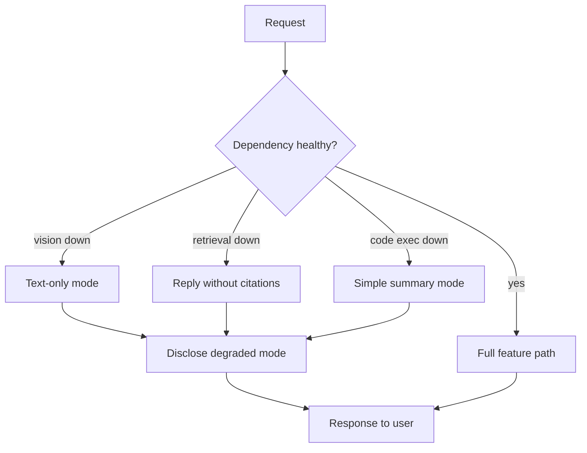

# Graceful Degradation

**Also known as:** Feature-Level Fallback, Degraded Mode

**Category:** Routing & Composition  
**Status in practice:** mature

## Intent

When a dependency fails, downgrade the user-facing experience to a working subset rather than failing entirely.

## Context

A user-facing agent product combines several optional capabilities — a retrieval-augmented-generation backend that produces citations, a vision model that reads screenshots, a sandbox that runs user code, a payment integration. Each of these dependencies can have its own bad day independently of the others. The product is more than the sum of any single capability and can produce something useful even when one piece is missing.

## Problem

If the product treats every dependency as load-bearing and fails the whole request when any one of them is down, an isolated vendor outage becomes a complete product outage from the user's point of view. If it silently drops the failing capability and ships whatever it can produce without disclosure, the user gets a worse answer than expected without knowing why and loses trust the next time it happens. Without a defined per-feature fallback, neither outcome is acceptable.

## Forces

- Degradation paths multiply test surface.
- User-visible degradation messaging is its own UX problem.
- Some failures must hard-fail (PII path, payment).

## Therefore

Therefore: define per-feature downgrades and disclose them to the user when triggered, so that a dependency outage reduces the experience instead of killing it.

## Solution

Define per-feature fallback behaviour. On dependency failure, downgrade (text-only when vision fails, no citations when retrieval fails, simple summary when code execution fails) and disclose to the user that degraded mode is active. Feature flags double as degradation switches.

## Structure

```
Request --> Health check per dependency --healthy--> Full feature path --> Response | --dependency down--> Per-feature fallback (text-only | no citations | simple summary) --> Disclosure notice --> Response; hard-fail features --> explicit error
```

## Diagram



## Example scenario

A multimodal customer-support bot relies on a vision model to read screenshots, a vector store for citations, and a code sandbox for repro. During an outage of the vision provider, every screenshot upload returns a 503 and the whole conversation errors out. The team adds graceful degradation: when vision fails the bot falls back to asking the user to describe the screenshot in words and tells them so plainly; when retrieval is down it answers from the model's own knowledge with a visible 'no sources today' badge. Outages now feel like reduced service rather than total failure.

## Consequences

**Benefits**

- Product resilience under partial outages.
- User trust via transparent degradation.

**Liabilities**

- Test matrix grows with feature count.
- Degraded modes can themselves have bugs.

## Failure modes

- Undisclosed downgrade — the degraded path ships its answer without the notice, and the user takes a citation-free reply as the full result.
- Untested fallback — a degraded mode that rarely runs has its own bug, and it fails on the day the dependency actually goes down.
- Degrading what must hard-fail — a payment or PII feature drops into a reduced mode instead of returning a clear error.
- Stale degradation switch — a feature flag forced into degraded mode during an incident is never reset, and users get the reduced path long after recovery.

## What this pattern constrains

On failure, the agent must produce a degraded response with disclosure rather than a generic error.

## Applicability

**Use when**

- A dependency outage would otherwise fail the user request entirely.
- Per-feature fallback behaviour can be defined (text when vision fails, no citations when retrieval fails).
- The user can be told that degraded mode is active without breaking trust.

**Do not use when**

- There is no meaningful subset of working features to degrade to.
- Silent degradation would mislead the user and explicit failure is more honest.
- Feature flags do not exist and per-feature fallback cannot be wired without a major refactor.

## Components

- Health check — per-dependency probe that decides whether the full path is available
- Per-feature fallback handlers — text-only, no-citations, simple-summary paths defined ahead of time
- Feature-flag store — runtime switch to force a feature into degraded mode without redeploy
- Disclosure layer — composes the user-visible notice that degraded mode is active
- Hard-fail allowlist — features (payment, PII) that refuse to degrade and surface an explicit error

## Tools

- Feature-flag platform — LaunchDarkly, Unleash, OpenFeature, or an in-house store
- Dependency health probes — synthetic checks against vision, retrieval, sandbox endpoints
- Observability stack — metrics and traces tagging each response with its degradation mode

## Evaluation metrics

- Per-feature degraded-mode firing rate — how often each downgrade path is taken
- User-visible disclosure completeness — share of degraded responses that carried the notice
- Conversion or task-completion delta under degraded vs full mode — value preserved by the downgrade
- Hard-fail rate on allowlisted features — degradation correctly refused for PII or payment paths
- Time-to-recovery — how quickly each feature flips back to full mode after the dependency heals

## Known uses

- **[Perplexity (citations missing under retrieval issues)](https://www.perplexity.ai/)** _available_
- **[ChatGPT (vision unavailable falls back to text)](https://chat.openai.com/)** _available_
- **[Sparrot](https://marco-nissen.com/sparrot/)** _available_ — When a dependency fails (provider down, MCP server unreachable, voice channel offline), the dispatcher downgrades to a working feature subset rather than refusing the whole tick.

## Related patterns

- _complements_ **Fallback Chain**
- _uses_ **Circuit Breaker**
- _specialises_ **Exception Handling and Recovery**
- _complements_ **Infrastructure Burst Bottleneck (Agent Scale-Out)**
- _alternative-to_ **Silent External-Source Rot** — Graceful degradation is the corrective stance: route a failed source-health check to a degraded-mode fallback instead of feeding the empty payload forward.
- _alternative-to_ **Fail-Plausible Narration** — The remedy shape: on partial failure, degrade explicitly and disclose the gap instead of letting the model fabricate over it.
- _complements_ **Control-Loop-Mapped Agent Chain** — A missing or invalid proposal degrades the loop to its base regulatory controller instead of stalling the sample, which is what makes a per-sample model call safe to depend on.
- _complements_ **Feasibility-Negotiated Intent Contract** — There degradation happens after a dependency has already failed and is disclosed to the user; here the degradation is proposed before actuation as a counter-offer the caller agrees to in advance.

## References

- [Release It! (Michael Nygard, ch. 4)](https://pragprog.com/titles/mnee2/release-it-second-edition/) — 2007
