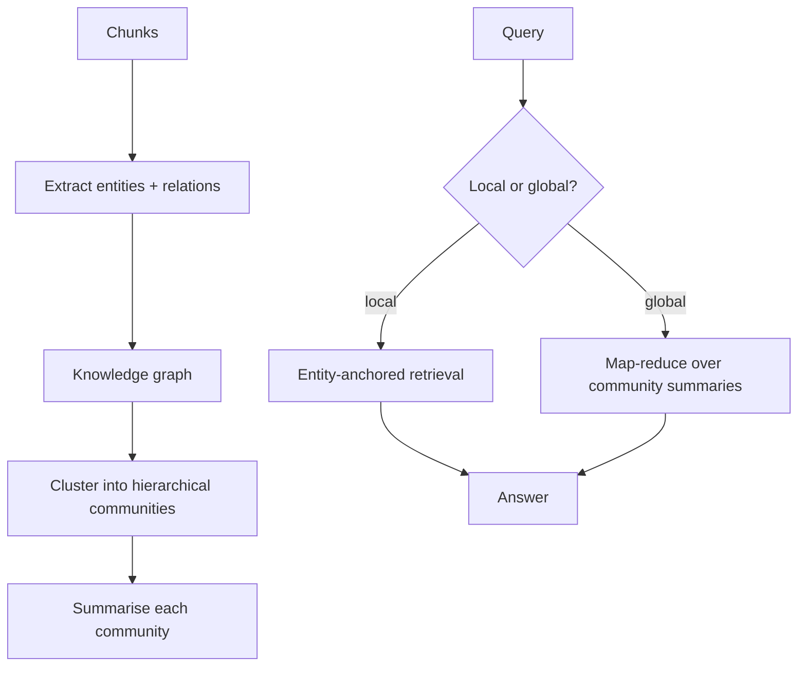

# GraphRAG

**Also known as:** Graph-Based RAG, Knowledge Graph RAG

**Category:** Retrieval & RAG  
**Status in practice:** emerging

## Intent

Build an LLM-extracted entity-and-relation knowledge graph plus hierarchical community summaries, then answer global queries via map-reduce over those summaries.

## Context

A team is using a retrieval-augmented system over a large corpus and starts receiving questions about the corpus as a whole rather than individual facts in it: 'what are the main themes in these reports?', 'how does this position evolve across the documents?', 'which entities are central to the discussion?' These are corpus-level sensemaking queries, not local lookup queries, and they arrive alongside the easier fact-style questions.

## Problem

Naive retrieval pulls the top-k chunks for each query, which is fine for local lookup but cannot answer questions about the whole corpus. The answer to 'what are the main themes?' does not live in any single chunk; it requires seeing how chunks connect, what entities recur across them, and how communities of related content cluster. Without a representation that captures corpus-level structure — entities, relations, communities — chunk-level retrieval is mismatched to corpus-level questions, and the system returns confidently wrong, partial summaries that the user has no easy way to spot.

## Forces

- Indexing cost is high (LLM calls per entity, relation, community).
- Graph quality depends on extraction prompts.
- Local-search vs global-search modes serve different query types and must be routed.

## Therefore

Therefore: index documents into an LLM-extracted knowledge graph with hierarchical community summaries and route queries by scope, so that global questions get global answers and local questions stay local.

## Solution

Index time: extract entities and relations from chunks; build a knowledge graph; cluster into hierarchical communities; summarise each community. Query time: classify query as local (entity-specific) or global (corpus-wide). Local queries use entity-anchored retrieval; global queries map-reduce over community summaries.

## Structure

```
Index: Chunks --> Extract entities + relations --> Knowledge graph --> Cluster into hierarchical communities --> Summarise each community. Query: Query --> Local or global? --local--> Entity-anchored retrieval --> Answer | --global--> Map over community summaries --> Reduce --> Answer
```

## Diagram



## Example scenario

An analyst pointed at a 4000-page deal-room corpus asks 'what are the recurring risk themes across these contracts?' Naive RAG returns five chunks and an answer that misses two themes entirely because no single chunk carries them. The team switches to GraphRAG: at index time the LLM extracts parties, obligations, and clauses into a knowledge graph, clusters the graph into communities, and writes a summary of each. The corpus-wide question now map-reduces over community summaries and surfaces the recurring themes the chunk-level retriever could not see.

## Consequences

**Benefits**

- Answers corpus-level sensemaking questions naive RAG cannot.
- Communities are inspectable artefacts of the corpus.

**Liabilities**

- High indexing cost (orders of magnitude more LLM calls).
- Entity extraction errors cascade through the graph.

## Failure modes

- Extraction error cascade — the extractor splits one entity into two or links unrelated ones, and every community and summary built on top inherits the error.
- Local-global misroute — an entity-specific question is classified global, and the answer comes back as a vague theme summary instead of the specific fact.
- Stale summaries — the corpus changes, the costly index is not rebuilt, and global answers describe themes that no longer hold.
- Lossy map-reduce — community summaries drop a minor but important thread, and the reduced answer reads complete while missing it.

## What this pattern constrains

Global queries operate only on community summaries, not raw chunks; local queries operate only on entity-anchored neighbourhoods.

## Applicability

**Use when**

- Users ask global, corpus-wide questions that local chunk retrieval cannot answer.
- The corpus has clear entities and relations worth extracting into a graph.
- Index-time cost can be paid up front to enable hierarchical community summaries.

**Do not use when**

- Queries are narrowly local and naive RAG already serves them well.
- The corpus is small or volatile enough that graph extraction will not pay off.
- Entity and relation extraction quality is too low to trust the resulting graph.

## Components

- Entity-and-relation extractor — LLM-driven pass over chunks that builds the typed graph
- Community detector — clusters the knowledge graph into hierarchical communities
- Community summariser — emits a natural-language summary per community
- Query router — classifies a query as local or global and dispatches accordingly
- Map-reduce answerer — for global queries, maps the question over community summaries and reduces to a single answer

## Tools

- LLM API — heavy index-time use for extraction and community summarisation, plus inference-time generation
- Knowledge graph store — persists entities, relations, and community hierarchy (Neo4j, in-memory, or columnar)
- Graph clustering library — Leiden or similar for hierarchical community detection

## Evaluation metrics

- Win rate on global sensemaking benchmarks — head-to-head against naive RAG on corpus-wide questions
- Entity-extraction F1 — quality of the graph the rest of the pipeline rests on
- Local-vs-global router accuracy — share of queries dispatched to the right mode
- Index-time LLM cost per million corpus tokens — the high capex this pattern incurs
- Community-summary groundedness — fraction of summary claims traceable to the chunks they cover

## Known uses

- **[Microsoft GraphRAG (open source)](https://github.com/microsoft/graphrag)** _available_

## Related patterns

- _alternative-to_ **Naive RAG**
- _uses_ **MapReduce for Agents**
- _composes-with_ **Knowledge Graph Memory**
- _alternative-to_ **HippoRAG**
- _alternative-to_ **Hierarchical Retrieval**
- _complements_ **World-Model Graph Memory**
- _alternative-to_ **Vectorless Reasoning-Based Retrieval** — Both impose explicit structure at index time; vectorless retrieval reuses the document's own table-of-contents tree instead of an extracted entity graph.
- _alternative-to_ **Repo Map** — GraphRAG builds an entity-relation graph over prose; a repo map builds a symbol-dependency graph over code.
- _complements_ **Tacit-Knowledge Elicitation Agent** — GraphRAG indexes documented knowledge into an entity-relation graph; elicitation front-loads the undocumented criteria so there is expert knowledge for that graph to capture in the first place.

## References

- [From Local to Global: A Graph RAG Approach to Query-Focused Summarization](https://arxiv.org/abs/2404.16130) — Edge, Trinh, Cheng, Bradley, Chao, Mody, Truitt, Metropolitansky, Ness, Larson, 2024
