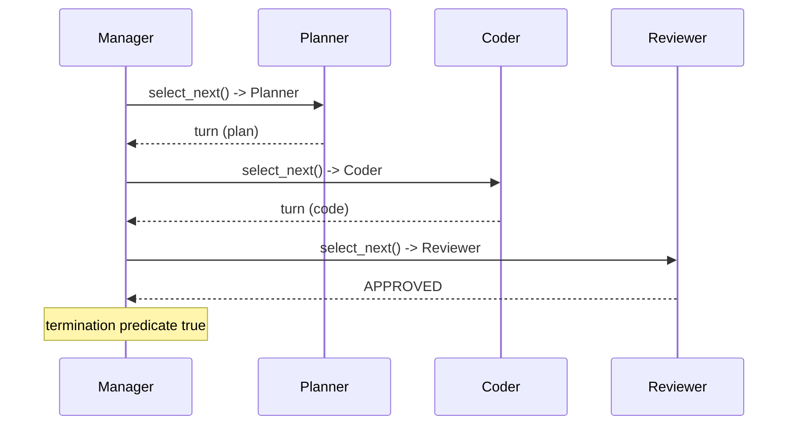

# Group-Chat Manager

**Also known as:** Speaker Selector, Conversation Chair, Team Manager Agent

**Category:** Multi-Agent  
**Status in practice:** mature

## Intent

Place a dedicated manager between the participants of a multi-agent group chat that decides which participant speaks next on each turn.

## Context

A team is running three or more specialist agents — a planner, a coder, a reviewer, a tester — that all share one conversation transcript and need to take turns sensibly. Only one agent should speak per turn, the transcript needs to stay coherent, and the conversation has to end when the work is done rather than running forever.

## Problem

If every agent decides for itself whether to speak, the result is either chatter (each agent emits a turn on every step) or paralysis (no agent picks itself and the conversation stalls). Wiring up per-pair hand-offs — agent A always passes to B, B to C — works for two or three agents but does not generalise as the cast grows, and gives no central place to decide when the conversation is finished. The team needs a single component that allocates turns, watches for termination, and leaves an audit trail.

## Forces

- Turn allocation must be explicit when more than two agents share a thread.
- A round-robin chair is simple but blind to relevance; an LLM-based chair is relevance-aware but adds a model call per turn.
- Termination must be evaluated centrally so the chat ends predictably.
- Allowing any agent to hand off to any other (swarm-style) is flexible but harder to audit.

## Therefore

Therefore: place one manager between the participants and let it pick the next speaker each turn — by round-robin, by LLM relevance scoring, by named-handoff token, or by orchestrator decree — so that turn allocation, termination, and audit-ability live in one component.

## Solution

Define a Manager that owns the shared conversation transcript and a `select_next(transcript, participants) -> participant` function. On each turn the manager appends the new message to the transcript, calls `select_next`, and invokes the chosen participant. Implementations vary in how `select_next` is computed (see Variants). The manager also enforces termination — a turn cap, a content predicate, or an explicit `STOP` signal from a participant.

## Structure

```
New message --> Manager (owns transcript) --append--> Transcript --select_next(transcript, participants)--> Chosen participant --turn--> Manager --check termination (turn cap, predicate, STOP)--> [next turn | end]
```

## Diagram



## Example scenario

A coding team agent has a planner, a coder, a reviewer, and a tester sharing one transcript. A round-robin manager is too rigid — the tester should not speak before the coder has produced code. The team swaps the manager for an LLM-driven selector that reads the transcript and picks the most relevant speaker, falling back to round-robin if the selector is uncertain. Termination triggers when the reviewer emits an `APPROVED` token or after twenty turns. The same skeleton later supports a swarm variant where the current speaker emits a `transfer_to(...)` token at the end of its turn.

## Consequences

**Benefits**

- Single place to enforce turn allocation and termination.
- Variants let the same skeleton serve fair (round-robin) and relevance-aware (selector) conversations.
- Audit trail is centralised in the manager.

**Liabilities**

- The manager is a single point of failure for the conversation.
- LLM-based selectors add a model call per turn.
- Per-pair affinity is harder to express than in pure handoff designs.

## Failure modes

- Manager outage — the manager crashes or stalls, and the whole conversation stops because no participant may speak on its own.
- Selector favourite — an LLM-based selector keeps picking the same participant, and the others never get a turn on work they own.
- No stop — the termination predicate never matches, so the chat runs until the turn cap and returns an unfinished result.
- Lost pairing — two participants that should always follow each other are separated by the selector, because per-pair affinity is not expressed.

## What this pattern constrains

Participants may not speak unless the manager selects them; no agent is allowed to emit a turn out of band.

## Applicability

**Use when**

- Three or more agents must share a single conversation context.
- Turn order, termination, and audit need to live in one component.
- Relevance-aware speaker selection is worth a per-turn model call.

**Do not use when**

- Only two agents are involved (use autogen-conversational instead).
- Agents must run concurrently without a shared turn (use actor-model-agents).
- Hand-offs are per-pair and a swarm of bilateral edges is simpler.

## Components

- Group-chat manager — owns the transcript, picks the next speaker, and enforces termination
- Speaker selector — round-robin, LLM-relevance, handoff-token, or magentic-orchestrator policy
- Participant agents — three or more specialists sharing one transcript under the manager
- Shared transcript — append-only conversation that every selected speaker reads from
- Termination predicate — turn cap, content predicate, or explicit STOP signal from a participant

## Tools

- AutoGen Teams — RoundRobinGroupChat, SelectorGroupChat, Swarm, and MagenticOneGroupChat implementations
- LLM API — invoked once per speaker turn and again per turn for LLM-based selectors
- Turn counter and stop hook — central place to enforce termination

## Evaluation metrics

- Speaker-selection precision — share of turns where the chosen speaker was the most relevant
- Turns to termination — distribution of rounds before the predicate fires
- Selector overhead — per-turn token cost added by LLM-based selectors versus round-robin
- Manager-failure rate — runs where the single-point-of-failure manager stalled or crashed
- Audit completeness — share of conversations whose manager log fully reconstructs turn order

## Known uses

- **[AutoGen Teams (RoundRobinGroupChat, SelectorGroupChat, Swarm, MagenticOneGroupChat)](https://microsoft.github.io/autogen/stable/user-guide/agentchat-user-guide/tutorial/teams.html)** _available_ — AutoGen's GroupChat family realises round-robin, LLM-selector, handoff-token, and orchestrator variants of this pattern.
- **[CAMEL role-playing](https://www.camel-ai.org/)** _available_ — Two-agent variant with an implicit fixed chair (user-agent speaks first, assistant-agent responds).

## Related patterns

- _specialises_ **Supervisor**
- _complements_ **Conversational Multi-Agent**
- _uses_ **Handoff**
- _complements_ **Swarm**
- _complements_ **Role Assignment**

## References

- [AutoGen — Teams](https://microsoft.github.io/autogen/stable/user-guide/agentchat-user-guide/tutorial/teams.html) — Microsoft
