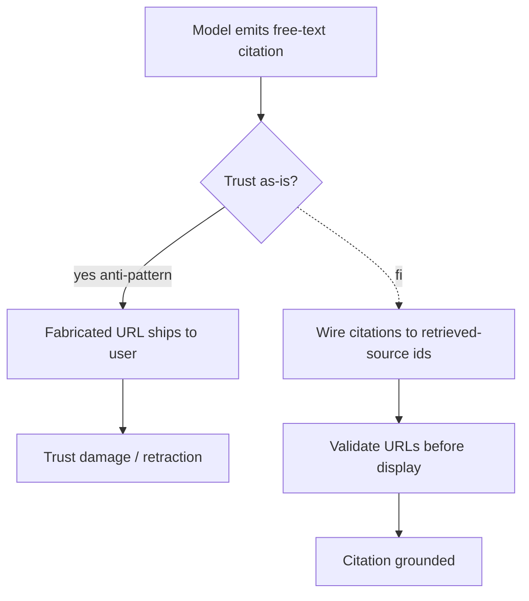

# Hallucinated Citations

**Also known as:** Fake URLs, Invented References

**Category:** Anti-Patterns  
**Status in practice:** deprecated

## Intent

Anti-pattern: let the model emit citations as free text and trust them.

## Context

A team builds a research, legal, medical, or general question-answering assistant that should back its claims with sources, and the easiest way to add citations is to ask the model to include them in its free-text answer. There is no retrieval pipeline that returns documents by stable identifier, or there is one but its results are not bound to the citations the model emits. Whatever URL, paper title, or case name the model writes in its answer is shipped to the user as-is.

## Problem

Language models trained on academic and legal text are particularly fluent at producing authoritative-looking references that do not exist — invented authors, plausible but wrong digital object identifiers, real-sounding case names that no court ever decided. The citations look correct until somebody clicks them, and end users routinely do not click. In regulated domains like law and medicine, a single hallucinated citation that reaches a customer can trigger sanctions, retractions, or loss of trust the product never recovers from.

## Forces

- Real citations require source ids and a retrieval pipeline.
- Models trained on academic text are particularly fluent at fabricating citations.
- End users do not check.

## Therefore

Therefore: bind every citation to a retrieved-source id and validate URLs against the retrieval result before rendering, so that the model cannot smuggle invented references into authoritative-looking output.

## Solution

Don't. Wire citations to retrieved-source ids. See citation-streaming, naive-rag, contextual-retrieval. Validate URLs before display.

## Structure

```
Anti-pattern: model writes citations as free text -> shown to user unchecked -> some citations do not exist. Corrected: retrieve sources -> model cites retrieved-source ids -> validate links -> display.
```

## Diagram



## Example scenario

A legal-research assistant ships with a plausible-looking footnote feature: the model writes citations as free text. After launch, three customers report that quoted case names do not exist on Westlaw and one cited statute number is off by a digit. The team treats hallucinated-citations as the named anti-pattern they fell into: they rewire the assistant to cite only documents returned from the retrieval call by id, and add a URL-liveness check that strips any citation whose link 404s before the answer renders. Free-text citations are now banned at the prompt template level.

## Consequences

**Benefits**

- Short-term: free-text citations make answers look well-sourced with no retrieval or validation work.
- Naming it lets a team require that every citation maps to a source the system actually retrieved.

**Liabilities**

- Trust collapse on first user verification.
- Legal / regulatory exposure in regulated domains.

## Failure modes

- Phantom reference — the model invents an author, title, or identifier that looks correct, and the user trusts it without checking.
- Fake case law — a legal answer cites a case no court decided, and it reaches a customer or a filing.
- Trust collapse on first click — one user checks a citation, finds it does not exist, and stops trusting the product.

## What this pattern constrains

Avoiding it imposes a binding rule: a citation must not be emitted as free text; every reference shown to a user must resolve to a retrieved-source id validated before display.

## Applicability

**Use when**

- Cite this entry when a system displays model-emitted references without checking them against retrieval results.
- You are already here if users report URLs or paper titles that do not exist.
- Bind citations to retrieved-source ids and validate before display (see citation-streaming, contextual-retrieval).

**Do not use when**

- Any production setting where users may rely on cited sources.
- Any setting where authoritative-looking but invented sources can mislead.
- Any audit or compliance setting requiring traceable provenance.

## Components

- LLM generator — emits citations as free text inside the answer
- Prompt template — asks for references without binding them to retrieved sources
- Rendering layer — ships the model's invented URLs and titles straight to the user
- Missing retrieval pipeline — would return documents by stable id and bind every citation to one

## Tools

- Free-text citation field — the unverified surface the model fills with plausible-looking references
- URL liveness check — the missing pre-display validator that would catch 404s and wrong DOIs
- Retrieval index keyed by source id — the missing store that would make citations binding

## Evaluation metrics

- Citation-resolvability rate — fraction of emitted URLs and DOIs that resolve to live, matching sources
- Title-match accuracy — share of cited paper or case titles that exist verbatim in an authoritative index
- Author-name fabrication rate — share of cited authors that cannot be matched in the source database
- User-flagged citation rate — fraction of answers where users report a citation does not exist

## Known uses

- **Notable lawyer's brief incident, 2023 (filed hallucinated cases)** _available_

## Related patterns

- _alternative-to_ **Citation Streaming**
- _alternative-to_ **Naive RAG**
- _alternative-to_ **Citation Attribution**
- _alternative-to_ **Verify-Before-Cite Resolution Gate** — Hallucinated-citations is the anti-pattern of trusting free-text references; this gate is the positive remedy that resolves each one against an external registry before output.
- _complements_ **Oversight as Legitimation** — The legal seam where this failure was measured: the designated attorney overseer is expected to catch fabricated citations by hand, at rates of 17 to 33 percent, inside a normal filing deadline.

## References

- [OWASP LLM09: Misinformation](https://genai.owasp.org/llmrisk/llm092025-misinformation/) — 2025
