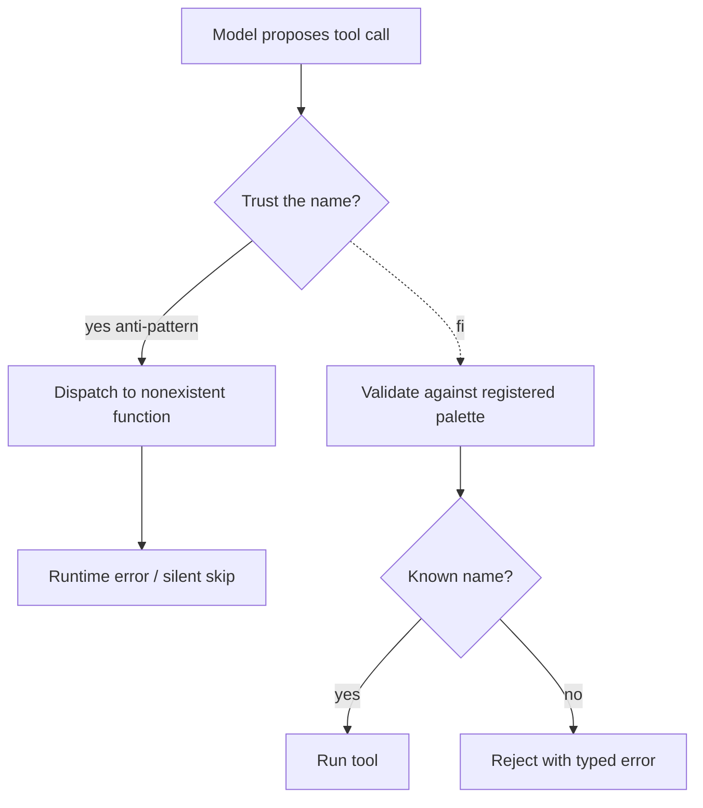

# Hallucinated Tools

**Also known as:** Phantom Tool Calls, Imagined Functions

**Category:** Anti-Patterns  
**Status in practice:** deprecated

## Intent

Anti-pattern: trust the model to invoke only the tools it has been given, then debug calls to functions that do not exist.

## Context

An agent is configured with a registered set of tools — a tool palette — that it is supposed to choose from on each turn. The host code that receives the model's tool call accepts whatever name and arguments the model emits and dispatches them without first checking that the name actually exists in the registered palette. The team assumes that because the model was shown the palette in the prompt, the model will only call tools from it.

## Problem

Models routinely invent tool names that look reasonable but are not registered — a slight rename, a pluralised version, an imagined helper that should logically exist. The unvalidated host then either crashes with an unhelpful error, silently drops the call, or, in the worst case, fuzzy-matches the invented name to a similar real tool and executes the wrong action with side effects. Without strict validation at the dispatch boundary, phantom calls become indistinguishable from legitimate ones in the logs.

## Forces

- Validation feels redundant when providers offer typed tool calls.
- Provider-side validation is not always strict.
- Logging fails to surface 'tool does not exist' as a first-class event.

## Therefore

Therefore: validate every model-emitted tool name against the registered palette before dispatch and reject unknowns with a typed error the agent loop can read on the next turn, so that phantom calls cannot silently fan out to similar-named real tools.

## Solution

Don't trust. Validate every tool call against the registered palette before dispatch. Reject unknown names with a typed error the agent can react to. See tool-use, structured-output.

## Structure

```
Anti-pattern: model emits tool call -> host dispatches without check -> unknown name crashes, is dropped, or fuzzy-matched. Corrected: model emits tool call -> validate against registered palette -> unknown name returns typed error to agent -> agent corrects.
```

## Diagram



## Example scenario

A coding agent in production starts logging mysterious errors: 'unknown function: search_repo_v2'. The model invented a tool name that almost matches a real one and the host quietly dispatched to the closest match, deleting a file. The team recognises hallucinated-tools as the underlying anti-pattern and adds a strict allowlist: every tool call is validated against the registered palette, unknown names return a typed error the agent reads on the next turn, and fuzzy matching is forbidden. The phantom calls disappear within a day.

## Consequences

**Benefits**

- Short-term: dispatching tool calls straight through is less code and works in the happy path.
- Naming it lets a team add strict validation at the dispatch boundary.

**Liabilities**

- Silent failures.
- Wrong actions executed by similar-named tools.

## Failure modes

- Phantom call crash — the model calls a tool name that is not registered, and the host fails with an unhelpful error.
- Silent drop — the unknown call is ignored, and the agent continues as if it had worked.
- Wrong tool by fuzzy match — the invented name is matched to a similar real tool, which runs an action with side effects nobody asked for.

## What this pattern constrains

Avoiding it imposes a dispatch rule: a model-emitted tool name is untrusted input and must not reach execution without validation against the registered palette; unknown names must return a typed error.

## Applicability

**Use when**

- Cite this entry when dispatch code calls whatever function name the model emits.
- You are already here if logs show invocations of tools that were never registered.
- Validate every call against the registered palette and reject unknown names with a typed error (see tool-use, structured-output).

**Do not use when**

- Any production agent loop with side-effecting tools.
- Any setting where silent drops or fuzzy-matched dispatch could cause harm.
- Any environment without a registered, enumerable tool palette.

## Components

- LLM tool-emitter — proposes tool names that look plausible but are not registered
- Host dispatcher — accepts whatever name and arguments arrive without checking the palette
- Fuzzy-match fallback — silently routes invented names to the nearest registered tool
- Missing allowlist validator — would reject unknown names with a typed error before dispatch

## Tools

- Registered tool palette — the enumerable allowlist the dispatcher fails to consult
- Typed error channel — the missing return path that would let the agent recover on the next turn

## Evaluation metrics

- Unknown-tool-name dispatch rate — fraction of calls whose name is not in the registered palette
- Fuzzy-match correction count — count of dispatches routed to a near-match tool name
- Side-effect mis-execution incidents — count of cases where a phantom call triggered the wrong real action
- Phantom-call log visibility — whether 'tool does not exist' appears as a first-class log event or is buried

## Known uses

- **[Berkeley Function-Calling Leaderboard (relevance detection)](https://gorilla.cs.berkeley.edu/leaderboard.html)** _available_ — The benchmark scores models on declining to call tools that do not exist — a metric that exists because production agents kept inventing tool names.

## Related patterns

- _alternative-to_ **Tool Use**
- _alternative-to_ **Structured Output**
- _complements_ **Physical Hallucination** — Both are hallucination at the action boundary; hallucinated-tools invents a nonexistent tool, physical hallucination issues a real-tool command the physical world cannot execute.
- _complements_ **Retrieval-Saturation Tool Attack** — Hallucinated-tools is the model inventing nonexistent tools; retrieval saturation is an attacker injecting real-but-malicious tools that crowd out the benign ones.

## References

- [Tool use with Claude](https://docs.claude.com/en/docs/agents-and-tools/tool-use/overview) — 2025
