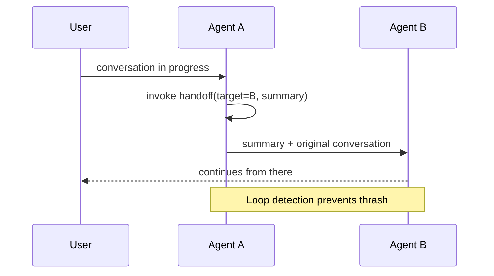

# Handoff

**Also known as:** Agent Handoff, Transfer, Routine Switch

**Category:** Multi-Agent  
**Status in practice:** emerging

## Intent

Transfer the active conversation from one agent to another, carrying context across the switch.

## Context

An agent system has several specialised agents — tier-1 support, billing, technical, sales — and one of them is mid-conversation with a user when it realises the request actually belongs to a different specialist. The user has already explained their situation, and forcing them to start over with a new agent would be a poor experience.

## Problem

Without an explicit way to transfer the conversation, the team is stuck choosing between two bad options: keep the wrong agent on the line and let it bluff through territory it cannot really handle, or restart the conversation with a new agent and make the user repeat themselves. A naive transfer that just changes which agent is responding loses the context that has accumulated in the transcript. Worse, repeated transfers can ping-pong between agents that each think the other is the right one, with nothing detecting the loop.

## Forces

- Context transfer is lossy; what travels?
- Handoff loops (A→B→A→B) are a real failure.
- User experience must signal the change without disorienting.

## Therefore

Therefore: expose a handoff tool that transfers the active conversation to a named target agent along with a context summary, and detect loops at the call site, so that mid-conversation rerouting carries enough state without thrashing.

## Solution

Define a handoff tool. The current agent invokes it with target agent and a context summary. The target agent receives the summary plus the original conversation and continues from there. Loop detection prevents thrash.

## Structure

```
User <-> Agent A --handoff(target=B, context summary)--> Agent B (receives summary + original conversation) --> continues with user; loop detector watches the handoff chain
```

## Diagram



## Example scenario

A customer-support bot answers tier-1 questions but keeps trying to bluff its way through billing disputes it cannot actually resolve. The team adds a handoff tool: when the conversation classifier detects a billing intent, the tier-1 agent calls handoff(target='billing-specialist', summary='customer disputes Sept invoice for $412, two prior tickets'), and the billing agent picks up with the summary plus the original transcript. Loop-detection refuses a re-handoff back to tier-1 within the same conversation. The customer no longer has to repeat themselves.

## Consequences

**Benefits**

- Specialisation without supervisor overhead on every turn.
- User-visible continuity.

**Liabilities**

- Context summary fidelity bounds quality.
- Loop detection is its own code path.

## Failure modes

- Thin summary — the context summary drops a detail the user already gave, and the new agent asks for it again or acts without it.
- Handoff ping-pong — agent A hands to B, B hands back to A, and without loop detection the user waits while the two bounce the conversation.
- Bluffing instead of handing off — the current agent does not call the handoff tool and keeps answering in territory it cannot handle.
- Silent switch — an agent changes which agent responds outside the registered tool, and the switch leaves no trace in the log.

## What this pattern constrains

Handoffs happen only via the registered tool; out-of-band agent switches are forbidden.

## Applicability

**Use when**

- Mid-conversation routing must transfer context to a more appropriate specialist.
- Multiple specialised agents exist and not every conversation belongs to one.
- A summary plus the original conversation is enough for the target to continue.

**Do not use when**

- A single agent can handle the conversation without rerouting.
- Loop detection or thrash prevention cannot be implemented to bound handoffs.
- The cost of summarising and re-onboarding outweighs the specialisation benefit.

## Components

- Source agent — currently active specialist that detects the request belongs elsewhere
- Target agent — named specialist that picks up the conversation after the transfer
- Handoff tool — registered function that carries target id and a context summary across the switch
- Context summary — compressed state of the conversation so the target need not rebuild it
- Loop detector — refuses re-handoff back to a recent agent within the same conversation

## Tools

- OpenAI Swarm primitives — provide the handoff tool and routine-switch semantics
- LLM API — invoked once on the summary step and again on the target's first response
- Agent registry — directory of which named target agents exist and what they handle

## Evaluation metrics

- Handoff-loop rate — share of conversations where loop detection had to intervene
- Summary fidelity — sample-audited preservation of load-bearing facts across the switch
- User repeat-statement rate — turns where the user has to restate context the summary missed
- Per-handoff latency — extra wall-clock from summarisation and target onboarding
- Specialisation lift — task-success delta over keeping the wrong agent on the line

## Known uses

- **[OpenAI Swarm primitives](https://github.com/openai/swarm)** _available_

## Related patterns

- _alternative-to_ **Supervisor**
- _complements_ **Role Assignment**
- _composes-with_ **Inter-Agent Communication**
- _generalises_ **Conversation Handoff to Human**
- _used-by_ **Cross-Domain Enterprise Agent Network**
- _used-by_ **Group-Chat Manager**
- _composes-with_ **Talker-Reasoner**
- _generalises_ **Decentralized Swarm Handoff**
- _complements_ **Local-to-Cloud Handoff**

## References

- [openai/swarm](https://github.com/openai/swarm)
