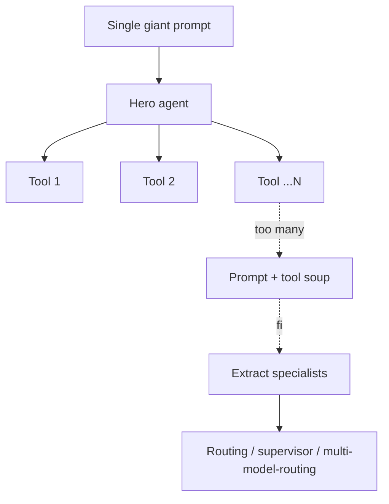

# Hero Agent

**Also known as:** Mega-Prompt Agent, God Agent

**Category:** Anti-Patterns  
**Status in practice:** deprecated

## Intent

Anti-pattern: stuff every capability into one agent with one giant prompt.

## Context

A team has a single agent that started small and is winning use cases. Each new capability — calendar handling, email, research, file editing — is added by appending more instructions to the system prompt and more entries to the tool list of that same agent. Splitting into specialists feels like premature optimisation, so the one agent keeps absorbing scope, often crossing a thousand prompt lines and dozens of registered tools.

## Problem

Past a certain size the single agent stops behaving like one coherent assistant and starts behaving like a confused junior who has been handed every job in the company. The model picks the wrong tool when two tools overlap, follows the wrong section of the prompt because two sections contradict each other, and the smallest user request now pays for the full giant prompt on every call. Latency, cost, and quality all regress together, and debugging which prompt fragment caused which behaviour becomes archaeological work.

## Forces

- Specialisation requires routing or multi-agent infrastructure that does not yet exist.
- Splitting feels like premature optimisation.
- One-prompt is fastest to ship and slowest to maintain.

## Therefore

Therefore: when the prompt passes a few hundred lines or the tool palette passes about a dozen, extract specialists behind a small router, so that cheap requests stop paying expensive prompts and capabilities stop colliding inside a single model.

## Solution

Don't. Once the prompt exceeds a few hundred lines or the tool count exceeds about a dozen, extract specialists. See routing, supervisor, multi-model-routing.

## Structure

```
Anti-pattern: every capability + every tool -> one agent, one giant prompt -> wrong tool, conflicting rules, high cost. Corrected: request -> router or supervisor -> specialist agents with focused prompts and small tool sets.
```

## Diagram



## Example scenario

A startup ships a single 'do-everything' assistant whose system prompt grew to 1800 lines and whose tool list passed forty entries. Latency triples, the model confuses calendar tools with email tools, and the cheapest 'what time is it' request now costs as much as a full research query. They diagnose hero-agent as the named anti-pattern and extract specialists: a small router up front, a calendar agent, a mail agent, a research agent. The monolith stays only as an escape hatch and the prompt shrinks by 80 percent.

## Consequences

**Benefits**

- Short-term: adding one more capability to the existing agent is the fastest way to ship a feature.
- Naming it lets a team set a size threshold at which specialists get extracted.

**Liabilities**

- Quality regressions on each new capability.
- Cost ballooning.
- Debugging the agent becomes archaeology.

## Failure modes

- Wrong tool pick — two overlapping tools in the same agent confuse the model, and it picks the wrong one.
- Contradicting sections — the model follows one part of the giant prompt that conflicts with another, and behaviour shifts per request.
- Full cost for small asks — a simple request pays for the whole prompt on every call, so cost and latency rise together.
- Prompt archaeology — debugging means guessing which fragment of a huge prompt caused a behaviour.

## What this pattern constrains

Avoiding it caps monolith growth: one agent must not accumulate every capability; past a few hundred prompt lines or about a dozen tools, specialists have to be extracted.

## Applicability

**Use when**

- Cite this entry when every new capability lands in the same prompt and tool list.
- Warning signs: the system prompt has grown past a few hundred lines or the tool count past about a dozen, and regressions appear in unrelated features.
- Extract specialists via routing, supervisor, or multi-model-routing instead of growing the monolith.

**Do not use when**

- Any agent with more than a handful of distinct workflows.
- Any agent where cheap requests must not pay expensive prompt costs.
- Any team that needs independent ownership of separate capabilities.

## Components

- Single agent loop — absorbs every new capability instead of delegating
- Mega-prompt — passes a few hundred lines with contradictory instructions from successive bug fixes
- Tool palette — grows past a dozen entries with overlapping responsibilities
- Missing router — would dispatch cheap requests to small specialists instead of paying the full prompt

## Tools

- Append-only system prompt — the surface every bug fix grows by one section
- Unfiltered tool registry — every capability lives on one agent, multiplying selection ambiguity

## Evaluation metrics

- System prompt token length — exceeds a few hundred lines and grows monotonically
- Tool count per agent — passes the tested function-calling accuracy threshold around twenty
- Tool-selection error rate — model picks an overlapping tool when two cover similar ground
- Cost-per-trivial-request — cheap intents pay the full hero prompt on every call

## Known uses

- **[Auto-GPT (2023)](https://github.com/Significant-Gravitas/AutoGPT)** _deprecated_ — The canonical single do-everything agent: one prompt, every tool, publicly documented to loop and stall on real tasks — the failures that pushed the field toward scoped specialist agents.

## Related patterns

- _alternative-to_ **Routing**
- _alternative-to_ **Supervisor**
- _alternative-to_ **Multi-Model Routing**
- _complements_ **Tool Explosion**
- _complements_ **Prompt Bloat**
- _alternative-to_ **SOP-Encoded Multi-Agent Workflow**
- _alternative-to_ **Cross-Domain Enterprise Agent Network**
- _complements_ **Multi-Agent on Sequential Workloads**

## References

- [ai-standards/ai-design-patterns (Hero Agent)](https://github.com/ai-standards/ai-design-patterns)
