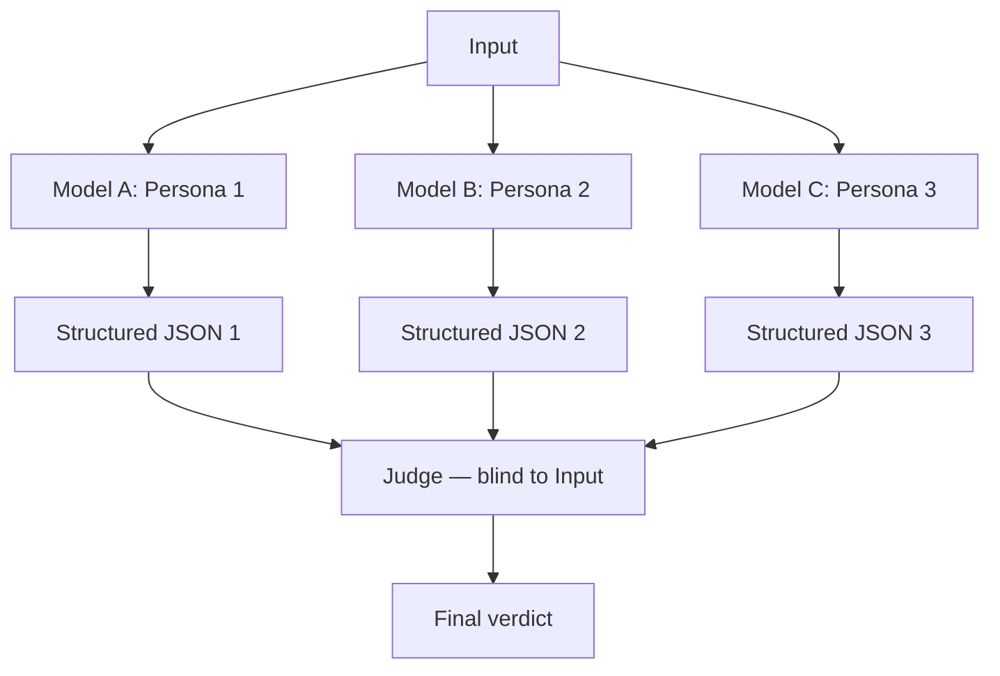

# Heterogeneous-Model Council with Synthesis Judge

**Also known as:** Multi-Architecture Council, Decorrelated-Model Judge

**Category:** Multi-Agent  
**Status in practice:** emerging

## Intent

Three or more role-specialized personas run on different model architectures in parallel; a synthesis judge — given only their structured JSON, not the original input — produces the final verdict.

## Context

A team uses a council/voting pattern for high-stakes decisions. Council members all run on the same model, so their errors correlate. The judge sees both the council outputs and the original input, allowing bias from the input to drive the verdict.

## Problem

Same-model councils give correlated errors — a hallucination one model makes is likely to be made by clones of the same model. Judges that see the original input can drift toward their own interpretation, ignoring the council's signal. Distinct from voting-based-cooperation by mandating heterogeneous models AND blind judge.

## Forces

- Heterogeneous models are more expensive to operate (multiple vendor relationships).
- Blind judge cannot apply input-specific judgment, which sometimes is warranted.
- Structured-JSON exchange constrains what council members can express.

## Therefore

Therefore: council members must run on different model architectures (different vendors or different model families); the judge sees only structured JSON outputs, never the original input; verdict synthesizes the council without input-driven bias.

## Solution

Council of N (typically 3) role-specialized personas, each on a different model architecture. Each produces structured JSON output per a fixed schema. A judge — different model again, blind to original input — synthesizes from JSON only. Errors decorrelate across model families; judge cannot drift from council signal. Pair with voting-based-cooperation, llm-as-judge, parallel-fan-out-gather.

## Structure

```
Input --> Persona 1 (model A) | Persona 2 (model B) | Persona 3 (model C) in parallel --structured JSON per fixed schema--> Judge (different model, blind to input) --synthesise--> Final verdict
```

## Diagram



## Example scenario

A drawing-feedback agent: Technician (vision model from vendor A) judges technical execution, Storyteller (vision model from vendor B) judges narrative, Coach (vision model from vendor C) judges progress vs prior work. Each emits {dimension, score, evidence}. Judge (text-only model, never sees the image) takes 3 JSON outputs and produces final verdict. A geometry hallucination by Technician does not correlate with Storyteller's narrative reading; judge sees disagreement and downweights.

## Consequences

**Benefits**

- Decorrelated errors across model architectures.
- Judge cannot rationalize against original-input bias because it never sees the input.
- Verdict is reconstructable from structured JSON alone.

**Liabilities**

- Operating multiple model vendors increases cost and complexity.
- Blind judge cannot apply input-specific reasoning.
- Council members may disagree on JSON schema interpretation.

## Failure modes

- Schema disagreement — council models read the shared JSON schema differently, and the judge compares fields that do not mean the same thing.
- Blind judge misses context — the input has a detail that decides the case, and the judge, seeing only JSON, cannot use it.
- Hidden correlation — the 'different' models share training data or a base model, and their errors still line up.
- Vendor sprawl — running several model vendors adds outages and cost that a single-vendor setup would not have.

## What this pattern constrains

Council members must run on architecturally distinct models; the judge must not see the original input; only structured JSON flows from council to judge.

## Applicability

**Use when**

- High-stakes verdicts where error decorrelation matters.
- Multiple model vendors are operationally feasible.
- Outputs can be expressed in structured JSON.

**Do not use when**

- Cost/operational burden of multi-vendor stack is prohibitive.
- Judgment requires input-specific reasoning the blind judge cannot do.
- Council size N is too small to benefit from decorrelation.

## Components

- Heterogeneous council — N members on distinct model architectures
- Structured-JSON output schema — fixed across council
- Blind judge — sees only council JSON, never original input
- Disagreement detector — surfaces low-consensus cases for human review

## Tools

- N model APIs from distinct vendors/architectures
- Structured-JSON output schema
- Blind judge — text-only model

## Evaluation metrics

- Inter-model agreement rate
- Judge-verdict stability under model swap
- Decorrelated-error catch rate — disagreements that surface real issues

## Known uses

- **[Habr (Russian): multi-agent feedback for drawing instruction (3 personas on different models + blind judge)](https://habr.com/ru/articles/1037770/)** _available_

## Related patterns

- _specialises_ **Voting-Based Cooperation**
- _complements_ **LLM-as-Judge**
- _specialises_ **Parallel Fan-Out / Gather**
- _complements_ **Cross-Reflection**
- _alternative-to_ **Inner Committee**
- _generalises_ **Parallel Fan-Out / Gather**
- _complements_ **Epistemic Fault-Domain Quorum** — Decorrelates along a single axis, model architecture; here architecture is one root among several, and the shared root is often upstream telemetry or a common tool backend rather than the model at all.
- _complements_ **Prior-Estimate Anchoring** — Decorrelating members by model architecture does not remove the anchor, which was measured across fourteen models including frontier systems, so the council's independence has to come from what each member is shown and not only from whose weights it runs on.
- _complements_ **Judge-Channel Injection** — Decorrelated judges are a partial corrective: a payload tuned against one judge is less likely to carry across model families, though shared reading heuristics still leave common ground.

## References

- [Как мы проектировали multi-agent feedback для обучения рисованию](https://habr.com/ru/articles/1037770/) — 2026
