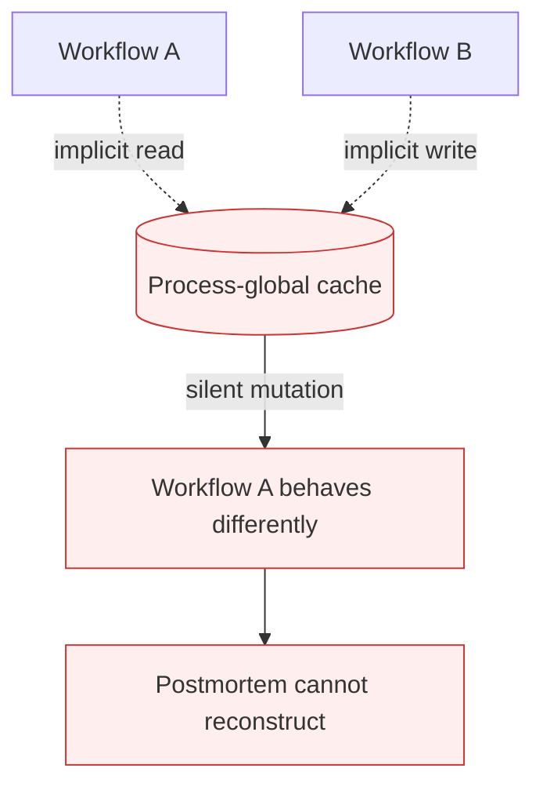

# Hidden State Coupling

**Also known as:** Invisible Workflow Coupling, Undeclared Shared State

**Category:** Anti-Patterns  
**Status in practice:** deprecated

## Intent

Anti-pattern: agent workflows read or write undeclared shared state (caches, env vars, process globals) instead of explicit inputs and outputs.

## Context

Multiple agent workflows or steps interact with the same underlying state — a process-global cache, an env-var-configured singleton, an external store — but the dependency is implicit. Nothing in the workflow signature names the shared state.

## Problem

When the shared state mutates in unexpected ways, dependent workflows experience silent retry storms, duplicated side effects, or behavior changes nobody can trace. Postmortems are slow because the coupling is invisible to readers of the agent code. Reproduction in test environments often fails because tests bypass the shared singleton.

## Forces

- Globals and caches are convenient and reduce verbose plumbing.
- Making every input explicit looks like over-engineering at small scale.
- Hidden coupling rarely fails in dev where there is one process and one user.

## Therefore

Therefore: every input that affects agent decisions must be in the workflow signature; shared state must be passed explicitly or accessed via a versioned, observable interface.

## Solution

Pass all inputs as arguments to the workflow function. Where shared state is genuinely needed (caches, feature flags), route it through a typed accessor with version stamping and structured logging. Treat the agent run as a pure-ish function of its declared inputs so replay produces the same result. Pair with stateless-reducer-agent and provenance-ledger to make every state read auditable.

## Structure

```
Anti-pattern: Workflow -> reads/writes undeclared caches, env vars, globals -> silent coupling -> untraceable changes. Corrected: Workflow(explicit inputs) -> typed, versioned accessor for needed shared state + logged reads -> replayable output.
```

## Diagram



## Example scenario

A research agent reads from a process-global LRU cache populated by a separate ingestion workflow. The ingestion workflow restarts and the cache empties. The research agent's behavior changes silently — answers regress because the cache miss path produces different rankings. The agent code never mentions the cache. Postmortem takes 3 days to localize.

## Consequences

**Benefits**

- Short-term: reaching for a global or cache avoids threading arguments through every function.
- Naming it lets a team check workflow boundaries for undeclared inputs during review.

**Liabilities**

- Silent retry storms when shared state mutates unexpectedly.
- Duplicate side effects from workflows that read a different snapshot of shared state.
- Postmortems unable to reconstruct what the agent saw at decision time.

## Failure modes

- Mystery behavior change — a cache or environment variable changes, and an agent workflow starts acting differently with no code change.
- Snapshot mismatch — two workflows read different versions of shared state and both perform the same side effect.
- Unreproducible bug — tests bypass the shared singleton, so the production failure cannot be reproduced.
- Blind postmortem — the team cannot reconstruct what the agent saw at decision time.

## What this pattern constrains

No useful constraint; the missing constraint is explicit-input discipline at the workflow boundary.

## Applicability

**Use when**

- Never. Cite when reviewing workflows that read undeclared globals.
- Pass shared state explicitly through a versioned, observable accessor.
- Stamp every cache read with the cache version in the agent log.

**Do not use when**

- Any agent that reads from process-globals not in its declared inputs.
- Any agent whose behavior changes when an unrelated workflow restarts.
- Any agent whose replay cannot reconstruct exactly what it saw at decision time.

## Components

- Shared state store — accessed without being in workflow signatures
- Reader workflow — depends on state it does not declare
- Writer workflow — mutates state readers depend on, with no contract
- Missing typed-accessor layer — would surface coupling explicitly

## Tools

- Detection signal — monitors or audits that surface this anti-pattern in the wild
- Mitigation pattern infrastructure — the positive pattern that resolves this anti-pattern
- Incident-response playbook — what to do when the anti-pattern fires

## Evaluation metrics

- Incident rate — occurrences per period
- Mean time to detection — how long the anti-pattern runs unobserved
- Cost / damage per incident — measurable impact of each occurrence

## Known uses

- **[Production agentic workflow 2026 failure taxonomy (digitalapplied.com)](https://www.digitalapplied.com/blog/agentic-workflow-anti-patterns-orchestration-mistakes-2026)** _available_

## Related patterns

- _complements_ **Stateless Reducer Agent**
- _complements_ **Provenance Ledger**
- _complements_ **Missing Idempotency on Agent Calls**
- _complements_ **Race Conditions on Shared Tool Resources**
- _complements_ **Errors Swept Under the Rug**
- _complements_ **Hidden Distributed Monolith (Multi-Agent)** — Hidden-state-coupling is generic shared mutable state; the distributed monolith names the broader false-decoupling where agents marketed as independent share context and run synchronously.
- _complements_ **Actuation-Scope-Registered Control Loops** — The same undeclared-dependency failure one level down: there a workflow reads or writes shared state that its signature never names, here a long-lived loop actuates a resource its declaration never names.

## References

- [Agentic Workflow Anti-Patterns: Orchestration Mistakes (2026)](https://www.digitalapplied.com/blog/agentic-workflow-anti-patterns-orchestration-mistakes-2026) — 2026
