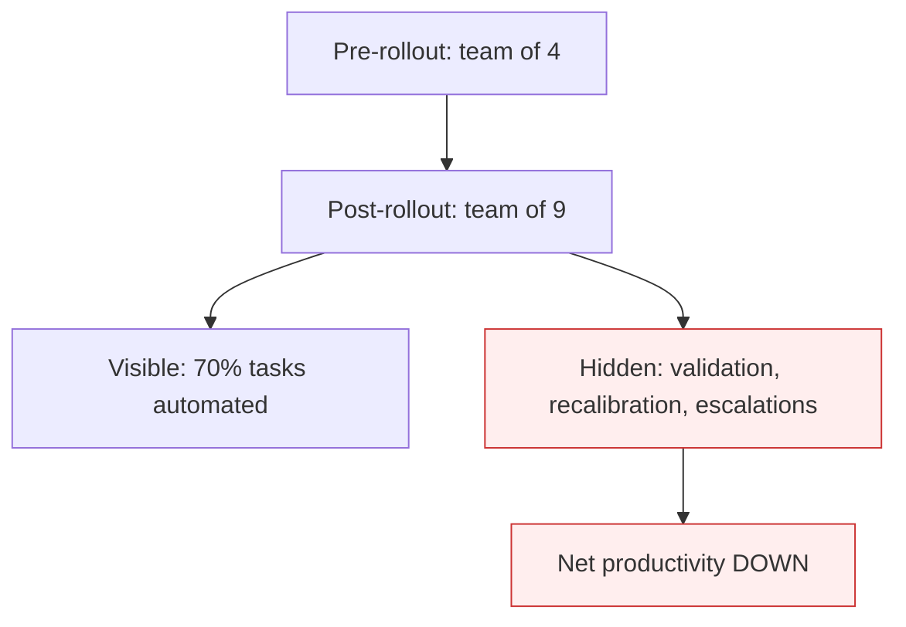

# Hidden Validation-Work Amplification

**Also known as:** AI Productivity Paradox, Validation-Burden Shift

**Category:** Anti-Patterns  
**Status in practice:** deprecated

## Intent

Anti-pattern: an agent rollout shifts effort from doing the work to validating, monitoring, and recalibrating the agent — net productivity is negative because the hidden human evaluation burden exceeds the visible automation gain.

## Context

An organization deploys agents across a workflow expecting productivity gains. The visible work the agent performs is automated. The invisible work — validating outputs, monitoring drift, recalibrating thresholds, handling edge cases the agent escalates — accumulates on humans nobody planned for. Documented in Chinese (Huxiu) and MIT/Gartner data as the 2026 'productivity paradox' for the model rollouts.

## Problem

Total human effort across the team rises, not falls, because validation effort exceeds saved-execution effort. The work shifts from doers to validators without staffing for it. Productivity-impact dashboards show the automation but not the validation tax. Differs from existing review-bottleneck-migration (which is the where-it-lands view); this names the *aggregate productivity loss*.

## Forces

- Validation work is invisible in dashboards that measure 'tasks done by agent'.
- Quality teams absorb the validation burden silently rather than escalate.
- Rollout decisions are made on automation gains projected from happy-path runs.

## Therefore

Therefore: measure total human-hours per business outcome before and after agent rollout, not just 'tasks the agent did'; if total hours rose, the rollout has net-negative productivity even if automation is up.

## Solution

Instrument total human-hours per business outcome (validation, recalibration, escalation handling) and compare to pre-rollout baseline. Reject or downscope rollouts whose total-hours metric is worse. Surface validation effort as a first-class metric on rollout dashboards. Use llm-as-judge selectively but track its own accuracy drift to avoid pushing validation upstream invisibly. Pair with three-tier-autonomy-portfolio so validation cost is sized appropriately per tier.

## Structure

```
Anti-pattern: Agent rollout -> tasks automated (visible) + validation, recalibration, escalation (hidden) -> net human effort rises. Corrected: Rollout -> measure total human-hours per business outcome vs baseline -> downscope or reject if worse -> validation shown on dashboard.
```

## Diagram



## Example scenario

An agent automates 70% of customer-support tickets. The quality team grows from 4 to 9 to validate agent outputs, handle edge-case escalations, and recalibrate the agent monthly. Net team size: 13 before vs 19 after. Tickets per hour: down 8%. The 'automation success' dashboard shows the 70% automation; nobody dashboards the 11% staff growth.

## Consequences

**Benefits**

- Short-term: the count of tasks automated rises fast and makes the rollout look like a clear win.
- Naming it lets a team measure total human effort per outcome before declaring success.

**Liabilities**

- Apparent automation gains masked by hidden validation work.
- Quality team burnout from absorbing the validation tax.
- Strategic decisions made on 'tasks automated' metric that does not capture true productivity.

## Failure modes

- Validation tax — staff spend more hours checking and correcting agent output than the agent saves.
- Unstaffed shift — work moves from doers to validators with no change in staffing, and the quality team burns out.
- One-sided dashboard — the dashboard counts tasks automated and leaves out time spent on validation.
- Judge drift — a model judge takes over validation, its own accuracy drifts, and nobody tracks it.

## What this pattern constrains

No useful constraint; the missing constraint is total-human-hours-per-business-outcome measurement, not just automation count.

## Applicability

**Use when**

- Never as a default state. Cite when reviewing agent-rollout productivity claims.
- Measure total human-hours per business outcome, not tasks-automated.
- Surface validation effort on the rollout dashboard.

**Do not use when**

- Any agent rollout whose productivity case rests on 'tasks automated' without total-hours measurement.
- Any deployment whose validation burden grew without staffing plan.
- Any post-rollout review that ignores validation/recalibration human cost.

## Components

- Visible automation metric — counts tasks done by agent
- Hidden validation work — uncounted human effort
- Quality team — absorbs validation tax silently
- Missing total-hours metric — would expose the paradox

## Tools

- Detection signal — monitors or audits that surface this anti-pattern in the wild
- Mitigation pattern infrastructure — the positive pattern that resolves this anti-pattern
- Incident-response playbook — what to do when the anti-pattern fires

## Evaluation metrics

- Incident rate — occurrences per period
- Mean time to detection — how long the anti-pattern runs unobserved
- Cost / damage per incident — measurable impact of each occurrence

## Known uses

- **[Huxiu: 2026年企业AI应用面临价值鸿沟](https://m.huxiu.com/article/4842126.html)** _available_

## Related patterns

- _complements_ **Automating a Broken Process**
- _complements_ **Agentic Skill Atrophy**
- _complements_ **Perma-Beta**
- _complements_ **Agent Output Alert Fatigue** — Effort inflation from checking output pairs with reviewers disengaging from it entirely.
- _complements_ **Understanding-Capacity Gap** — Both separate visible automation gain from hidden human burden; that anti-pattern is about validation effort exceeding the automation saving, this one about scaling output past the capacity to specify, verify, and understand it so correctness degrades unseen.
- _complements_ **Oversight as Legitimation** — That anti-pattern is what happens when the validation burden is genuinely paid and eats the productivity gain; this one is what happens when the same burden is assigned on paper and never paid.

## References

- [2026年企业AI应用面临价值鸿沟，三大误区导致项目失败](https://m.huxiu.com/article/4842126.html) — 2026
