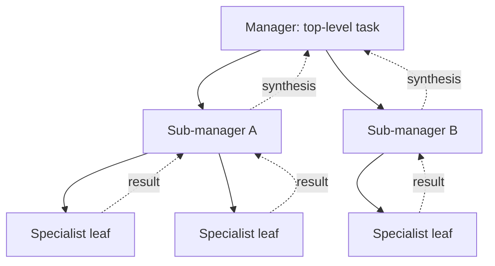

# Hierarchical Agents

**Also known as:** Manager-Worker Tree, Agent Hierarchy

**Category:** Multi-Agent  
**Status in practice:** mature

## Intent

Organise agents in a tree where higher-level agents decompose tasks for lower-level agents, recursively.

## Context

A team is working with tasks that decompose recursively across several levels — a market research project breaks into vertical-specific research, each vertical breaks into specific information-gathering steps; a software project breaks into epics, tickets, and individual edits. At each level the right next step is different in kind, not just in detail. A single supervisor cannot meaningfully reason about every leaf at once.

## Problem

A flat supervisor pattern, where one coordinating agent dispatches to a list of specialists, scales poorly as the list grows. The supervisor's prompt grows with the number of specialists, recall on which specialist to call drops, and any new vertical forces an edit to the root prompt. The supervisor ends up trying to think simultaneously at the level of the whole project and the level of individual specialist tasks, which neither it nor any other agent does well.

## Forces

- Tree depth trades latency for clarity.
- Inter-level communication needs a contract.
- Failure recovery: which level retries?

## Therefore

Therefore: organise agents as a tree where each non-leaf decomposes and dispatches downward and synthesises results upward, so that decomposition scales beyond what a flat supervisor's prompt complexity can hold.

## Solution

Each non-leaf agent receives a task, decomposes it, and dispatches sub-tasks to its children. Children may be specialists (leaves) or further managers. Results bubble up; each manager synthesises its children's outputs. Bounded depth and breadth prevent runaway hierarchies.

## Structure

```
Task --> Root manager --decompose--> Sub-managers --decompose--> Specialist leaves --results--> Sub-managers (synthesise) --> Root manager (synthesise) --> Answer; depth and breadth bounded
```

## Diagram



## Example scenario

A consulting firm builds a market-research agent with one supervisor and twenty specialist tools: data-fetch, summarise, compare, draw-chart, and so on. As they add specialists for new verticals, the supervisor prompt balloons and the agent starts forgetting which tool to call. They restructure as hierarchical-agents: a root research-manager dispatches to vertical managers (healthcare, fintech), each of whom dispatches to leaf specialists for their domain. Depth and breadth are both capped, and adding a new vertical no longer touches the root prompt.

## Consequences

**Benefits**

- Scales to deep decomposition.
- Each level has clear responsibility.

**Liabilities**

- Latency multiplies with depth.
- Coordination bugs become hard to localise.

## Failure modes

- Latency stack — each level waits on the level below, and a deep tree turns a simple request into a long chain of sequential calls.
- Runaway tree — managers keep spawning sub-managers without a depth or breadth bound, and cost grows far past what the task needs.
- Lost in synthesis — a mid-level manager summarises its children's results and drops the one finding the root needed.
- Unlocalised bug — the final answer is wrong, and it is hard to tell which level's decomposition or synthesis caused it.

## What this pattern constrains

An agent communicates only with its parent and children; cross-tree communication is forbidden.

## Applicability

**Use when**

- Tasks decompose recursively and a single supervisor cannot cleanly orchestrate the breadth.
- Sub-tasks are themselves big enough to merit their own decomposition step.
- Bounded depth and breadth limits can be enforced to prevent runaway hierarchies.

**Do not use when**

- A flat supervisor over a small set of specialists already suffices.
- Bubbling synthesis up multiple levels is too lossy for the task.
- Latency and token cost of nested orchestration are unacceptable.

## Components

- Root manager — owns the top-level task and dispatches to sub-managers
- Sub-manager — non-leaf agent that decomposes further and synthesises children's results upward
- Leaf specialist — bottom agent that executes against a concrete sub-task and returns a result
- Parent-child contract — typed message shape for downward dispatch and upward synthesis
- Depth and breadth caps — hard limits that prevent runaway tree expansion

## Tools

- CrewAI hierarchical processes — provides parent-child orchestration scaffolding
- AutoGen nested GroupChat — supports tree-shaped multi-agent layouts
- LLM API — invoked at every non-leaf for decomposition and synthesis steps

## Evaluation metrics

- End-to-end latency by tree depth — wall-clock multiplied by hops
- Synthesis-fidelity loss — sample-audited information lost as results bubble up
- Failure-localisation accuracy — share of failures correctly attributed to one subtree
- Per-level recall — does each manager pick the right child for its sub-task
- Token cost per task — total spend across all levels of the hierarchy

## Known uses

- **AutoGen GroupChat with nested groups** _available_
- **CrewAI hierarchical processes** _available_

## Related patterns

- _generalises_ **Supervisor**
- _specialises_ **Orchestrator-Workers**
- _complements_ **Goal Decomposition**
- _generalises_ **Agent-as-Tool Embedding**
- _complements_ **Hybrid HTN + Generative Agent**
- _complements_ **One Tool, One Agent**
- _complements_ **Behavior Tree Back Chaining**
- _alternative-to_ **Partial Global Planning**
- _complements_ **Two-Rate Cloud-Brain / Edge-Controller Split** — Hierarchy decomposes tasks logically across levels; this split adds a frequency boundary so the lowest level runs on its own real-time clock.

## References

- [AutoGen multi-agent docs](https://microsoft.github.io/autogen/)
