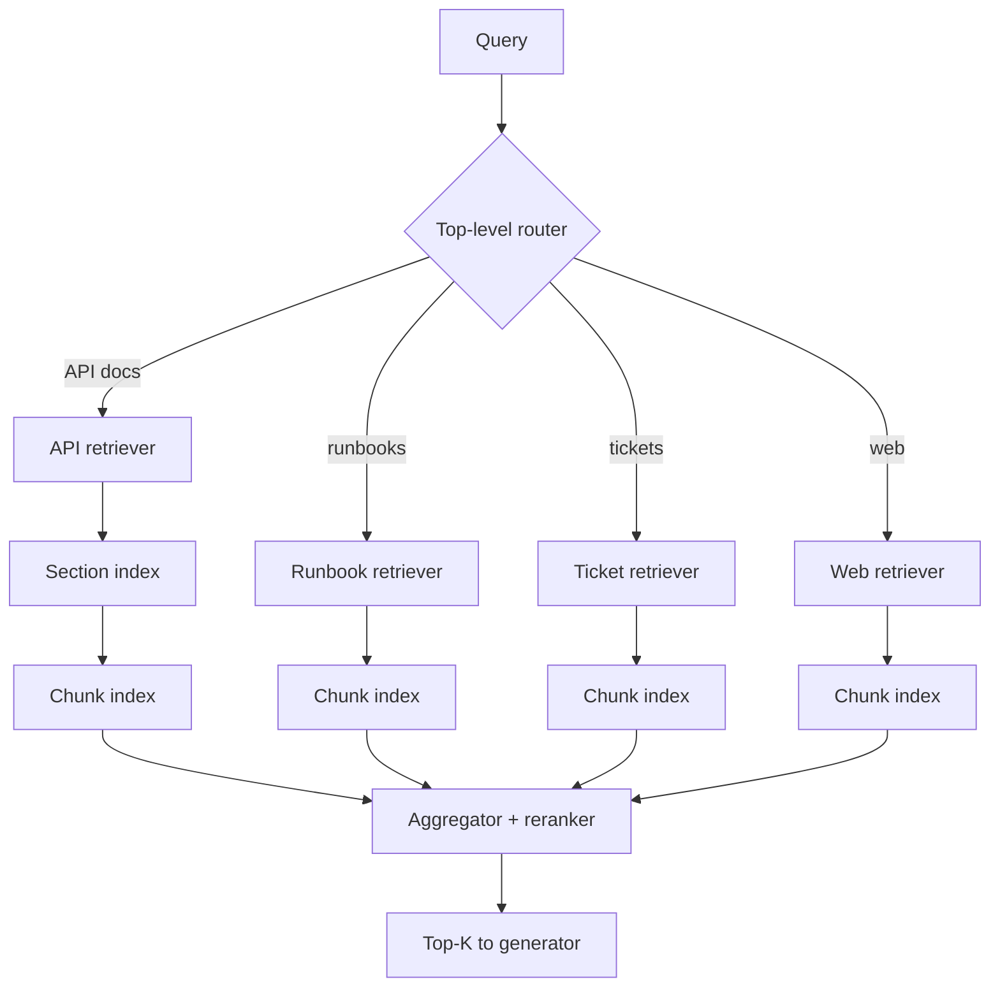

# Hierarchical Retrieval

**Also known as:** Cascade Retrieval, Multi-Level Retrieval, Router-Then-Retrieve, Tree Retrieval

**Category:** Retrieval & RAG  
**Status in practice:** mature

## Intent

Route a query through a multi-level cascade — coarse source or index selection, then per-source narrower retrieval, then chunk-level — so each retrieval decision is pushed to the cheapest tier that can answer it.

## Context

A team runs retrieval over a heterogeneous knowledge base: several distinct corpora (product docs, support tickets, internal wikis, code, web), each with its own index and its own access cost. A single flat index across the union is either prohibitively expensive to maintain or loses too much fidelity, and querying every index in parallel on every request wastes calls on sources that cannot answer the question. Within each source, documents are themselves structured — chapters contain sections contain paragraphs — and the right granularity for retrieval varies per query.

## Problem

Flat retrieval over a single union index pays the cost of querying everything for every question, even when most sources are irrelevant. Fanning out to every retriever in parallel is even worse: latency stacks, costs multiply, and the downstream reranker has to filter noise from sources the query never needed. At the same time, retrieving at one fixed granularity (always paragraphs, or always full documents) mismatches half of the query mix; some questions want a corpus-level answer and some want a single span. The team needs a way to spend retrieval budget proportional to how much routing the query actually requires.

## Forces

- Each retrieval tier has its own cost, latency, and recall profile; querying all of them is wasteful.
- Routing decisions made by an LLM are expensive; routing decisions made by a classifier are cheap but less flexible.
- Granularity should follow the query — coarse for overview questions, fine for span-level lookup.

## Therefore

Therefore: structure retrieval as a cascade of tiers, with a router at each level deciding which retriever or which child node to descend into, so retrieval cost and granularity track the query's actual scope.

## Solution

Index the corpus hierarchically: a parser builds parent-child relationships (document → section → chunk, or topic-cluster → document → chunk) and stores both levels. At query time, a top-level router picks the source or sub-index that matches the query (by classifier, by embedding similarity to source summaries, or by an LLM call). The selected source runs its own retriever, optionally a further router or a coarse-to-fine descent (retrieve summaries, then retrieve the children of the top-ranked summaries). The chunk-level retriever returns the final candidates. Compose with cross-encoder reranking on the final candidate set; compose with hybrid search inside each leaf retriever.

## Structure

```
Query --> Top-level router --selected source(s)--> Per-source retriever --> (optional section / summary tier --children of top summaries-->) Chunk index --> Aggregator + reranker --> Top-K to generator; skipped sources are not searched
```

## Diagram



## Example scenario

A developer-support agent answers questions over four sources: API reference, runbooks, support-ticket history, and the public web. Flat retrieval hits all four on every query and the reranker has to fight ticket noise on API questions. The team switches to hierarchical retrieval: a classifier routes 'how do I authenticate?' to the API reference, 'why did deploy fail last Tuesday?' to support tickets, and 'is this issue known?' first to runbooks and then to the web only if runbooks return nothing. Inside the API reference, a tree retriever descends from section summaries to the specific code-block chunk. Three of the four retrievers are skipped on most queries; latency drops; reranker noise drops with it.

## Consequences

**Benefits**

- Retrieval cost scales with the cascade depth touched, not the union of all sources.
- Granularity adapts per query: overview questions stop at the summary tier, span lookups descend to chunks.
- Each tier can use the retriever best suited to it (BM25 for source routing, dense for chunk-level).

**Liabilities**

- A wrong top-level routing decision is unrecoverable at lower tiers; the right answer is never reached.
- Two or three levels of index plus routers raise the operational surface area.
- Router calibration drifts as new sources are added; routing accuracy must be monitored over time.

## Failure modes

- Wrong first turn — the top-level router picks the runbooks when the answer is in the tickets, and no lower tier can reach it.
- Router drift on new sources — a source is added, the router's summaries or classifier are not updated, and its content is rarely or never selected.
- Wrong granularity — an overview question descends to chunks and returns fragments, or a span lookup stops at a summary that lacks the detail.
- Thin parent summaries — the summary tier poorly describes its children, so coarse-to-fine descent skips the branch that holds the answer.

## What this pattern constrains

Retrieval at any tier sees only the candidates the upstream router selected; sources or sub-trees the router skipped are unreachable for this query.

## Applicability

**Use when**

- Several distinct corpora or indexes exist and only a subset is relevant to any given query.
- Documents have meaningful parent-child structure (chapter, section, paragraph) worth preserving in the index.
- Query mix spans different granularities — some questions are summary-level, some are span-level.
- Retrieval cost or latency makes querying every source in parallel impractical.

**Do not use when**

- A single homogeneous corpus is small enough that flat retrieval already serves every query.
- Routing accuracy at the top tier would be too low to trust; one bad route would dominate failures.
- Query mix is uniform in scope and a single granularity already wins.

## Components

- Top-level router — classifies the query and selects one or more downstream sources or sub-indexes
- Per-source retriever — the actual retrieval pipeline (dense, BM25, or hybrid) for each leaf source
- Hierarchical parser — builds the parent-child node tree at index time
- Granularity selector — at query time, decides which tier of the tree the query targets
- Aggregator and reranker — merges results from whichever sub-retrievers fired and produces the final top-K

## Tools

- Hierarchical node parser — LlamaIndex HierarchicalNodeParser, Haystack HierarchicalDocumentSplitter
- Router retriever — LlamaIndex RouterRetriever or an LLM-driven router prompt
- Multi-vector store — LangChain MultiVectorRetriever or equivalent that holds multiple representations per document
- Embedding model and BM25 index — one per leaf retriever
- Cross-encoder reranker — optional final stage over the cascade's output

## Evaluation metrics

- Top-level routing accuracy — fraction of queries routed to a source that actually contains the answer
- Recall@K vs flat baseline — does the cascade lose recall compared with querying every source in parallel
- Average retrievers fired per query — cost signal showing the cascade is actually pruning
- Granularity-match rate — share of queries whose returned chunks match the human-judged right granularity
- End-to-end latency — sum of router plus leaf retrieval, compared with flat parallel retrieval

## Known uses

- **[LlamaIndex HierarchicalNodeParser and AutoMergingRetriever](https://developers.llamaindex.ai/python/examples/retrievers/auto_merging_retriever/)** _available_ — Ships a hierarchical node parser that emits a coarse-to-fine tree (e.g. 2048/512/128-char chunks) and an auto-merging retriever that escalates from leaf nodes to parent context.
- **[LlamaIndex RouterRetriever](https://docs.llamaindex.ai/en/stable/examples/retrievers/router_retriever/)** _available_ — Top-level router selects among sub-retrievers (one per source) by LLM- or classifier-driven choice.
- **[Haystack HierarchicalDocumentSplitter](https://docs.haystack.deepset.ai/docs/hierarchicaldocumentsplitter)** _available_ — Preprocessor component that creates a multi-level document structure with parent-child relationships between text segments.
- **[LangChain MultiVectorRetriever](https://python.langchain.com/docs/how_to/multi_vector/)** _available_ — Stores multiple vectors per document (full doc, summary, child chunks) so retrieval can match at one granularity and return another.
- **[A-RAG hierarchical retrieval interfaces](https://arxiv.org/abs/2602.03442)** _available_ — Exposes keyword search, semantic search, and chunk read as separate tools so the agent can pick the right granularity per sub-query.

## Related patterns

- _generalises_ **Agentic RAG** — Agentic RAG can drive a hierarchical retriever; this pattern is the static cascade form.
- _specialises_ **Naive RAG**
- _composes-with_ **Cross-Encoder Reranking** — Reranks the final chunk-level candidates the cascade surfaces; different stage of the same pipeline.
- _composes-with_ **Hybrid Search** — Each leaf retriever inside the cascade can be hybrid lexical-plus-dense.
- _alternative-to_ **GraphRAG** — GraphRAG queries an explicit knowledge graph; hierarchical retrieval routes over a tree of indexes.
- _composes-with_ **Modular RAG**
- _composes-with_ **Query Rewriting** — Query rewriting before the top-level router improves routing accuracy.
- _composes-with_ **Contextual Retrieval** — Contextualised chunks at the leaf tier sharpen the final retrieval.
- _alternative-to_ **HippoRAG** — HippoRAG handles multi-hop via PPR over an entity graph; hierarchical retrieval handles heterogeneity via routed indexes.
- _uses_ **Routing** — Hierarchical retrieval is the routing pattern applied to the retrieve step.
- _uses_ **Topic-Based Routing**
- _alternative-to_ **Multi-Model Routing** — Structurally analogous: routing the generate step across models versus routing the retrieve step across indexes.
- _alternative-to_ **Vectorless Reasoning-Based Retrieval** — Both descend a coarse-to-fine document tree; the vectorless variant navigates by LLM reasoning with no embeddings, where this cascade routes over vector or BM25 leaf retrievers.
- _alternative-to_ **Repo Map** — Hierarchical retrieval cascades coarse-to-fine by content similarity; a repo map ranks by code structure (call/import centrality).
- _complements_ **Foveated Perception Escalation** — There a coarse index narrows to candidates across a corpus; here a single observation is already in hand and the descent is a re-observation of the same surface at a finer scale, with no index and no retrieval step.

## References

- [A Two-Dimensional Framework for AI Agent Design Patterns: Cognitive Function and Execution Topology](https://arxiv.org/abs/2605.13850) — Huang, Zhou, 2026
- [A-RAG: Scaling Agentic Retrieval-Augmented Generation via Hierarchical Retrieval Interfaces](https://arxiv.org/abs/2602.03442) — 2026
- [SoK: Agentic Retrieval-Augmented Generation: Taxonomy, Architectures, Evaluation, and Research Directions](https://arxiv.org/abs/2603.07379) — 2026
- [LlamaIndex — Auto Merging Retriever](https://developers.llamaindex.ai/python/examples/retrievers/auto_merging_retriever/)
- [Haystack — HierarchicalDocumentSplitter](https://docs.haystack.deepset.ai/docs/hierarchicaldocumentsplitter)
