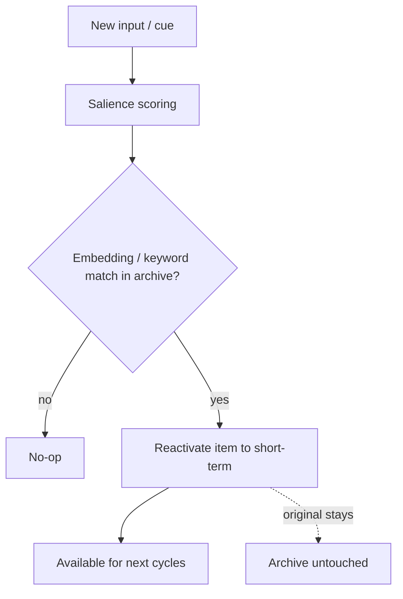

# Hippocampal Rehearsal

**Also known as:** Memory Reactivation, Lift-from-Archive

**Category:** Memory  
**Status in practice:** experimental

## Intent

Lift archived memory items back into short-term tiers when something re-attends to them.

## Context

A long-running agent has archived a piece of information into cold storage — a previous insight, a prior thought, an observation from days ago. Retrieving items from cold storage is slow and out-of-band; it happens only when the agent explicitly searches for them. Today, the current context has drifted close to a topic where that archived item is relevant again, but the agent has no reason to go looking and so it never realises the item is there.

## Problem

Archived items might as well not exist if the agent never thinks about them again, even when the current context makes them relevant. The bottleneck is not the storage itself — the item is on disk and addressable — but the absence of any mechanism that periodically pulls archived items back into the agent's active attention, the way the hippocampus rehearses memories during sleep. Without rehearsal, the agent has perfect recall in principle and amnesia in practice.

## Forces

- Re-attention triggers must be cheap to evaluate.
- Lifting too aggressively floods the working tier.
- The lifted item is now a duplicate of the archive copy.

## Therefore

Therefore: when salience matches an archived item, copy it back into short-term memory for a few cycles while leaving the archive intact, so that re-attention re-grounds without losing the original record.

## Solution

When salience scoring matches against archived items (embedding similarity, keyword match, explicit reference), the matched item is reactivated into short-term memory for one or more cycles. The original archive copy stays untouched.

## Structure

```
New input / cue --> Salience scoring --embedding / keyword / reference match--> Archive item --reactivate--> Short-term memory (one or more cycles); archive copy stays untouched; no match --> no-op
```

## Diagram



## Example scenario

A long-running personal agent archives anything older than seven days into cold storage. When the user mentions 'the dentist thing' six weeks later, the agent has no idea what they mean. The team adds hippocampal-rehearsal: the salience scorer also runs against archived items, and when the embedding similarity for 'dentist' clears the threshold, the original archived note ('molar crown, scheduled Nov 14') is reactivated into short-term memory for the next several cycles. The agent picks up the thread without the user explaining anything.

## Consequences

**Benefits**

- Long-tail relevance does not require the agent to remember to remember.
- Mimics the rehearsal step of biological memory consolidation.

**Liabilities**

- False rehearsals waste working-memory slots.
- Operationally complex; requires content-addressable storage.

## Failure modes

- False reactivation — a loose keyword match lifts an unrelated archived item, and it takes a short-term slot from something useful.
- Rehearsal storm — one broad cue matches many archived items at once and floods short-term memory.
- Never-cued item — an important archived fact shares no words or embedding neighbours with current input, so it is never lifted.
- Archive mutation — the reactivation step edits or moves the archive copy, so the original is lost.

## What this pattern constrains

Archived items become readable only after rehearsal lifts them; direct cold reads are not part of the agent's primary path.

## Applicability

**Use when**

- Archived memory items become relevant again and must re-enter short-term context.
- A salience scorer can match current context against the archive reliably.
- Reactivation can be bounded so short-term memory does not flood.

**Do not use when**

- Memory is small enough that nothing needs to be archived in the first place.
- Salience scoring is unreliable and would surface noise rather than relevance.
- Short-term context cannot afford the additional reactivated tokens.

## Components

- Re-attention trigger — cheap salience check on every cue that decides whether to query the archive at all
- Archive matcher — runs embedding similarity or keyword match against cold storage to find candidate items
- Reactivator — copies the matched item into short-term memory for a bounded number of cycles
- Cycle-budget controller — caps how many items can be lifted at once so the working tier does not flood
- Cold archive — content-addressable store where the original copy stays untouched after rehearsal

## Tools

- Content-addressable cold store — S3/GCS or a file-backed archive with stable IDs the rehearser can resolve
- Vector index over archived items — Chroma/FAISS that lets cheap similarity match drive the rehearsal trigger
- Embedding model — used to score current context against archived items

## Evaluation metrics

- Rehearsal precision — fraction of reactivated items the agent actually used in the next few cycles
- False-rehearsal rate — how often reactivation displaced more relevant working-set content
- Cue-to-lift latency — milliseconds from new input arriving to the matched item being available in short-term
- Long-tail recall lift — answer-quality delta on questions about content older than the short-term horizon
- Working-tier flood incidents — counts of cycles where the rehearsal cap was breached

## Known uses

- **Author's long-running personal agent (single private deployment)** _available_ — Single-source evidence: one private deployment by the catalog author; no independently documented use yet.

## Related patterns

- _used-by_ **Five-Tier Memory Cascade**
- _complements_ **Episodic Memory**

## References

- [The Role of Hippocampal Replay in Memory and Planning](https://www.ncbi.nlm.nih.gov/pmc/articles/PMC5847173/) — Ólafsdóttir, Bush, Barry, 2018
- [Hippocampal sharp wave-ripple: A cognitive biomarker for episodic memory and planning](https://pmc.ncbi.nlm.nih.gov/articles/PMC4648295/) — György Buzsáki, 2015
- [Reverse replay of behavioural sequences in hippocampal place cells during the awake state](https://pubmed.ncbi.nlm.nih.gov/16474382/) — David J. Foster, Matthew A. Wilson, 2006
