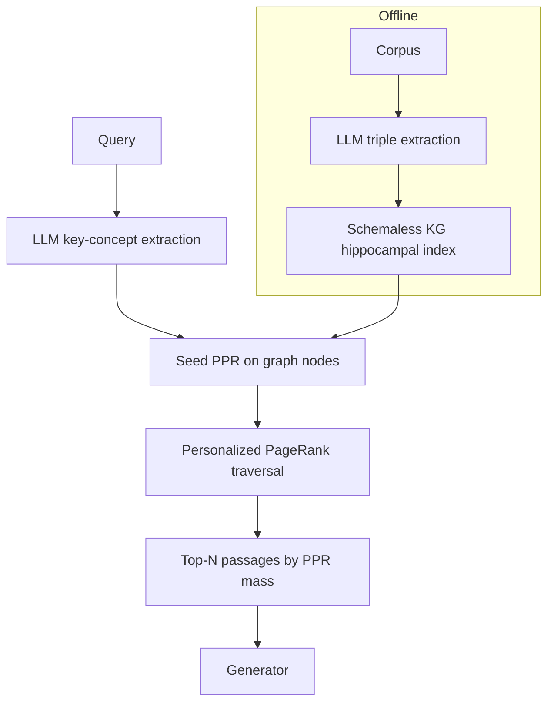

# HippoRAG

**Also known as:** Hippocampus-Indexed Retrieval, PPR-over-LLM-KG, 海马体启发的检索增强生成

**Category:** Retrieval & RAG  
**Status in practice:** emerging

## Intent

Build an LLM-extracted schemaless knowledge graph from the corpus and run Personalized PageRank seeded on the query's key concepts so multi-hop retrieval completes in a single pass.

## Context

A team runs RAG over a corpus where the answer to many queries lives across several documents that share entities or relations rather than vocabulary. Multi-hop questions — 'which Stanford professor co-authored a paper with someone now at DeepMind on RLHF?' — require crossing edges in entity space, not just embedding similarity. Iterative retrieve-then-reason loops do work but pay an LLM call per hop and lose context between hops.

## Problem

Single-query dense retrieval lands in one embedding neighbourhood and cannot follow entity-mediated chains across documents. Iterative agentic retrieval reaches the answer but costs an LLM call per hop and the agent has no global view of the graph that connects passages. Community-summary approaches such as GraphRAG handle global queries via map-reduce over pre-built summaries, but their cost and latency are dominated by the summary build and they do not naturally surface a tight path between two concrete entities.

## Forces

- Multi-hop answers depend on entity-mediated paths the embedding similarity flattens away.
- Iterative agentic retrieval costs one LLM call per hop and drifts off-topic.
- Pre-building dense community summaries is expensive and re-runs on corpus updates.
- Graph construction quality bounds retrieval quality; bad NER means bad recall.

## Therefore

Therefore: have an LLM extract a schemaless entity-relation graph from the corpus once, and at query time run Personalized PageRank seeded on the query's key concepts so the graph itself does the multi-hop traversal in a single retrieval step.

## Solution

Offline, prompt an LLM to extract (subject, predicate, object) triples from each passage and store the resulting schemaless graph alongside per-node passage pointers — this is the artificial hippocampal index. At query time, extract the query's key concepts (also via LLM), seed Personalized PageRank on the corresponding graph nodes, run PPR to propagate relevance through entity-mediated edges, and surface the top passages by aggregated PPR mass. Pass the surfaced passages forward to the generator, optionally through a reranker.

## Structure

```
Offline: Corpus --> LLM triple extraction --> Schemaless KG (nodes carry passage ids). Query: Query --> LLM key-concept extraction --> Seed graph nodes --> Personalized PageRank --> Aggregate mass to passages --> Top-N passages --> (optional reranker) --> Generator
```

## Diagram



*HippoRAG builds an LLM-extracted KG offline, then seeds Personalized PageRank on query concepts at retrieval time for single-pass multi-hop traversal.*

## Example scenario

A research assistant gets the query 'which professor at Stanford co-authored an RLHF paper with someone now at DeepMind?' A single embedding lookup retrieves vaguely-related ML papers but cannot follow the author edges. HippoRAG's offline extraction has produced a graph with Person, Affiliation, and Authored-Paper nodes. The query's key concepts ('Stanford', 'DeepMind', 'RLHF') seed Personalized PageRank, which propagates mass through Authored-Paper edges and lands on the specific paper plus its two co-author nodes. The generator answers from those passages in a single retrieval pass.

## Consequences

**Benefits**

- Multi-hop QA lift over flat dense retrieval without an iterative LLM loop.
- Single-pass retrieval — no per-hop LLM call at query time.
- Cheaper than community-summary GraphRAG on incremental corpus updates (only new nodes/edges).
- Graph is human-inspectable, so failures localise to bad extraction or bad seeding.

**Liabilities**

- Extraction quality bounds retrieval quality; poor NER on the corpus poisons the graph.
- PPR over a large graph can be expensive without precomputed indexes or sparsification.
- Schemaless triples drift over time; semantically-equivalent edges may not merge.
- Cold-start cost is the full LLM-driven extraction pass over the corpus.

## Failure modes

- Poisoned graph — weak entity extraction misses or garbles key names, so the passages that hold the answer have no node to reach them.
- Bad seeds — the query concept extractor picks the wrong concepts, and PageRank spreads relevance around the wrong part of the graph.
- Unmerged edges — the same relation is stored under several predicate wordings, so the path between two entities is broken in the graph.
- Hub dominance — very common entities collect PageRank mass, and generic passages crowd out the specific ones the multi-hop question needs.

## What this pattern constrains

Retrieval cannot rely on the query embedding alone; relevance is propagated through the LLM-extracted entity graph via Personalized PageRank, and passages with no graph anchor are unreachable.

## Applicability

**Use when**

- Queries require multi-hop reasoning across entity-mediated paths in the corpus.
- An iterative retrieve-then-reason loop is too expensive or too slow in production.
- The corpus has stable enough entities that LLM extraction yields a useful graph.
- Single-pass latency is required (multi-hop without per-hop LLM calls).

**Do not use when**

- Queries are single-hop and dense retrieval already saturates recall.
- The corpus lacks named entities (e.g. abstract conceptual text without proper nouns).
- Cold-start cost of full LLM extraction is unaffordable and the corpus changes rarely.
- GraphRAG's community-summary global-query shape fits the workload better.

## Components

- LLM extractor — converts each passage into (subject, predicate, object) triples plus passage pointers
- Schemaless graph store — nodes are entities, edges are predicates, each node carries a list of source-passage ids
- Query concept extractor — LLM call that emits the query's seed concepts as a small set of nodes
- PPR engine — runs Personalized PageRank seeded on those nodes and aggregates mass back to passages
- Top-N selector — surfaces the highest-mass passages to the generator or to a downstream reranker

## Tools

- LLM for OpenIE-style triple extraction (offline) and query concept identification (online)
- Graph store with PPR support — NetworkX, igraph, or graph-native databases that expose Personalized PageRank
- Embedding model for the dense fallback or for entity disambiguation

## Evaluation metrics

- Multi-hop QA accuracy vs. flat dense and vs. iterative agentic baselines on MuSiQue, 2WikiMultihopQA, HotpotQA
- End-to-end retrieval cost (extraction + PPR) vs. GraphRAG community summarisation
- Per-query latency — PPR cost grows with graph size; measure p95 against query mix
- Graph quality — extraction precision/recall on a held-out triple set
- Cold-start time — wall-clock for the offline extraction pass on the target corpus

## Known uses

- **[HippoRAG (OSU-NLP-Group, NeurIPS 2024)](https://arxiv.org/abs/2405.14831)** _available_
- **[HippoRAG 2 (continual KG variant)](https://arxiv.org/abs/2502.14802)** _available_

## Related patterns

- _specialises_ **Naive RAG**
- _alternative-to_ **GraphRAG**
- _composes-with_ **Cross-Encoder Reranking**
- _complements_ **Knowledge Graph Memory**
- _alternative-to_ **Hierarchical Retrieval**

## References

- [HippoRAG: Neurobiologically Inspired Long-Term Memory for Large Language Models](https://arxiv.org/abs/2405.14831) — Gutiérrez, Shu, Gu, Yasunaga, Su, 2024
- [OSU-NLP-Group/HippoRAG](https://github.com/OSU-NLP-Group/HippoRAG)
- [HippoRAG2：仿人脑检索的RAG，超越GraphRAG、KAG等](https://zhuanlan.zhihu.com/p/27647453810)
