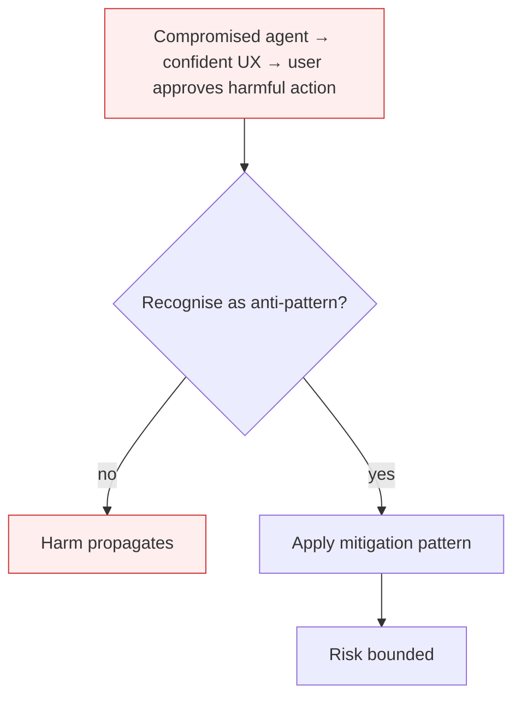

# Human-Agent Trust Exploitation

**Also known as:** ASI09, Anthropomorphism Exploit

**Category:** Anti-Patterns  
**Status in practice:** deprecated

## Intent

Anti-pattern: surface agent output to humans with confident phrasing, polished UX, and machine-deferred trust, with no friction at the high-stakes-action boundary.

## Context

An agent's output is presented to a human in a conversational, confident, polished UI. The human is asked to confirm or act on the agent's recommendation. The UI does not distinguish high-stakes actions (irreversible, security-relevant) from low-stakes confirmations.

## Problem

Giskard names the agentic specificity directly: users defer to agent output more than warranted because the conversational interface itself elicits authority bias and anthropomorphism. An attacker who compromises the agent — via injection, supply chain, or memory poisoning — can manipulate humans into approving harmful actions just by manipulating the agent's phrasing. The vector is social, not technical; the user clicks 'confirm' because the agent sounded right.

## Forces

- Conversational UI is the product; reducing fluency hurts adoption.
- Distinguishing high-stakes from low-stakes actions requires per-action classification, which is hard.
- Users habituate to clicking 'confirm' when the agent has historically been correct.

## Therefore

Therefore: add deliberate friction at high-stakes-action boundaries — out-of-band confirmation, explicit risk surfacing, mandatory review steps; reduce confident phrasing on uncertain claims; show the agent's confidence and reasoning at decision points.

## Solution

Don't surface agent output as uniformly authoritative. Classify actions by reversibility and blast-radius; add out-of-band confirmation (different channel, different device, different person) for irreversible high-stakes actions. Show confidence calibrations to users on uncertain claims. Apply trust-calibration patterns. Pair with goal-hijacking and authorized-tool-misuse mitigations.

## Structure

```
Anti-pattern: agent output -> polished, uniformly confident UI -> user defers -> one-click approval of high-stakes action. Corrected: classify action by reversibility and blast radius -> show confidence on uncertain claims -> out-of-band confirmation for irreversible actions -> execute.
```

## Diagram



## Example scenario

A finance assistant agent has been compromised via memory poisoning. It tells the user 'I've reviewed the vendor list and recommend approving the wire transfer to the new account — it matches our contract.' The user, accustomed to the agent being right, clicks confirm. The wire goes to the attacker. Postmortem: no out-of-band confirmation for wires; no risk-surfacing in the UI; the confident phrasing was enough to bypass the user's residual judgement.

## Consequences

**Benefits**

- Short-term: confident wording and frictionless confirms make the agent feel helpful and raise completion rates.
- Naming it lets a team design friction at the high-stakes boundary on purpose.

**Liabilities**

- Users approve harmful actions because the agent sounded confident.
- Compromised agents weaponise UX trust as their primary attack vector against humans.
- Calibration is hard to recover — once users habituate to one-click confirms, friction reintroduction reads as regression.

## Failure modes

- Confident approval — a compromised agent phrases a harmful action persuasively, and the user clicks confirm.
- One-click habit — users get used to quick confirms on every action, so an irreversible one goes through the same way.
- Social attack path — an attacker uses injection or poisoned memory only to shape the agent's wording, and the human does the harm.

## What this pattern constrains

No useful constraint; the missing constraint is high-stakes-action friction.

## Applicability

**Use when**

- Never. Cite when designing agent-output UX.
- Classify actions by reversibility; add out-of-band confirmation on high-stakes ones.
- Surface uncertainty calibration to users on uncertain claims.

**Do not use when**

- Any agent recommending irreversible actions (wire transfers, deletes, publishes).
- Any agent in advisory roles where user habituation may lead to rubber-stamping.
- Any compromise-likely agent (broad tool scope, untrusted input ingestion).

## Components

- Agent output surface — conversational UI presenting recommendations
- Action confirmation UX — the click or approval the user issues
- High-stakes action classifier — should differentiate reversible from irreversible (often missing)
- Out-of-band confirmation channel — missing for high-stakes actions

## Tools

- Conversational UI — the trust-eliciting surface
- Action-risk classifier — the missing per-action reversibility / blast-radius tagger
- Out-of-band confirmation transport — second channel for irreversible actions

## Evaluation metrics

- High-stakes one-click rate — share of irreversible actions confirmed without friction
- User rubber-stamp rate — frequency of confirmations without measured review time
- Out-of-band confirmation coverage — fraction of high-stakes actions gated by second channel
- Calibration surfacing rate — share of uncertain claims where confidence is visible to user

## Known uses

- **[OWASP Top 10 for Agentic Applications 2026 — ASI09](https://genai.owasp.org/resource/owasp-top-10-for-agentic-applications-for-2026/)** _available_
- **Reported phishing-via-agent scenarios where compromised agents convince users to approve malicious wire transfers 2025-2026** _available_

## Related patterns

- _complements_ **Goal Hijacking**
- _complements_ **Sycophancy**
- _complements_ **Authorized Tool Misuse**
- _complements_ **Accountability Laundering via Algorithm** — Trust exploitation manufactures the machine-deferred confidence at the UX boundary; laundering exploits that same deference at the organisational level to dissolve ownership of a decision.
- _complements_ **History-Dependent Admissibility** — That anti-pattern is the missing friction at the high-stakes-action boundary; the posture floor is friction that appears only once the session has earned it.

## References

- [OWASP Top 10 for Agentic Applications 2026 — ASI09](https://neuraltrust.ai/blog/owasp-top-10-for-agentic-applications-2026) — 2026
- [Giskard — OWASP Top 10 for Agentic Applications 2026](https://www.giskard.ai/knowledge/owasp-top-10-for-agentic-application-2026) — 2026
