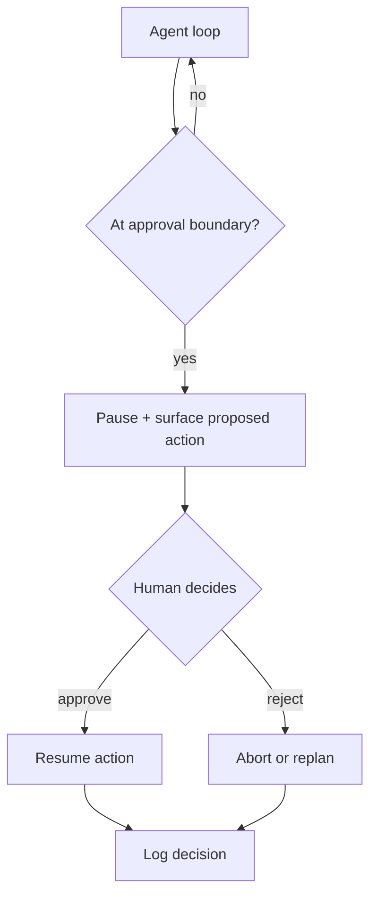

# Human-in-the-Loop

**Also known as:** HITL, Approval Gate, Confirmation Step, Risky Action Gate, Destructive Action Confirmation, Ask Before Risky Action

**Category:** Safety & Control  
**Status in practice:** mature

## Intent

Require explicit human approval at defined points before the agent performs an action.

## Context

A team runs an agent that can take consequential actions on the user's behalf — moving money, deleting files, sending public messages, deploying code, changing production configuration. The agent is correct most of the time but the cost of being wrong on certain action classes (an irreversible payment, a public broadcast, a destructive write) is much higher than the cost of pausing for a human to confirm. Some of those action classes also carry regulatory weight: the operator must be able to show that a human approved the step.

## Problem

If the agent acts fully autonomously across all action classes, then any moment of model overconfidence becomes a real-world incident: a typo-squatted vendor gets paid, the wrong customer gets emailed, the production database loses a table. If the agent gates every action behind human approval, users get approval-fatigued, start clicking through prompts without reading them, and the gating stops protecting anyone. Without a way to single out the small set of action classes that genuinely warrant a pause, the team has to choose between unsafe autonomy and unusable friction.

## Forces

- Where to place the gate trades latency and friction for safety.
- Approval-fatigue: too many gates train users to click through.
- Asynchronous approval stalls the loop.

## Therefore

Therefore: pause the loop at a defined risk boundary and require an explicit approve or reject from a human before the action runs, so that consequence and confidence are decoupled at the moments that matter.

## Solution

Identify the boundary. Pause the loop. Surface the proposed action with enough context for the human to decide. Require an explicit approve/reject. Resume on approve; abort or replan on reject. Log the decision.

## Structure

```
Agent loop --at approval boundary--> Pause + surface proposed action with context --> Human decides --approve--> Resume action | --reject--> Abort or replan; both --> Log decision
```

## Diagram



## Example scenario

A finance ops agent automates supplier payments end to end. After an incident where it paid $42k to a typo-squatted vendor domain, the team installs human-in-the-loop at the payment-execution boundary: the agent prepares the full payment proposal, surfaces vendor name, amount, IBAN, and the source invoice, then pauses for an explicit approve or reject from the on-call operator. Reject sends the proposal back for replan. The decision and the operator id are logged. Auto-payments resume but the bad-vendor class of incident stops.

## Consequences

**Benefits**

- Risk drops to a level the system can defend.
- Decision log captures human judgement that can later train an automated gate.

**Liabilities**

- User experience friction.
- Synchronous gates break async agents.

## Failure modes

- Approval fatigue — the boundary is drawn too wide, prompts arrive constantly, and the human approves without reading.
- Thin context — the surfaced proposal lacks what the human needs to judge it, so the decision is a guess either way.
- Blocked async run — a synchronous gate fires in a background agent with no one watching, and the whole job waits for hours.

## What this pattern constrains

The defined action class cannot proceed without an affirmative approval signal.

## Applicability

**Use when**

- Action consequences at a defined boundary are too costly to leave to the model alone.
- A human reviewer is reachable within the latency budget the workflow allows.
- Approve, reject, and resume semantics can be expressed cleanly in the agent loop.

**Do not use when**

- Decisions must be made in unattended or sub-second autonomous settings.
- Volume is too high for human review to keep up without becoming a rubber stamp.
- Risk per action is small enough that automated guardrails are sufficient.

## Components

- Approval boundary — defined risk gate where the loop pauses for human review
- Action proposal surface — UI that renders the pending action with enough context to decide
- Human Reviewer — explicit approver who returns an approve or reject signal
- Decision log — record of action, reviewer id, and verdict for audit and future automation

## Tools

- Pause-and-resume primitive — loop control that suspends execution awaiting a signal
- Audit log — append-only store of decisions and reviewer identity

## Evaluation metrics

- Approval-fatigue rate — share of approvals granted faster than reading time
- Override correctness — fraction of human rejections where the agent's proposal was wrong
- Latency added by the gate — wall-clock delay between proposal and execution
- Gated-action incident rate — production incidents traced to actions that passed the gate

## Known uses

- **Knitting-DSL Pipeline (Stash2Go)** _available_ — Opt-in fixer: user clicks to invoke.
- **Bobbin (Stash2Go)** _planned_ — On destructive writes (project create, queue add, stash subtract).
- **[Sparrot](https://marco-nissen.com/sparrot/)** _available_ — The human partner (Marco) is wired into the loop as a deliberate participant — wish queue, atelier inbox, approval gates — not as a customer or a controller.

## Related patterns

- _complements_ **Step Budget**
- _generalises_ **Cost Gating**
- _generalises_ **Approval Queue**
- _generalises_ **Disambiguation**
- _complements_ **Compensating Action**
- _alternative-to_ **Conversation Handoff to Human**
- _alternative-to_ **Communicative Dehallucination**
- _complements_ **Policy-as-Code Gate**
- _complements_ **Simulate Before Actuate**
- _complements_ **Socratic Questioning Agent**
- _complements_ **Dry-Run Harness**
- _generalises_ **Synchronous Execution-Plan Confirmation**
- _complements_ **Pipeline Triad Pattern**
- _generalises_ **Human Reflection**
- _complements_ **Context Gap (Security)**
- _complements_ **Constrained Adaptability**
- _generalises_ **Two Human Touchpoints**
- _complements_ **Priority Matrix (Conflict Resolution)**
- _complements_ **Confidence-Checking Workflow**
- _used-by_ **crawl-walk-run-automation-gating**
- _used-by_ **Progressive Delegation**
- _complements_ **Autonomy Slider**
- _complements_ **Corrigible Off-Switch Incentive**
- _used-by_ **Cost-Aware Action Delegation**
- _complements_ **Generative UI** — Human-in-the-loop confirmation steps are rendered as generative-UI components and routed back to the agent.
- _complements_ **Risk-Tiered Action Autonomy** — Human-in-the-loop is the mechanism; risk-tiering decides which tier requires it.
- _used-by_ **Calibrated Help-Gate via Conformal Prediction** — When the prediction set is not a singleton the gate invokes a human to choose the action.
- _conflicts-with_ **Accountability Laundering via Algorithm** — Genuine human-in-the-loop requires a reviewer who can and does override; laundering keeps the reviewer for form while collapsing review into a rubber stamp, subverting the safeguard it imitates.
- _complements_ **Scope-of-Practice Boundary Gate** — A licensed human attached to the session is what unlocks a gated act; the gate decides which acts require that human and which are general information.
- _complements_ **Mandatory Red-Flag Escalation** — Human-in-the-loop gates a planned action on approval; this aborts the whole flow on a detected signal rather than pausing one step for sign-off.
- _complements_ **Change-Freeze-Aware Action Gate** — A freeze converts otherwise-autonomous actions into ones that need explicit human re-authorisation for the duration of the window.
- _complements_ **Deployment-Correlated Rollback Gate** — When no deploy correlates with the failure, the gate falls back to human judgement rather than autonomous rollback.
- _complements_ **Advisory-to-Mandate Escalation** — Human-in-the-loop keeps a human approval point; advisory-to-mandate is the failure where the human is nominally in the loop but punished for exercising judgement against the output.
- _complements_ **Action-Admissibility Tiering** — The escalation obligation inside the admissibility tier routes an action to a human principal when causal understanding is insufficient rather than letting the agent proceed on a weak story.
- _conflicts-with_ **Oversight as Legitimation** — Human-in-the-loop assumes a reviewer who can and does refuse; this anti-pattern keeps the checkpoint while removing every condition that makes refusal possible, so the safeguard it imitates is the one it defeats.
- _complements_ **Semantic Decision Node** — The abstain band between the two thresholds is where a human approval step belongs.

## References

- [LangGraph: Human-in-the-Loop](https://langchain-ai.github.io/langgraph/concepts/human_in_the_loop/)
- [Agent design pattern catalogue: A collection of architectural patterns for foundation model based agents](https://doi.org/10.1016/j.jss.2024.112278) — Yue Liu, Sin Kit Lo, Qinghua Lu, Liming Zhu, Dehai Zhao, Xiwei Xu, Stefan Harrer, Jon Whittle, 2025
