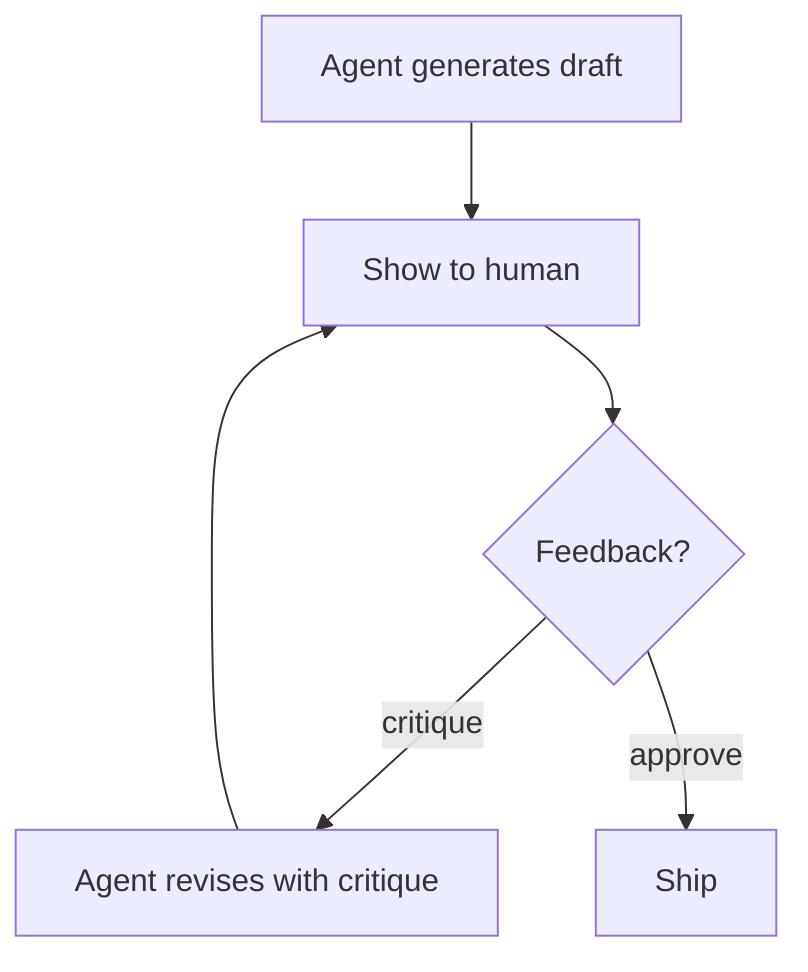

# Human Reflection

**Also known as:** Human-Critique-In-Reflection-Loop, Human-Feedback Refinement

**Category:** Verification & Reflection  
**Status in practice:** emerging

## Intent

Reflection loop that explicitly collects human feedback (not approval) on agent plans to improve them, distinct from approval gates where the human only says yes/no.

## Context

A team has an agent that produces plans, drafts, or analyses. Human-in-the-loop is in place but limited to approving or rejecting the final output. Humans see the output but cannot easily inject critique that the agent must act on.

## Problem

Yes/no approval underuses the human's expertise. A reviewer often knows *why* something is wrong and could improve it with a suggestion, but the approval workflow has no channel for that suggestion to become an agent revision. The agent ships approved-but-imperfect outputs; the reviewer takes the burden of editing manually.

## Forces

- Pure approval workflows are simpler and faster than feedback loops.
- Human feedback adds latency to the production cycle.
- Feedback quality varies — agents must handle low-signal feedback gracefully.

## Therefore

Therefore: provide a structured feedback channel (not yes/no but free-form-critique) that the agent ingests as a critique input to a reflection revision; treat humans as critics in the reflection loop, not just approvers at the gate.

## Solution

Render agent output to the human with a structured feedback widget (critique text + optional structured fields like 'wrong section', 'missing claim'). On submit, the agent ingests the feedback as a critique and produces a revision. Loop until human approves OR loop budget exhausts. Differs from approval-queue (yes/no) and from human-in-the-loop (which subsumes both). Pair with reflection, frozen-rubric-reflection, approval-queue.

## Structure

```
Agent drafts -> show to human with structured feedback widget (critique text + fields like wrong section, missing claim) --critique--> agent revises -> show again ... --approve or loop budget spent--> ship
```

## Diagram



## Example scenario

A research-summary agent produces a draft for a senior analyst. Instead of {approve, reject}, the UI shows the draft with a critique widget. Analyst writes 'the methodology section omits the control group'. The agent ingests the critique and emits a revised draft. Three rounds. The third draft is approved. The captured critiques feed a quarterly rubric update.

## Consequences

**Benefits**

- Captures human expertise as agent training signal, not just as final-edit work.
- Reduces 'approved-but-imperfect' shipped outputs.
- Human feedback over time can be aggregated into improved rubrics.

**Liabilities**

- Adds latency on every reflection cycle that needs human input.
- Feedback quality varies; agents must handle vague or contradictory feedback.
- Risk of unbounded loops if human keeps requesting revisions.

## Failure modes

- Endless revision — the human keeps asking for changes, the loop budget is missing or too high, and the draft never ships.
- Vague feedback — the critique says only that something is off, and the agent guesses at a revision that misses the point.
- Contradictory rounds — feedback in one round reverses the last, and the agent swings between versions.
- Feedback as approval — the agent treats any submitted comment as a yes, and ships without acting on the critique.

## What this pattern constrains

The agent must treat human feedback as a critique input subject to revision, not as a binary signal; a loop budget caps the number of revision rounds.

## Applicability

**Use when**

- Human expertise is the relevant quality signal.
- Latency budget allows for one or more revision rounds.
- Critique text can be ingested by the agent as input to revision.

**Do not use when**

- Pure approval is sufficient (binary yes/no signal).
- Latency budget allows no revision rounds.
- Human time is scarce and binary triage is the realistic option.

## Components

- Draft generator — agent produces initial output
- Critique widget — UI for free-form + structured human feedback
- Reviser — agent ingests critique and produces revision
- Loop budget — caps revision rounds
- Critique aggregator — captures patterns over time for rubric updates

## Tools

- Draft renderer with critique widget
- Reviser — agent that ingests critique into revision
- Loop budget tracker

## Evaluation metrics

- Revision rounds per draft
- Approval-on-first-draft rate
- Captured critique themes — feeds rubric updates

## Known uses

- **[elcamy: 【論文紹介】LLMベースのAIエージェントのデザインパターン18選](https://blog.elcamy.com/posts/20431baf/)** _available_

## Related patterns

- _specialises_ **Human-in-the-Loop**
- _specialises_ **Reflection**
- _alternative-to_ **Approval Queue**
- _complements_ **Frozen Rubric Reflection**
- _complements_ **Evaluator-Optimizer**
- _complements_ **Confidence-Checking Workflow**
- _complements_ **Cooperative Preference Inference**

## References

- [【論文紹介】LLMベースのAIエージェントのデザインパターン18選](https://blog.elcamy.com/posts/20431baf/) — 2026
