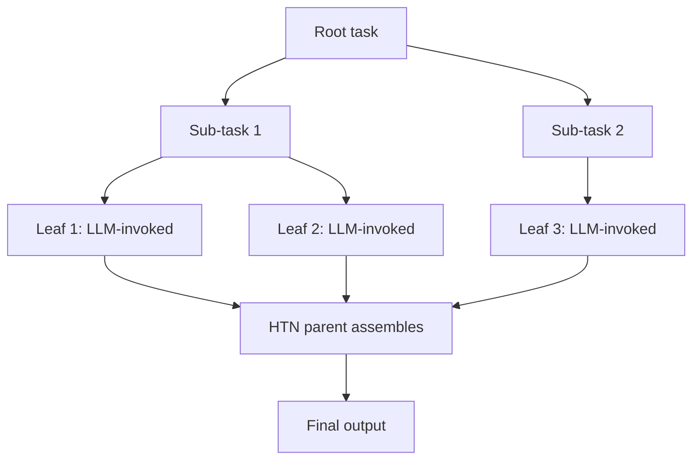

# Hybrid HTN + Generative Agent

**Also known as:** HTN-Backbone Generative Agent, Hierarchical-Task-Network Hybrid

**Category:** Planning & Control Flow  
**Status in practice:** emerging

## Intent

Hierarchical Task Network decomposition provides the procedural backbone; the generative LLM is invoked only at leaf nodes for the parts of the task that are genuinely open-ended.

## Context

A team has a task whose structure is well-known (HTN-style decomposition exists) but whose leaves require open-ended language understanding or generation. Pure LLM-driven planning re-invents the structure each run; pure HTN cannot handle the open-ended leaves.

## Problem

Pure-LLM planning is expensive and inconsistent for tasks with known structure. Pure HTN cannot handle the leaves that require natural-language reasoning. Neither alone fits tasks with both well-known structure and open-ended leaves.

## Forces

- HTN backbone requires upfront task decomposition.
- Generative leaves are unpredictable; HTN expectations may not match.
- Hybrid increases system complexity — two planning paradigms in one agent.

## Therefore

Therefore: HTN backbone provides the procedural structure (decomposition into sub-tasks); generative LLM is invoked only at the leaves whose work is genuinely open-ended.

## Solution

HTN decomposition specifies the task structure: root task → sub-tasks → ... → leaves. Internal nodes are deterministic decomposition (no LLM). Leaf nodes invoke the LLM for the open-ended work (drafting text, classifying ambiguous input, summarizing). LLM outputs at leaves feed back into the HTN structure (parent nodes assemble leaf outputs). Pair with goal-decomposition, hierarchical-agents, deterministic-control-flow-not-prompt, plan-and-execute.

## Structure

```
Root task --deterministic HTN decomposition--> sub-tasks --> ... --> leaves --Leaf invoker--> LLM (draft / classify / summarise, per leaf-output schema) --> Parent assembler combines leaf outputs --> Final output
```

## Diagram



## Example scenario

A legal-research agent's task decomposes via HTN: research-question → [find-cases, find-statutes, find-commentary] → [for each: search, filter, summarize]. HTN structure is fixed. At each leaf (e.g. 'summarize this case'), the LLM is invoked. Parent nodes assemble leaf summaries deterministically. Pure LLM planning would re-invent this decomposition every run; pure HTN couldn't summarize.

## Consequences

**Benefits**

- Combines deterministic structure (HTN) with generative flexibility (LLM at leaves).
- Cheaper than pure-LLM planning (LLM only at leaves).
- More flexible than pure HTN (handles open-ended leaves).

**Liabilities**

- HTN decomposition is upfront engineering work.
- Two paradigms in one agent — more complex to maintain.
- LLM outputs must conform to what parent HTN nodes expect.

## Failure modes

- Leaf schema mismatch — an LLM leaf returns text in a shape the parent node does not expect, and assembly fails or drops content.
- LLM in the backbone — an interior node starts calling the LLM for convenience, and the deterministic structure becomes inconsistent.
- Rigid decomposition — the HTN has no method for a new task variant, and the agent cannot handle it at all.
- Split maintenance — the HTN and the leaf prompts are changed separately, and they stop agreeing on what each leaf produces.

## What this pattern constrains

HTN decomposition is deterministic; LLM invocation is restricted to leaf nodes; non-leaf nodes may not invoke the LLM.

## Applicability

**Use when**

- Task structure is well-known and decomposable as HTN.
- Leaves require open-ended natural-language work.
- Cost or consistency matters enough to justify HTN engineering.

**Do not use when**

- Task structure is unknown or highly variable.
- Pure-LLM planning is good enough at the cost.
- No engineering capacity for HTN authoring.

## Components

- HTN decomposition — deterministic task structure
- Leaf invoker — calls LLM only at HTN leaves
- Parent assembler — combines leaf outputs deterministically
- Leaf-output schema — what each leaf must produce for parent assembly

## Tools

- HTN authoring tool
- Leaf-invoker — calls LLM at HTN leaves
- Parent assembler

## Evaluation metrics

- Leaf invocation rate — share of nodes that call LLM
- HTN depth distribution
- Cost vs pure-LLM planning

## Known uses

- **[aissentials (Dutch): Wat zijn agentic LLM's en hoe transformeren ze AI](https://aissentials.nl/agentic-llms/)** _available_

## Related patterns

- _complements_ **Goal Decomposition**
- _complements_ **Hierarchical Agents**
- _complements_ **Deterministic Control Flow, Not Prompt**
- _alternative-to_ **Plan-and-Execute**
- _complements_ **Hybrid Symbolic-Neural Routing**

## References

- [Wat zijn agentic LLM's en hoe transformeren ze AI](https://aissentials.nl/agentic-llms/) — 2026
