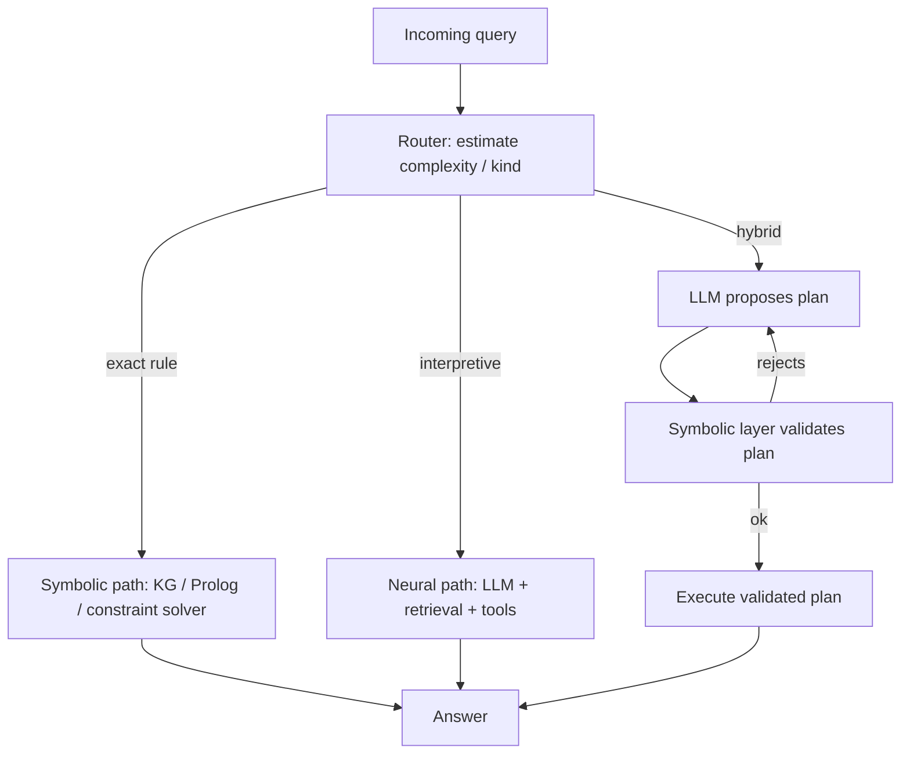

# Hybrid Symbolic-Neural Routing

**Also known as:** Neuro-Symbolic Routing, Symbolic/Neural Hybrid, ハイブリッド・シンボリック・ニューラル

**Category:** Routing & Composition  
**Status in practice:** emerging

## Intent

Per query, route between a symbolic path (rule engine, knowledge graph) and a neural path (LLM), using the LLM for interpretation and the symbolic layer for exact constraints.

## Context

An agent serves a mixed workload: some queries are inherently logical (tax rules, dosage limits, schema validation, eligibility checks) where a wrong answer is unacceptable; other queries are inherently interpretive (free-text intent, summarization, ranking) where exact rules do not exist. Sending everything to the LLM costs accuracy on the logical queries; sending everything to a rule engine is impossible for the interpretive ones.

## Problem

LLMs are bad at exact constraint satisfaction at scale — they confabulate edge cases, lose track of conjunctions, and silently round numbers. Rule engines are bad at interpretation — they cannot handle free text. Yet most real workloads need both. A single path forces one of two losses: confabulated rule violations from the LLM path, or brittle template-only coverage from the symbolic path. Recent practitioner write-ups (Japanese Qiita, Anthropic-style architecture posts) and the Nov 2025 arXiv preprint 'Bridging Symbolic Control and Neural Reasoning in LLM Agents' converge on per-query routing as the resolution: estimate complexity, decide where the query belongs, and only blend the two when neither pure path suffices.

## Forces

- Hard rules need verifiable execution; LLMs cannot give that guarantee without external enforcement.
- Interpretive queries need free-text understanding; rule engines cannot give that.
- Per-query routing is itself a model — a bad router collapses to either pure-LLM or pure-symbolic.
- Maintaining two stacks (LLM + symbolic) doubles the surface for drift; the routing decision is also the boundary that has to be kept current.

## Therefore

Therefore: introduce an explicit router that classifies each query as symbolic, neural, or hybrid, runs it through the matching path, and is itself tested with both rule-satisfaction and interpretation benchmarks so the boundary does not silently move.

## Solution

Build three first-class components: (a) a symbolic path holding the rules, ontologies, and constraint solvers; (b) a neural path holding the LLM with retrieval, tools, and synthesis; (c) a router that estimates per-query complexity and resource needs and dispatches. For genuinely hybrid queries, the LLM proposes a plan that the symbolic layer validates and executes — the LLM never asserts the answer alone. Track router accuracy as a first-class metric; treat boundary drift as a regression.

## Structure

```
Query --> Router (estimate kind and complexity) --exact rule--> Symbolic path (KG / rules / solver) --> Answer | --interpretive--> Neural path (LLM + retrieval + tools) --> Answer | --hybrid--> LLM proposes plan --> Symbolic validator --ok--> Execute --> Answer; --reject--> LLM revises
```

## Diagram



## Example scenario

A medication-recommendation assistant takes free-text clinician queries. The router classifies each query: 'is amoxicillin contraindicated with X?' → symbolic path (drug-interaction graph, deterministic answer). 'Summarize this patient's last three visits' → neural path (LLM with retrieval). 'Patient is allergic to penicillin and on warfarin — what should I avoid?' → hybrid: LLM proposes candidate drugs, symbolic layer validates each against allergy + interaction rules and returns the filtered set. Router accuracy is tracked weekly; a regression on hard-rule queries triggers a rule-base refresh.

## Consequences

**Benefits**

- Hard constraints stay verifiable: violations are caught by the symbolic layer regardless of LLM phrasing.
- Free-text and ambiguous inputs still flow; the LLM is not removed, just contained.
- Cost can drop because the symbolic path is dramatically cheaper than an LLM call for queries that fit it.
- Failure modes become legible: a wrong answer is either a symbolic-rule miss or an LLM confabulation, not 'something happened'.

**Liabilities**

- Router accuracy becomes a load-bearing component; misrouting either confabulates rules or fails interpretation.
- Two stacks must be kept in sync; rule changes and prompt/tool changes both move the boundary.
- Hybrid queries (LLM-proposes, symbolic-validates) introduce latency and a new failure mode — the LLM proposing plans the symbolic layer cannot represent.

## Failure modes

- Misrouted constraint query — the router sends an exact-rule question to the neural path, and the LLM confabulates an edge case the rule engine would have caught.
- Misrouted free text — an interpretive query lands on the symbolic path, and the rule engine fails or returns a template answer that misses the point.
- Unrepresentable plan — in the hybrid case the LLM proposes plans the symbolic layer cannot express, and the propose-validate loop keeps rejecting without converging.
- Boundary drift — rules or prompts change on one stack only, and the router keeps sending queries to a path that can no longer handle them.

## What this pattern constrains

Forbids the LLM from asserting outputs that fall under the symbolic path's jurisdiction without symbolic validation. The router and symbolic layer together restrict the LLM's freedom to ungoverned interpretive and synthesis tasks.

## Applicability

**Use when**

- Workloads that mix hard-rule queries (tax, dosage, eligibility, schema) with free-text/interpretive queries.
- Domains where a single wrong rule-application is unacceptable and the rules can be represented symbolically.
- Cost regimes where the symbolic path is materially cheaper per query than the LLM path.
- Settings where a knowledge graph or rule base already exists and is maintained.

**Do not use when**

- Pure interpretive workloads (summarization, chat) where no symbolic representation of the rules exists.
- Workloads where the rules change too fast for the symbolic representation to keep up.
- Small deployments where maintaining two stacks costs more than the accuracy gain.
- Settings where router-quality cannot be measured — the routing decision becomes silent risk.

## Components

- Router — per-query classifier that picks symbolic / neural / hybrid path
- Symbolic path — rule engine, knowledge graph, constraint solver, ontology
- Neural path — LLM with retrieval, tools, synthesis
- Validator — symbolic check on LLM-proposed plans in the hybrid case
- Boundary monitor — flags drift between what the router sends symbolic vs what the symbolic layer can actually handle

## Tools

- Rule engine — Prolog, Answer Set Programming, Drools, custom DSL
- Knowledge graph store — Neo4j, RDF triple store, in-memory graph
- LLM with tool-use — the neural path
- Router classifier — small model or heuristic that scores per-query
- Router-accuracy harness — held-out labelled queries used to track router drift

## Evaluation metrics

- Router accuracy — share of queries routed to the path that produces the highest-quality answer on a held-out set
- Hard-rule violation rate — symbolic violations escaping past the validator
- Cost per query by path — should show meaningful savings on the symbolic path
- Hybrid-validation rejection rate — share of LLM-proposed plans rejected by the symbolic layer (high = LLM-symbolic mismatch growing)
- Boundary-drift rate — change over time in what the router classifies as symbolic vs neural for the same input class

## Known uses

- **[NeSyC — neuro-symbolic hypothesis induction with symbolic validation and continual trajectory monitoring](https://arxiv.org/pdf/2511.17673)** _available_
- **[Structured Cognitive Loop (Kim, 2025) — five-module R-CCAM design bridging expert-system principles with LLM capabilities](https://arxiv.org/abs/2511.17673)** _available_
- **[Cellular-X — retrieval-augmented, tool-centric agent with modular symbolic/neural routing for configuration generation](https://arxiv.org/abs/2504.13190)** _available_
- **[Reported in Japanese practitioner write-ups (Qiita syukan3 22-pattern survey, note.com makokon failure-modes analysis) as one of the operational design patterns under active use](https://qiita.com/syukan3/items/174e43235bde8a1a0694)** _available_

## Related patterns

- _specialises_ **Routing**
- _complements_ **Multi-Model Routing**
- _complements_ **Deterministic-LLM Sandwich** — the sandwich is one specific implementation when the symbolic layer brackets the LLM call
- _complements_ **World Model as Tool** — world-model-as-tool gives the LLM a callable simulator; here the symbolic layer is non-callable and authoritative
- _complements_ **Policy-as-Code Gate**
- _uses_ **Knowledge Graph Memory** — the symbolic path often reads from a knowledge graph
- _complements_ **Hybrid HTN + Generative Agent**
- _complements_ **BPMN/DMN Deterministic Shell Around Agent**
- _generalises_ **MRKL Systems (Modular Neuro-Symbolic)**
- _complements_ **Agent-to-Rule Distillation** — The hybrid router is the runtime seat of the pattern: promoted rules populate the symbolic path that short-circuits the neural one for matching inputs.
- _complements_ **Solver-Ready Formulation Handoff** — That picks a symbolic or a neural path per query; here both always run, in a fixed producer-and-decider order, with the model structurally barred from the decision.
- _complements_ **Semantic Decision Node** — Symbolic rules handle the conditions that can be written down; semantic decision nodes handle the rest inside the same code-owned structure.

## References

- [Bridging Symbolic Control and Neural Reasoning in LLM Agents](https://arxiv.org/pdf/2511.17673) — 2025
- [多様な AI エージェント設計パターン22選を比較](https://qiita.com/syukan3/items/174e43235bde8a1a0694) — 2025
- [LLMエージェントはなぜ失敗するのか？ 自律型AIのデバッグと改善手法](https://note.com/makokon/n/ne9b86a4cc82b) — 2025
