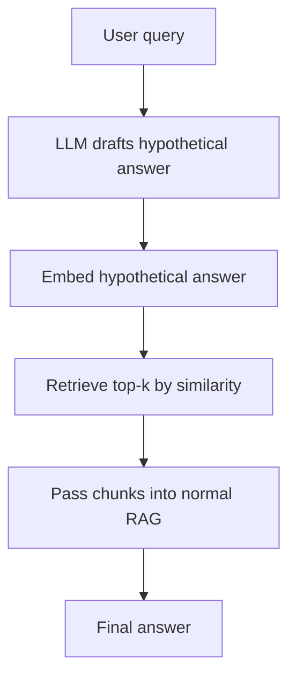

# HyDE

**Also known as:** Hypothetical Document Embeddings

**Category:** Retrieval & RAG  
**Status in practice:** emerging

## Intent

Have the LLM write a hypothetical answer document, embed it, and use it as the retrieval query.

## Context

A team is using dense vector retrieval to find documents that match user queries, but the queries are short and underspecified — often a few words — while the passages in the corpus are long, well-formed, and written in a different style. The team also does not have labelled query-document relevance pairs that would let them train a query encoder to bridge the asymmetry.

## Problem

Short queries embed far from long-form passages in the dense vector space because their length and style differ so much from the source text. Without supervised relevance pairs, the team cannot fine-tune a query encoder to close this gap, and zero-shot dense retrieval recall on short queries stays poor. They need a way to translate the user's short query into something that lives in the same neighbourhood of the embedding space as the target passages, using only the resources they already have on hand.

## Forces

- Hallucinated documents that miss the topic redirect retrieval badly.
- Adds an LLM call per query.
- Often paired with reranking to recover from off-topic hallucinations.

## Therefore

Therefore: have the LLM draft a hypothetical answer first and retrieve against its embedding, so that retrieval matches answer-shape, not just question-shape.

## Solution

On query: prompt the LLM to draft a hypothetical answer to the query. Embed the hypothetical answer. Retrieve top-k by similarity to that embedding (not the original query). Pass the retrieved chunks into normal RAG.

## Structure

```
User query --> LLM drafts hypothetical answer --> Embed hypothetical answer --> Vector index similarity search --top-k chunks--> (optional reranker) --> Normal RAG generation --> Answer
```

## Diagram



## Example scenario

A documentation-search agent for a developer platform keeps missing relevant pages because users type three-word queries like 'rate limit auth' while the docs are written in long prose. The team adds HyDE: the LLM first drafts a hypothetical answer paragraph to the query, that paragraph is embedded, and retrieval runs against the answer-shaped embedding instead of the bare query. Recall on short queries jumps without changing the index, the encoder, or the docs.

## Consequences

**Benefits**

- Zero-shot improvement; no encoder fine-tuning.
- Particularly strong on short, underspecified queries.

**Liabilities**

- Off-topic hallucinations cause retrieval drift.
- One extra LLM call per query.

## Failure modes

- Off-topic hypothesis — the LLM drafts an answer about the wrong sense of an ambiguous query, and retrieval returns passages for that wrong topic.
- Confident false detail — the hypothetical answer invents a specific name or number, and retrieval favours passages that match the invention.
- Lost exact terms — the query's rare identifier is paraphrased away in the hypothetical answer, and the passage that contains it ranks low.
- Latency on easy queries — every query pays the extra drafting call, including long specific ones that would have retrieved well on their own.

## What this pattern constrains

Retrieval queries the index with the hypothetical answer's embedding, not the user query's embedding.

## Applicability

**Use when**

- Short user queries underperform on dense retrieval against long documents.
- An LLM call to draft a hypothetical answer fits the latency and cost budget.
- Recall on the first stage of RAG is the current bottleneck.

**Do not use when**

- Naive query embedding already retrieves the right chunks.
- Drafting hypothetical answers introduces unacceptable latency.
- The corpus or query distribution makes hallucinated drafts misleading anchors.

## Components

- Hypothetical-answer drafter — LLM that turns the short query into an answer-shaped paragraph
- Embedding model — produces the dense vector for the hypothetical answer used as the retrieval query
- Vector index — receives the hypothetical-answer embedding rather than the user-query embedding
- Downstream RAG pipeline — consumes the retrieved chunks as in any naive RAG flow

## Tools

- LLM API — one extra call per query to draft the hypothetical answer
- Embedding model — same encoder that indexed the corpus, applied to the drafted answer
- Vector index — dense retrieval backend over the corpus

## Evaluation metrics

- Recall@k uplift on short queries vs query-embedding baseline — the metric this pattern targets
- Off-topic drift rate — share of hypothetical drafts that pull retrieval away from the gold neighbourhood
- Added latency per query — cost of the extra LLM call relative to direct query embedding
- Hybrid-HyDE win rate — does averaging the draft and query embeddings beat single-draft on this corpus

## Known uses

- **LangChain HyDE retriever** _available_

## Related patterns

- _specialises_ **Naive RAG**
- _composes-with_ **Cross-Encoder Reranking**
- _alternative-to_ **Query Rewriting**

## References

- [Precise Zero-Shot Dense Retrieval without Relevance Labels](https://arxiv.org/abs/2212.10496) — Gao, Ma, Lin, Callan, 2022
