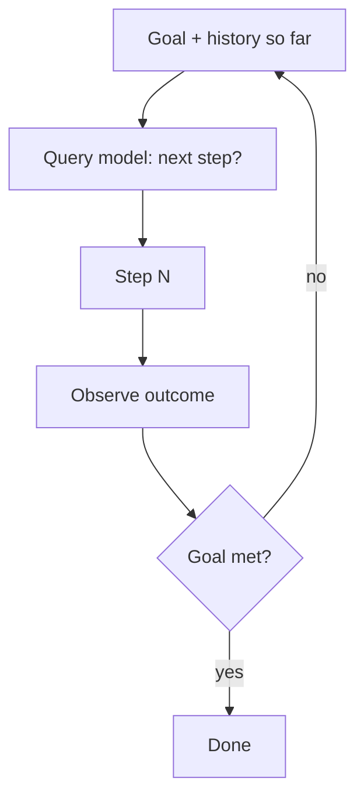

# Incremental Model Querying

**Also known as:** Step-By-Step Plan Generation, Sequential Model Plan

**Category:** Planning & Control Flow  
**Status in practice:** mature

## Intent

Generate plan steps by sequentially querying the model at each step rather than producing the whole plan upfront in one call.

## Context

A team has an agent that must produce a multi-step plan to achieve a goal. The team has the choice of either querying the model once for the full plan (one-shot) or querying step-by-step (incremental).

## Problem

One-shot plan generation forces the model to commit to all steps before seeing the consequences of any. When the world is uncertain or earlier steps reveal new information, the one-shot plan is wrong from step 2 onward. Incremental querying is better but is often unnamed as a deliberate alternative.

## Forces

- Incremental querying is N× more model calls than one-shot.
- Per-step context grows as prior step results accumulate.
- Some tasks need a complete plan upfront (commitment, parallelization).

## Therefore

Therefore: name incremental model querying as a deliberate planning shape — model is invoked at each step with the accumulated context, producing one step at a time, opposite of one-shot model querying.

## Solution

At each plan step, query the model with (goal, history-of-steps-so-far, current-observation) and receive only the next step. Execute the step. Observe. Repeat until goal-met or budget exhausted. Distinct from one-shot model querying (whole plan in one call) and from multi-path plan generation (which generates multiple next-step candidates at each node). Pair with single-path-plan-generator, multi-path-plan-generator, react, plan-and-execute.

## Structure

```
Goal + history so far + current observation --> query model for next step --> execute step --> observe outcome --> history accumulator --goal not met and budget left--> query again. Termination check --goal met / budget exhausted--> done
```

## Diagram



## Example scenario

A debugging agent troubleshoots a flaky test. With one-shot planning, it generates 8 steps upfront based on the initial error message; steps 4-8 turn out wrong once step 1 reveals the actual root cause. With incremental querying, the agent runs step 1 (read the test), observes (sees an undocumented dependency), then asks the model 'next step?' which adjusts to investigate the dependency. The plan adapts to what the world reveals.

## Consequences

**Benefits**

- Plan can react to step-by-step observations.
- Errors in early steps do not contaminate later steps' planning.
- Per-step latency is bounded by one model call's latency, not the full plan's.

**Liabilities**

- N× model calls vs one-shot.
- Per-step context grows with accumulated history.
- Cannot parallelize steps the model has not yet planned.

## Failure modes

- History bloat — each step's query carries all prior steps and outcomes, and late steps run on an overlong context.
- Call multiplication — every step is a separate model call, and a long task costs many times a one-shot plan.
- Lost direction — the model sees only the next step, and a run drifts with no plan to show it left the goal.
- No parallelism — independent steps still wait for each other because none is planned until the previous one finishes.

## What this pattern constrains

The model never sees beyond the current step in its planning context; one-shot whole-plan queries are excluded.

## Applicability

**Use when**

- Plans depend on observations not available at planning time.
- Cost of N× model calls is acceptable for the adaptivity gain.
- Steps cannot be parallelized in advance.

**Do not use when**

- Plan is well-known and parallelizable in advance (use one-shot).
- Per-step latency is unacceptable.
- Cost budget cannot absorb N× calls.

## Components

- Per-step model invoker — produces one step at a time
- History accumulator — prior steps + outcomes
- Observation collector — feeds back into next-step query
- Termination check — goal-met or budget-exhausted

## Tools

- LLM API — invoked at each step
- Per-step history accumulator
- Termination check

## Evaluation metrics

- Steps per plan distribution
- Plan-adjustment rate (mid-plan revisions)
- Cost vs one-shot plan generation

## Known uses

- **[elcamy: 【論文紹介】LLMベースのAIエージェントのデザインパターン18選](https://blog.elcamy.com/posts/20431baf/)** _available_

## Related patterns

- _complements_ **ReAct**
- _alternative-to_ **Plan-and-Execute**
- _complements_ **Single-Path Plan Generator**
- _complements_ **Multi-Path Plan Generator**
- _complements_ **Replan on Failure**

## References

- [【論文紹介】LLMベースのAIエージェントのデザインパターン18選](https://blog.elcamy.com/posts/20431baf/) — 2026
