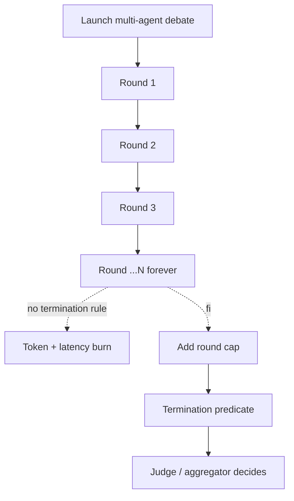

# Infinite Debate

**Also known as:** Stuck Multi-Agent, Convergence Failure, Agents Stuck Talking, Multi-Agent Loop

**Category:** Anti-Patterns  
**Status in practice:** deprecated

## Intent

Anti-pattern: launch multi-agent debate without a termination rule and watch the agents loop forever.

## Context

A team sets up a multi-agent debate or consensus pattern — for example a proponent, a skeptic, and a synthesiser — so that several agents argue a question before producing a final answer. The orchestrator is written with the assumption that the agents will eventually agree on their own and the loop will naturally end. There is no explicit round cap, no judge that emits a terminal verdict, and no measurable convergence signal between rounds.

## Problem

Without a termination rule, debate converges only by accident; far more often the agents keep finding new angles to disagree on, restate prior positions, or politely circle the same point indefinitely. Token cost and latency grow linearly with rounds while real progress on the answer stalls, and the loop ends only when an outer cost limiter or a timeout intervenes. The team is left with an expensive run, no decision, and no clean way to tell whether two more rounds would have helped.

## Forces

- Consensus heuristics are easy to game.
- Round caps cut off legitimate convergence.
- Judge agents become the new bottleneck.

## Therefore

Therefore: cap rounds explicitly and pair debate with a judge or aggregator that emits a terminal verdict, so that convergence is decided by a rule instead of by the cost limiter kicking in.

## Solution

Don't. Add a round cap and a termination predicate. Pair debate with a judge or aggregator. See debate, step-budget, the-stop-hook.

## Structure

```
Anti-pattern: debaters exchange arguments -> no termination rule -> rounds continue -> stopped by timeout or cost limit. Corrected: debaters -> round cap + termination predicate -> judge or aggregator -> answer.
```

## Diagram



## Example scenario

A research team sets up a three-agent debate to answer policy questions: a proponent, a skeptic, and a synthesiser. They forget to add a termination rule. The first run burns through 90 minutes and $34 of tokens with the proponent and skeptic still circling each other when an engineer kills the process. They name the failure infinite-debate and add a round cap of six exchanges plus a judge that emits 'agreement', 'irreducible-disagreement', or 'continue', with continue allowed at most once. Cost becomes predictable.

## Consequences

**Benefits**

- Short-term: an open-ended debate is easy to set up and seems likely to reach a better answer with more rounds.
- Naming it lets a team require a stop rule and a judge for every debate setup.

**Liabilities**

- Cost blow-up.
- User-visible non-termination.

## Failure modes

- Endless circling — agents restate earlier positions round after round, and no answer emerges.
- Timeout as decision — the run ends only when an outer cost limit or timeout cuts it, leaving no result.
- Cost without progress — token spend grows with every round while the answer stays where it was.

## What this pattern constrains

Avoiding it imposes a termination rule: multi-agent debate must not run without a round cap and an explicit stop predicate, and the verdict cannot be left to the debaters themselves.

## Applicability

**Use when**

- Cite this entry when a debate loop has no round cap or termination predicate.
- You are already here if debate transcripts grow until the budget runs out without converging.
- Add a round cap and a judge or aggregator (see debate, step-budget, the-stop-hook).

**Do not use when**

- Any production setting with latency or cost SLOs.
- Any debate setup that lacks a judge or stop condition.
- Any task where progress cannot be measured between rounds.

## Components

- Debate participants — proponent, skeptic, and synthesiser exchanging rounds with no stop rule
- Orchestrator loop — assumes participants will agree on their own and exits only on agreement
- Missing judge or aggregator — would emit a terminal verdict at a fixed round
- Outer cost limiter — the only thing that eventually stops the run, after spend

## Tools

- Multi-agent runner — invokes each participant per round with no `max_rounds` cap
- Convergence signal — missing measurable predicate that would short-circuit the loop

## Evaluation metrics

- Turns-per-decision distribution — long tails flag debates that never converge organically
- Convergence-rate drop — fraction of debates that exit without a conclusion or only on cost-limit cutoff
- Tokens-per-resolved-question — climbs linearly with rounds while answer quality plateaus
- Wall-clock-to-verdict — distribution shows runs that crossed the latency budget without producing one

## Known uses

- **Early multi-agent demos in 2023-2024** _available_

## Related patterns

- _alternative-to_ **Debate**
- _alternative-to_ **Step Budget**
- _alternative-to_ **Stop Hook**
- _conflicts-with_ **Communicative Dehallucination**
- _complements_ **Decision Paralysis**

## References

- [ai-standards/ai-design-patterns (Infinite Debate)](https://github.com/ai-standards/ai-design-patterns)
