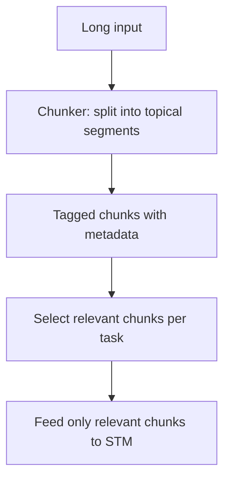

# Information Chunking for Agent Memory

**Also known as:** STM Chunking, Topical Segmentation for Memory

**Category:** Memory  
**Status in practice:** mature

## Intent

Structure inputs into digestible topical segments (chunks) before feeding to short-term memory rather than throwing the full input at the model; reduces overload and increases accuracy (~40% improvement observed in customer-service deployment).

## Context

An agent is given a long input — multi-turn conversation history, large document, multi-source context. The default is to dump it all into the model's context window and hope. STM is overwhelmed; attention diffuses across irrelevant content; response quality degrades.

## Problem

Unchunked inputs into STM trigger the context-window-dumb-zone and lost-in-the-middle effects: degradation that starts well before the nominal context limit. The model can't prioritize, attention mechanisms get confused, retrieval quality drops.

## Forces

- Chunking is an upstream preprocessing investment.
- Chunk boundaries require domain understanding — bad boundaries cut meaning in half.
- Per-domain chunking heuristics need design and maintenance.

## Therefore

Therefore: chunk inputs into topical segments before they enter STM; choose chunk size and boundaries to match how the agent will use the information, not how the source happens to be structured.

## Solution

Before feeding context into STM, run a chunker: split the input into topic-coherent, size-bounded segments. Tag each chunk with topic / source metadata so retrieval can prioritize. Feed only relevant chunks at decision time. Bornet's measured impact: 40% accuracy improvement in a customer-service deployment. Pair with context-window-packing, episodic-summaries, context-window-dumb-zone, contextual-retrieval.

## Structure

```
Long input --chunker (topic-coherent, size-bounded)--> Tagged chunks (topic, source) --select relevant per task--> Short-term memory --> Model
```

## Diagram



## Example scenario

A customer-service agent gets a 20-page case history before each call. Pre-chunking: full history into context, agent gives generic responses, 65% accuracy. Post-chunking: history split into topical segments (billing issues, technical complaints, account changes, escalations) with metadata; agent loads only relevant chunks for the current call topic. Accuracy climbs to 91%.

## Consequences

**Benefits**

- Measured accuracy lift (40% in Bornet's case) from chunking alone.
- STM attention focuses on relevant topical segments.
- Per-chunk metadata enables selective retrieval.

**Liabilities**

- Upstream chunking infrastructure to maintain.
- Bad boundaries cut meaning; chunker quality matters.
- Per-domain chunking heuristics require design.

## Failure modes

- Bad boundaries — the chunker splits a passage mid-thought, and neither half carries the meaning.
- Weak tags — chunks get vague topic metadata, so selection feeds the wrong segments to short-term memory.
- Bypass — a long input reaches short-term memory without passing the chunker, and overload returns.
- Domain mismatch — a chunking rule tuned for one domain is reused on another with very different text shapes.

## What this pattern constrains

No raw long input enters STM directly; all long inputs pass through the chunker first.

## Applicability

**Use when**

- Long inputs (multi-turn history, large documents).
- Topical structure exists in the input.
- Engineering capacity for chunker maintenance.

**Do not use when**

- Short inputs that fit without strain.
- Inputs with no topical structure (cut anywhere is bad).
- Latency-critical paths where chunking step adds too much overhead.

## Components

- Chunker — topical segmentation with size bounds
- Chunk metadata tagger — topic, source, freshness
- Chunk selector — picks relevant chunks per task
- STM loader — feeds only selected chunks

## Tools

- Chunker (topical segmentation)
- Chunk metadata tagger
- Chunk selector
- STM loader

## Evaluation metrics

- Chunking-vs-baseline accuracy delta
- Per-chunk relevance score
- STM-overload incidents post-chunking

## Known uses

- **[Bornet et al. — Agentic Artificial Intelligence, Chapter 7 (customer-service case, ~40% accuracy improvement)](https://www.worldscientific.com/worldscibooks/10.1142/14380)** _available_

## Related patterns

- _complements_ **Context Window Packing**
- _complements_ **Episodic Summaries**
- _complements_ **Context Window Dumb-Zone Cap**
- _complements_ **Contextual Retrieval**
- _complements_ **Lost in the Middle (Positional Bias)**
- _complements_ **Landmark Attention**
- _alternative-to_ **Lost in the Middle (Positional Bias)**

## References

- [Agentic Artificial Intelligence — Chapter 7](https://www.worldscientific.com/worldscibooks/10.1142/14380) — 2025
