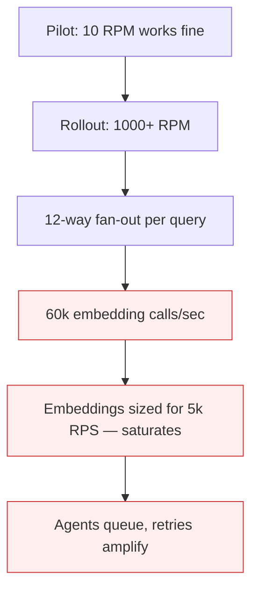

# Infrastructure Burst Bottleneck (Agent Scale-Out)

**Also known as:** Agent-Triggered Infra Saturation, Burst-Capacity Cliff

**Category:** Anti-Patterns  
**Status in practice:** deprecated

## Intent

Anti-pattern: deploy agents whose scale-out behavior triggers sudden data-and-compute bursts that on-prem or under-provisioned cloud infrastructure cannot absorb; agents work at small scale and freeze in production.

## Context

An organization moves a successful pilot agent to wide rollout. The agent's bursty workload pattern (parallel sub-agents, fan-out tool calls, large context loads) saturates underlying databases, vector stores, embedding services, or model gateways. Less than 30% of enterprises have infrastructure that flexes elastically to absorb the burst.

## Problem

The agent works fine at pilot scale (10–100 RPM). At production scale (1000+ RPM) the underlying infra saturates — Postgres connection pool exhausted, vector store latency spikes, embeddings backlog grows. Agents start queueing on infra, response times grow from 5s to 5min, retries amplify the saturation. Differs from orchestrator-as-bottleneck (which is the orchestrator process); this is the *upstream-infra* saturation.

## Forces

- Agent fan-out patterns are bursty — N sub-agents call simultaneously.
- Vector stores, embedding services, and DBs were sized for the pre-agent baseline.
- Auto-scale rules tuned for steady traffic miss agent bursts that arrive in seconds.

## Therefore

Therefore: capacity-test the entire dependency tree (DB, vector store, embeddings, gateway) at projected production fan-out before rollout; provision burst capacity sized to agent fan-out depth, not steady-state traffic.

## Solution

Map the agent's fan-out shape (number of concurrent sub-agents × calls per sub-agent × per-call infra cost). Load-test the dependency tree at projected fan-out. Provision burst capacity. Use connection pooling with circuit-breaker fallback. Throttle agent fan-out at the orchestrator when infra signals back-pressure. Pair with circuit-breaker, rate-limiting, and graceful-degradation.

## Structure

```
Anti-pattern: Pilot scale works -> production fan-out -> data and compute burst -> infrastructure saturates -> agents queue and retry. Corrected: Map fan-out shape -> load-test dependency tree -> provision burst capacity + pooling + circuit-breaker -> throttle fan-out on back-pressure.
```

## Diagram



## Example scenario

A research agent uses a 12-way fan-out on each query, each sub-agent embedding 50 documents. At 100 concurrent users: 60,000 embedding calls per second. The embedding service was sized for 5,000 RPS. Latency spikes from 50ms to 8s. Agents queue. Users see 10min response times. Postmortem: nobody load-tested the embedding service at projected fan-out before rollout.

## Consequences

**Benefits**

- Short-term: the pilot runs fine at small scale, so capacity work looks unnecessary.
- Naming it lets a team load-test the full dependency tree at projected fan-out before rollout.

**Liabilities**

- Production rollout immediately saturates upstream infra; agents queue.
- Cascading failures — agent retries amplify saturation, causing more retries.
- Engineering effort to retrofit burst capacity is significant after the fact.

## Failure modes

- Pool exhaustion — at production scale the database connection pool runs out, and agents queue.
- Vector store stall — store latency spikes under fan-out, and response times grow from seconds to minutes.
- Retry amplification — agents retry on slow infrastructure, which adds load and causes more retries.
- Pilot blind spot — the pilot ran at low request rates, so the burst shape was never tested.

## What this pattern constrains

No useful constraint; the missing constraint is full-dependency-tree capacity-testing at projected agent fan-out.

## Applicability

**Use when**

- Never. Cite when reviewing agent-rollout capacity planning.
- Capacity-test the full dependency tree at projected fan-out.
- Provision burst capacity sized to agent fan-out depth.

**Do not use when**

- Any agent rollout where upstream infra was not load-tested at projected fan-out.
- Any system whose vector store / DB / embeddings were sized for pre-agent traffic.
- Any deployment without back-pressure signals from infra to orchestrator.

## Components

- Agent fan-out — multiplies per-query infra load
- Upstream infra — sized for pre-agent baseline
- Missing dependency-tree capacity test — would have predicted saturation
- Missing back-pressure signal — orchestrator does not throttle on infra signals

## Tools

- Detection signal — monitors or audits that surface this anti-pattern in the wild
- Mitigation pattern infrastructure — the positive pattern that resolves this anti-pattern
- Incident-response playbook — what to do when the anti-pattern fires

## Evaluation metrics

- Incident rate — occurrences per period
- Mean time to detection — how long the anti-pattern runs unobserved
- Cost / damage per incident — measurable impact of each occurrence

## Known uses

- **[Huxiu: 2026年企业AI应用面临价值鸿沟](https://m.huxiu.com/article/4842126.html)** _available_

## Related patterns

- _complements_ **Orchestrator as Bottleneck**
- _complements_ **Circuit Breaker**
- _complements_ **Rate Limiting**
- _complements_ **Graceful Degradation**
- _complements_ **Blocking Sync Calls in Agent Loop**

## References

- [2026年企业AI应用面临价值鸿沟，三大误区导致项目失败](https://m.huxiu.com/article/4842126.html) — 2026
