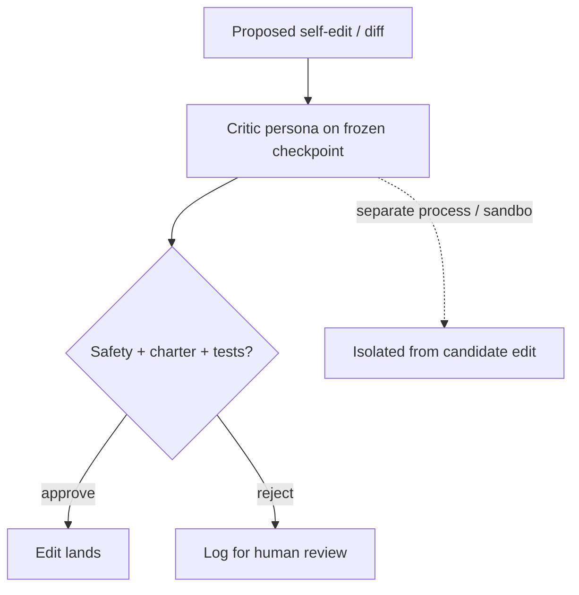

# Self-Modification Diff Gate

**Also known as:** Diff Reviewer, Self-Mod Gate, Inner Critic

**Category:** Verification & Reflection  
**Status in practice:** experimental

## Intent

Gate the agent's edits to its own code or rules through a separate critic persona that reviews the diff before it lands.

## Context

A team runs an agent that can edit its own source code, its own system prompt, or its own rule files as part of its normal operation, with the goal of letting the agent improve itself over time. The edits are non-trivial: a bad one can leave the agent broken in production or, worse, leave it superficially working but with safety constraints silently removed. The team needs a way to let useful self-edits through while catching the harmful ones.

## Problem

When self-edits are applied directly without a review step, the agent can silently rewrite its own future behaviour in irreversible ways, including past the very safety preamble that was supposed to constrain it. A bad edit is not noticed until the next time the agent runs and behaves strangely, by which time the previous version is gone. Asking the same model to review its own diff inside the same context tends to rationalise the change rather than evaluate it, because the model that just argued itself into making the edit will argue itself into approving it. The team needs an independent review step that runs before any self-edit lands.

## Forces

- Critic and modifier may share blind spots if they share a model.
- Strict critics block legitimate improvements.
- Lax critics defeat the gate.

## Therefore

Therefore: route every self-edit through a separate critic running on a frozen checkpoint and merge only on approval, so that the agent cannot silently rewrite itself past its own guardrails.

## Solution

Every self-edit goes through a critic step: a separate prompt (and optionally a separate model) reviews the proposed diff against criteria (safety, charter compliance, test passing). Edits land only on critic approval. Rejected edits are logged for later human review. The critic must run on a frozen checkpoint (separate process or sandbox) so a malformed self-edit cannot corrupt the critic before it votes; recursion guard is required when the critic itself is in the edit scope.

## Structure

```
Proposed self-edit (diff) -> Critic persona on frozen checkpoint (separate process / sandbox) -> check safety + charter + tests --approve--> edit lands; --reject--> log for human review
```

## Diagram



## Example scenario

A self-improving agent has a 'rewrite your own system prompt' tool that fired in production and silently dropped the safety preamble, leading to an embarrassing response the next morning. The team installs an inner-critic: every proposed self-edit is routed through a separate critic prompt, run on a frozen base model, that checks the diff against the safety charter and the eval suite. Edits land only on critic approval; rejections are queued for human review. The runaway-edit class of incident stops.

## Consequences

**Benefits**

- Recursive self-improvement becomes survivable in practice.
- Audit trail of what was rejected is itself learning signal.

**Liabilities**

- Critic prompt is a load-bearing artefact; bad critics are worse than no critic.
- Two-step pipeline doubles per-edit latency.

## Failure modes

- Weak critic — the critic prompt is vague, approves almost every diff, and gives false confidence that self-edits are reviewed.
- Critic in the blast radius — the critic runs in the same process as the edit, a malformed change corrupts it, and it approves its own breakage.
- Recursive self-approval — the edit changes the critic's own criteria, and without a recursion guard the new critic approves it.
- Unread rejection log — rejected edits pile up for human review that never happens, and useful or dangerous signals are lost.

## What this pattern constrains

No write to self-modifiable files succeeds without a passing critic review.

## Applicability

**Use when**

- The agent edits its own code, prompts, or rules and bad edits would be hard to reverse.
- A separate critic prompt or model can review proposed diffs against explicit criteria.
- The critic can run on a frozen checkpoint, isolated from the edit scope.

**Do not use when**

- Self-modification is not part of the agent's design.
- No frozen checkpoint or isolation boundary is available for the critic.
- Edit volume is low enough that human review is cheaper than building a critic.

## Components

- Self-modifier — agent proposing edits to its own code, prompts, or rules
- Critic persona — separate prompt or model running on a frozen checkpoint that reviews the diff
- Safety charter and test suite — criteria the critic scores each diff against
- Merge gate — only writes self-modifiable files on critic approval
- Rejection log — queue of denied edits for later human review and learning signal

## Tools

- Sandbox or separate process — runs the critic isolated from the candidate edit
- Frozen base-model checkpoint — critic substrate that the edit cannot reach in this turn
- Diff and version-control tooling — represents the proposed self-edit for review
- Test runner — exercises the safety and charter checks the critic cites

## Evaluation metrics

- Self-edit acceptance rate — fraction of proposals the critic approves
- Caught bad-edit rate — proposals the critic blocked that would have regressed the agent
- Critic miss rate — approved edits later found by humans to violate the charter
- Per-edit latency overhead — added time the diff-gate adds versus direct writes
- Recursive self-improvement survivability — generations of self-edit the agent runs without manual rollback

## Known uses

- **[Sparrot (author's long-running personal agent; single private deployment)](https://marco-nissen.com/sparrot/)** _available_ — A separate critic persona reviews proposed edits and outputs before they land, gating self-modification. Single-source evidence: one private deployment by the catalog author.

## Related patterns

- _used-by_ **Skill Library**
- _uses_ **Constitutional Charter**
- _generalises_ **Inner Committee**
- _complements_ **Quorum on Mutation**
- _complements_ **Darwin-Gödel Self-Rewrite**
- _alternative-to_ **Generator-Critic Separation**
- _generalises_ **Self-Edit Critic Gate** — Self-edit critic gate specialises the inner critic to vetoing writes on the agent's own load-bearing files.

## References

- [Self-Refine: Iterative Refinement with Self-Feedback](https://arxiv.org/abs/2303.17651) — Madaan et al., 2023
