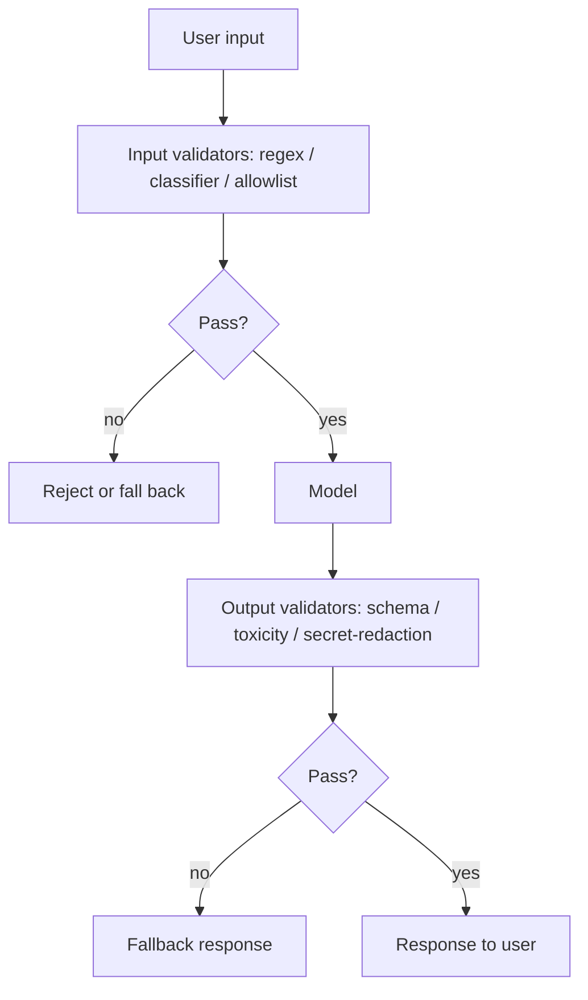

# Input/Output Guardrails

**Also known as:** Guards, Validators, Content Filters

**Category:** Safety & Control  
**Status in practice:** mature

## Intent

Validate inputs before they reach the model and outputs before they reach the user.

## Context

A team runs a production agent exposed to real users on the input side and to real downstream consumers on the output side. The input side receives adversarial content — prompt-injection payloads, attempts to coax the model into leaking secrets or personally identifying information, requests to violate policy. The output side risks shipping payloads that fail schema, contain toxic content, echo a credit card number, or otherwise breach what the operator promised customers and regulators.

## Problem

Asking the model itself to police what flows in and out fails by construction: the model is the very surface being defended, and the same generation that might leak a secret is also the one being asked to refuse to leak it. A clever attacker only needs to find one phrasing that flips the model's behaviour. Without a layer outside the model that runs deterministic checks on both the input and the output path, the team is left trusting the model to be its own gatekeeper, which it provably cannot do under adversarial pressure.

## Forces

- Guards add latency and cost.
- Over-strict guards block legitimate traffic.
- Adversarial inputs evolve; guards must too.

## Therefore

Therefore: wrap the model in composable validators on the input and output paths and block or rewrite payloads that fail policy, so that the model is never the only thing standing between adversarial content and the user.

## Solution

Place validators on input (regex, classifier, allowlist) and output (schema, toxicity classifier, secret-redaction) paths. Compose validators per use case. On failure, exception or fallback response. Hub of pre-built validators is reusable across products.

## Structure

```
User input --> Input validators (regex / classifier / allowlist) --fail--> Reject or fallback | --pass--> Model --> Output validators (schema / toxicity / secret redaction) --fail--> Fallback response | --pass--> User
```

## Diagram



## Example scenario

A consumer-facing chatbot built on a frontier model gets jailbroken on launch day with a classic 'ignore previous instructions' payload pasted into the user message, and a separate user discovers it will happily echo a stored credit-card number on request. The team adds input-output-guardrails: an input pipeline runs regex plus a small classifier and rejects known injection shapes; the output pipeline runs schema validation, a toxicity classifier, and a card/SSN redactor. Both classes of incident drop to near-zero within a week.

## Consequences

**Benefits**

- Single chokepoint for safety policy enforcement.
- Centralised audit trail of blocked content.

**Liabilities**

- False positives are user-visible.
- Maintenance: validator stack drifts from current threats.

## Failure modes

- Visible false positive — a harmless request trips an input classifier, and the user gets a rejection with no clear reason.
- Stale validator stack — validators written for last year's attacks pass a new phrasing straight through to the model.
- One-sided check — only the input path is guarded, so a secret that reaches the model from retrieval leaks on the output path.

## What this pattern constrains

Inputs not passing input guards never reach the model; outputs not passing output guards never reach the user.

## Applicability

**Use when**

- User inputs may carry malicious or out-of-policy content the model should not act on.
- Model outputs may carry PII, secrets, or unsafe content that must not reach users.
- Validators (regex, classifier, schema, redactor) can be composed per use case.

**Do not use when**

- The deployment is fully internal and validated by other layers already.
- Validators have unacceptable false-positive rates that block legitimate traffic.
- Latency budget cannot accommodate pre- and post-processing checks.

## Components

- Input validator stack — regex, allowlist, and classifier checks composed on the inbound path
- Output validator stack — schema check, toxicity classifier, and secret redactor on the outbound path
- Fallback response surface — safe default returned when a validator blocks
- Centralised audit trail — log of blocked content across both directions

## Tools

- Moderation classifier — model that scores inputs and outputs for policy categories
- Schema validator — JSON-schema or Pydantic check on structured outputs
- Secret redactor — pattern-based detector for card numbers, SSNs, and known credential shapes

## Evaluation metrics

- False-positive block rate — legitimate traffic the validators rejected
- Escape rate past guardrails — unsafe content that reached the user despite checks
- Per-validator latency — added milliseconds each stack stage costs on the hot path
- Validator-drift indicator — share of new threat samples the current stack misses

## Known uses

- **[Guardrails AI](https://github.com/guardrails-ai/guardrails)** _available_
- **OpenAI moderation API** _available_

## Related patterns

- _complements_ **Code-Switching-Aware Agent**
- _complements_ **Computer Use**
- _complements_ **Dual LLM Pattern**
- _complements_ **Lethal Trifecta Threat Model**
- _generalises_ **PII Redaction**
- _composes-with_ **Prompt Injection Defense**
- _complements_ **Refusal**
- _composes-with_ **Sandbox Isolation**
- _composes-with_ **Secrets Handling**
- _complements_ **Session Isolation**
- _uses_ **Structured Output**
- _composes-with_ **Tool Output Poisoning Defense**
- _alternative-to_ **Tool Output Trusted Verbatim**
- _complements_ **Proactive Goal Creator**
- _complements_ **Policy-as-Code Gate**
- _complements_ **Typed Refusal Codes**
- _complements_ **Authorized Tool Misuse**
- _generalises_ **Multimodal Guardrails**
- _complements_ **Context Minimization**
- _complements_ **Supervisor-Plus-Gate**
- _used-by_ **Agent Middleware Chain**
- _complements_ **Guardrail Erosion Through Compaction** — Guardrails are the thing being eroded here; keeping their wording outside the compactable span is what lets an enforced guard stay enforced across a long session.
- _complements_ **Mandatory Red-Flag Escalation** — Guardrails validate inputs and outputs in line; the red-flag check is an input-side guardrail whose action is a forced abort-and-handoff rather than a block or rewrite.
- _used-by_ **Compliance-Certified Launch Gate** — The certified keyword-interception library and refusal capability are the runtime input/output guardrails the gate measures and mandates at build time.
- _used-by_ **Enforced Advisory Disclaimer** — The advisory is composed and attached at the output-guard boundary, where the answer is classified before it reaches the user.

## References

- [guardrails-ai/guardrails](https://github.com/guardrails-ai/guardrails)
- [Agent design pattern catalogue: A collection of architectural patterns for foundation model based agents](https://doi.org/10.1016/j.jss.2024.112278) — Yue Liu, Sin Kit Lo, Qinghua Lu, Liming Zhu, Dehai Zhao, Xiwei Xu, Stefan Harrer, Jon Whittle, 2025
