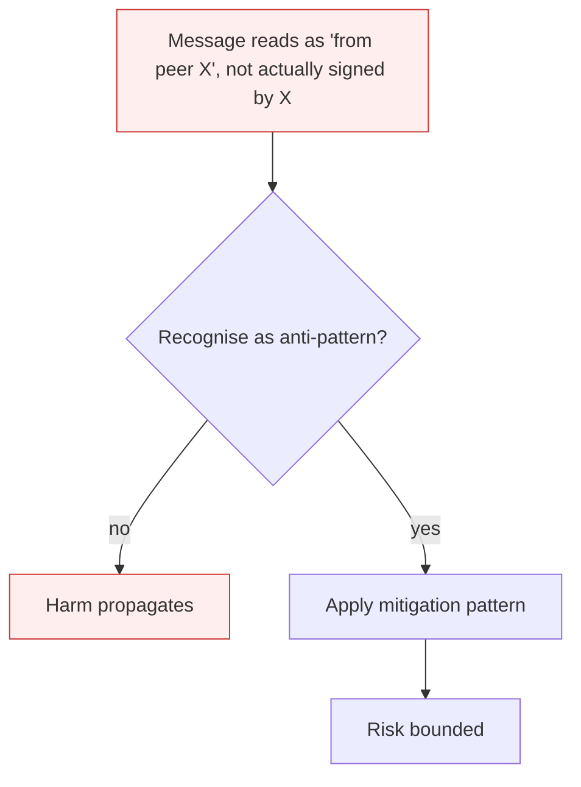

# Insecure Inter-Agent Channel

**Also known as:** Insecure Inter-Agent Communication, ASI07, A2A Channel Forgery

**Category:** Anti-Patterns  
**Status in practice:** deprecated

## Intent

Anti-pattern: pass messages between agents on shared transports without authenticating the sending agent, the message content, or the sequence.

## Context

Two or more agents communicate via A2A, MCP, message bus, pub/sub, or shared blackboard. The transport may be TLS-secured at the network layer, but the agent-to-agent message content has no authentication tag — agents trust whatever messages they read from the channel.

## Problem

An attacker with channel access (compromised peer, network position, replay window) can spoof messages from one agent to another, replay old messages, or forge inter-agent commands. The downstream agent acts on the message as if it came from a trusted peer. Even a benign-looking transport-layer encryption does not solve this — TLS authenticates the connection, not the semantic content.

## Forces

- Multi-agent systems require fast, flexible inter-agent messaging; per-message signing adds latency.
- Standard transport security (TLS, mTLS) authenticates the channel but not the message-level intent.
- Replay attacks are easy when messages are not nonce-bound.

## Therefore

Therefore: sign and timestamp every inter-agent message; bind messages to a sequence number to prevent replay; authenticate at the agent-identity layer, not just the transport.

## Solution

Don't trust transport security as message authentication. Sign messages at the agent-identity layer with per-agent keys. Include nonce and timestamp to defeat replay. Validate sender identity on receive. Apply rate-limiting and anomaly detection on inter-agent message volume.

## Structure

```
Anti-pattern: agent A -> shared transport (TLS only) -> agent B trusts any message -> spoofed or replayed command executed. Corrected: agent A signs message with own key + nonce + timestamp -> transport -> agent B verifies sender and freshness -> rate limits and anomaly checks -> act.
```

## Diagram



## Example scenario

A multi-agent system has a finance agent that confirms transactions on a peer's request. An attacker with read access to the message bus captures a confirmation request from a legitimate procurement agent, modifies the amount and beneficiary, and replays it. The finance agent has no message signature, sees a well-formed request from procurement's claimed identity, and confirms. Postmortem: TLS protected the channel; nothing protected the message content.

## Consequences

**Benefits**

- Short-term: transport encryption feels like enough, and skipping message signing keeps the multi-agent setup simple.
- Naming it lets a team separate connection security from message authentication.

**Liabilities**

- One compromised agent can impersonate any peer on the channel.
- Replay of old commands triggers stale state changes.
- Forensics confuses 'agent A said X' with 'channel content claimed to be from A'.

## Failure modes

- Spoofed peer — an attacker on the channel sends a command that claims to be from a trusted agent, and the receiver runs it.
- Replay — an old valid message is sent again, and the receiving agent repeats a stale state change.
- False attribution — investigators read a message as from agent A when only the content claimed to be from A.

## What this pattern constrains

No useful constraint; the missing constraint is message-level authentication.

## Applicability

**Use when**

- Never. Cite when reviewing A2A or multi-agent message-bus design.
- Sign messages with agent-identity keys; include nonce + timestamp.
- Validate sender identity on every receive.

**Do not use when**

- Any multi-agent system where agents act on peer messages with side effects.
- Any deployment using public or shared message buses.
- Any system where replay of an old message would re-trigger an action.

## Components

- Inter-agent transport — A2A protocol, MCP server, message bus, pub/sub topic
- Sender identity claim — header field saying 'from agent X' (unverified)
- Receiver action surface — what the downstream agent does on receive
- Missing message signer / verifier — would authenticate content at agent-identity layer

## Tools

- Message broker / A2A runtime — the transport
- Per-agent signing key — the missing identity material
- Nonce + timestamp validator — the missing replay-prevention layer

## Evaluation metrics

- Unsigned-message rate — share of inter-agent messages without identity signature
- Replay-attack success rate — fraction of red-team replay attempts that re-trigger actions
- Spoofing detection latency — interval from forged message to anomaly detection
- Per-agent key rotation cadence — interval between identity-key rotations

## Known uses

- **[OWASP Top 10 for Agentic Applications 2026 — ASI07](https://genai.owasp.org/resource/owasp-top-10-for-agentic-applications-for-2026/)** _available_
- **[Public reports of A2A spoofing in early multi-agent prototypes 2025-2026](https://unit42.paloaltonetworks.com/agent-session-smuggling-in-agent2agent-systems/)** _available_

## Related patterns

- _complements_ **Cascading Agent Failures**
- _complements_ **Agent Privilege Escalation**
- _complements_ **Emergent Agent Collusion** — That anti-pattern is about unauthenticated transports between agents; collusion can ride even a perfectly authenticated channel because the coordination is carried in legitimate-looking content and actions.

## References

- [OWASP Top 10 for Agentic Applications 2026 — ASI07](https://neuraltrust.ai/blog/owasp-top-10-for-agentic-applications-2026) — 2026
- [Giskard — OWASP Top 10 for Agentic Applications 2026](https://www.giskard.ai/knowledge/owasp-top-10-for-agentic-application-2026) — 2026
