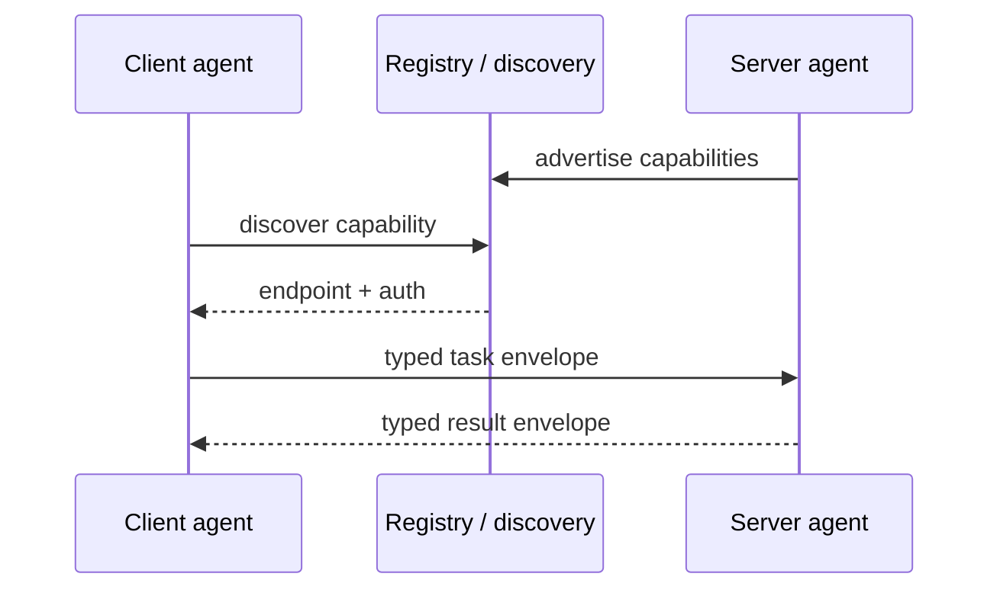

# Inter-Agent Communication

**Also known as:** A2A, Agent-to-Agent Protocol

**Category:** Multi-Agent  
**Status in practice:** emerging

## Intent

Define a protocol for agents to exchange tasks, capabilities, and results across process or vendor boundaries.

## Context

An organisation has agents built by different teams or bought from different vendors — a legal review agent from one supplier, an HR agent from another, an internal IT agent — and they need to cooperate on workflows that cross their boundaries. Each agent speaks a different internal shape: different request envelopes, different result formats, different auth.

## Problem

Wiring each pair of agents together with bespoke integration code does not scale. Every new agent forces fresh glue against every other agent it might talk to, and every change to one side breaks the others. There is no shared catalogue of what each agent can do, no shared auth story, and no shared way to version the request envelopes. The cost of adding the fourth or fifth agent becomes prohibitive long before the organisation has the agent population it wanted.

## Forces

- Capability discovery: how does agent A know what agent B can do?
- Auth and trust across organisational boundaries.
- Versioning: protocols evolve faster than legacy agents.

## Therefore

Therefore: adopt a standardised protocol — A2A, MCP, or an in-house equivalent — covering capability advertisement, task delegation, result return, and auth, so that agents from different teams or vendors cooperate without bespoke point-to-point glue.

## Solution

Adopt a protocol (Google A2A, Anthropic MCP, in-house equivalents) that covers capability advertisement, task delegation, result return, and auth. Agents advertise capabilities; clients discover and invoke; results round-trip in typed envelopes.

## Structure

```
Server agent --advertise capabilities--> Registry; Client agent --discover--> Registry --endpoint + auth--> Client agent --typed task envelope--> Server agent --typed result envelope--> Client agent
```

## Diagram



## Example scenario

An enterprise has agents from three vendors — a legal review agent from one, an HR agent from another, an internal IT agent — and every cross-agent integration is bespoke glue maintained by a different team. They adopt MCP as the inter-agent-communication protocol: each agent advertises its capabilities in a typed envelope, clients discover and invoke without knowing the implementation, and auth flows through one shared mechanism. Adding a fourth vendor's procurement agent now takes a day instead of a quarter.

## Consequences

**Benefits**

- Cross-team and cross-vendor reuse.
- Capability inventory becomes inspectable.

**Liabilities**

- Protocol overhead.
- Schema versioning becomes everyone's problem.

## Failure modes

- Schema break — one agent ships a new envelope version, and clients still on the old version fail to parse its results.
- Stale capability advert — an agent advertises a capability it no longer supports, and clients discover and invoke it anyway.
- Protocol overhead on chatty calls — small, frequent exchanges pay the full envelope and auth cost each time.
- Out-of-band shortcut — a team calls another agent directly to skip the protocol, and that path has no shared auth or inventory entry.

## What this pattern constrains

Agents may only invoke each other through the advertised protocol; out-of-band calls are forbidden.

## Applicability

**Use when**

- Multiple agents must exchange tasks, capabilities, or results across process or vendor boundaries.
- Bespoke point-to-point integrations are starting to multiply.
- A protocol like MCP or A2A is available and acceptable to the operating environment.

**Do not use when**

- All agents run in one process and direct function calls suffice.
- Capability advertisement and discovery are not actually needed.
- Adopting a cross-vendor protocol would add governance burden without payoff.

## Components

- Client agent — discovers capabilities and invokes remote agents via typed envelopes
- Server agent — advertises its capabilities and accepts typed task envelopes
- Capability registry — discovery service that maps capability names to endpoints and auth
- Task envelope — typed request payload that crosses process or vendor boundaries
- Result envelope — typed response payload returned on task completion

## Tools

- Google A2A protocol — agent-to-agent task delegation across organisational boundaries
- Anthropic MCP — model-context protocol for capability and tool exchange
- Auth broker — token issuer that backs cross-vendor invocations
- Schema registry — versioned envelope schemas that subscribers depend on

## Evaluation metrics

- Cross-vendor invocation success rate — share of calls that complete inside the envelope contract
- Capability-discovery hit rate — clients that find a matching server without falling back to glue
- Schema-break incidents — production failures traced to envelope-version drift
- Integration cost per added agent — engineer-hours to onboard a new vendor or team
- Protocol overhead per call — extra bytes and latency versus direct in-process function calls

## Known uses

- **Google A2A Protocol** _available_

## Related patterns

- _complements_ **Model Context Protocol**
- _composes-with_ **Handoff**
- _complements_ **Supervisor**
- _complements_ **Orchestrator-Workers**
- _used-by_ **Communicative Dehallucination**
- _used-by_ **Cross-Domain Enterprise Agent Network**
- _composes-with_ **Tool/Agent Registry**
- _generalises_ **Actor-Model Agents**
- _generalises_ **Topic-Based Routing**
- _alternative-to_ **Decentralized Agent Network**
- _complements_ **Agent-Initiated Payment** — Agent-to-agent commerce settles payments for services over the inter-agent channel.
- _complements_ **Agent Capability Manifest** — Agents read each other's capability manifests to learn how to address and authenticate inter-agent calls.

## References

- [A2A Protocol](https://a2a-protocol.org/) — 2025
