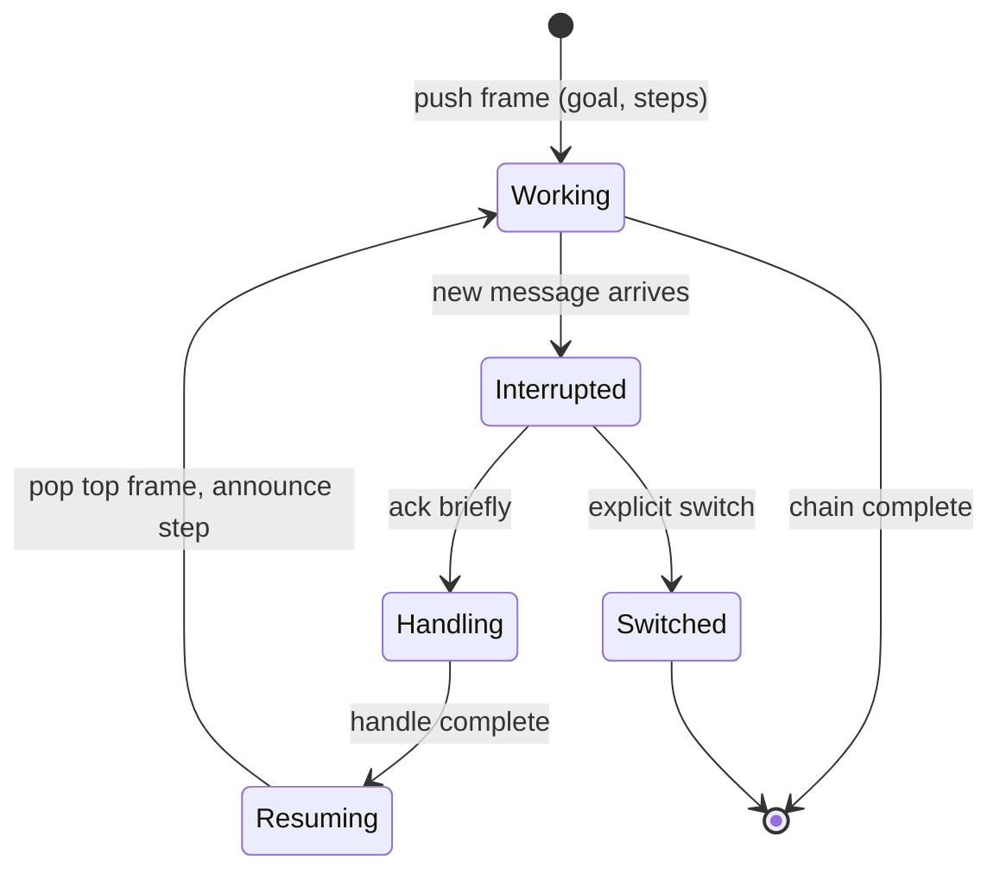

# Interrupt-Resumable Thought

**Also known as:** Pausable Thought Stream, Continuation-Preserving Interrupt, Suspendable Cognition

**Category:** Cognition & Introspection  
**Status in practice:** experimental

## Intent

Preserve multi-step reasoning across interrupts by supporting paused-and-resumed thought frames so a new message handles cleanly without clobbering in-flight work.

## Context

A team is running an agent whose individual reasoning chains take longer than a single turn — a six-step synthesis, a multi-stage debugging walkthrough, a careful comparison across documents. While the chain is mid-flight, new external messages can arrive: a user follow-up, a system notification, a scheduled note from earlier. The agent has no built-in concept of a paused thought, so every incoming message lands on whatever the model was about to say next.

## Problem

Without explicit continuation support, the agent has only two bad options when an interrupt arrives mid-chain. It can ignore the new message and look rude, finishing the previous thought as if nothing happened. Or it can answer the interrupt and quietly lose the in-flight reasoning, restarting from scratch later if at all. There is no notion of 'hold this thread, handle that one, then come back to where I was,' so any reasoning that takes longer than one turn fragments into shards every time the user speaks.

## Forces

- Latency: humans expect quick acknowledgement of new input.
- Context capacity: holding a paused thought costs tokens.
- Resume reliability: returning to a paused thought without distortion is hard.
- Priority: not every interrupt deserves to suspend work; some are themselves interruptable.

## Therefore

Therefore: push a named thought-frame onto a bounded stack at the start of a multi-step chain and require any interrupt to acknowledge, handle, and pop-then-resume the top frame, so that incoming messages neither clobber in-flight reasoning nor disappear into it.

## Solution

Introduce an explicit thought-frame: when starting a multi-step chain, push a frame onto a stack with the goal, the steps completed, and the next step. On interrupt: acknowledge briefly ('hold on — finishing X first' or 'switching: Y'), handle the interrupt, then look at the top frame and explicitly resume ('back to X — I was at step 3 / 6'). Cap stack depth to prevent infinite suspension. Frames older than a configurable window expire (the agent admits the resume would be reconstruction, not continuation).

## Structure

```
Start multi-step chain --push frame (goal, steps done, next step)--> Working --new message--> brief acknowledgement --> handle interrupt --> read top frame --> announce and resume at step k | frame too old -> admit reconstruction or abandon explicitly
```

## Diagram



## Example scenario

A research agent is on step 4 of a 7-step literature synthesis when the user fires off 'oh, also, what was that paper from Tuesday?'. The current agent either ignores the interrupt and looks rude, or starts answering it and loses the synthesis state. The team adds interrupt-resumable-thought: the synthesis pushes a thought-frame onto a stack, the agent acknowledges the interrupt with 'one sec — finishing the synthesis section, then I'll grab Tuesday's paper', completes the step, then pops the frame and resumes. Long thinking survives mid-flight questions.

## Consequences

**Benefits**

- Coherent long-form work survives interruptions.
- Human gets quick acknowledgement without losing depth.
- Failure mode (forgetting to resume) is observable as a stack with un-popped frames.

**Liabilities**

- Stack management adds complexity to the agent loop.
- Token cost of holding paused frames in context.
- Resume distortion over long pauses is a real failure.

## Failure modes

- Resume distortion — the agent comes back to a frame after a long pause and continues from a step whose premises no longer hold.
- Stack pile-up — repeated interrupts push frames faster than they resolve, and the depth cap starts dropping work without telling the user.
- Silent drop — the agent handles the interrupt and never names the paused chain, so the frame expires unseen.
- Wrong frame resumed — with several frames paused, the agent resumes the top one when the user meant an older thread.

## What this pattern constrains

Interrupts cannot silently discard in-flight multi-step reasoning; all paused chains must be visibly tracked, named in the next reply, and either resumed or explicitly abandoned.

## Applicability

**Use when**

- The agent supports incoming interrupts (new user messages) while it is mid-reasoning.
- Multi-step reasoning chains are common enough that losing one is a meaningful regression.
- The transport allows the agent to expose paused chains to subsequent turns.

**Do not use when**

- The agent is strictly request-response with no interruptible loops.
- Reasoning chains are short enough that restarting them is cheaper than paging them out.
- The user expects every new message to fully reset the agent's working state.

## Components

- Thought Frame — named record with goal, steps completed, and next step
- Frame Stack — bounded LIFO stack of paused chains
- Interrupt Handler — acknowledges, handles, then pops and resumes the top frame
- Frame Expiry — clock-bounded window after which resume becomes reconstruction
- Resume Announcer — visibly names the frame being resumed in the reply

## Tools

- Structured JSON store — durable frame stack across process restarts
- LLM API — generation that emits the acknowledge, handle, and resume turns

## Evaluation metrics

- Resume-completion rate — share of pushed frames that are popped and finished, not abandoned
- Un-popped frame count — leaked frames sitting on the stack past their expiry window
- Resume distortion — semantic drift between the paused frame's next step and the actual resume
- Acknowledge latency — wall-clock from interrupt arrival to brief acknowledgement

## Known uses

- **Self-observed in long-running cognitive agents** _available_
- **[Sparrot](https://marco-nissen.com/sparrot/)** _available_ — In-flight plans are preserved across user interrupts (chat arrives mid-tick) so the agent can resume the prior thread on a later tick rather than losing the train of thought.

## Related patterns

- _complements_ **Agent Resumption**
- _complements_ **Conversation Handoff to Human**
- _complements_ **Decision Log**
- _complements_ **Append-Only Thought Stream**
- _uses_ **Short-Term Thread Memory**
- _complements_ **Interruptible Agent Execution**

## References

- [LangGraph — interrupts and human-in-the-loop](https://langchain-ai.github.io/langgraph/concepts/human_in_the_loop/) — 2025
