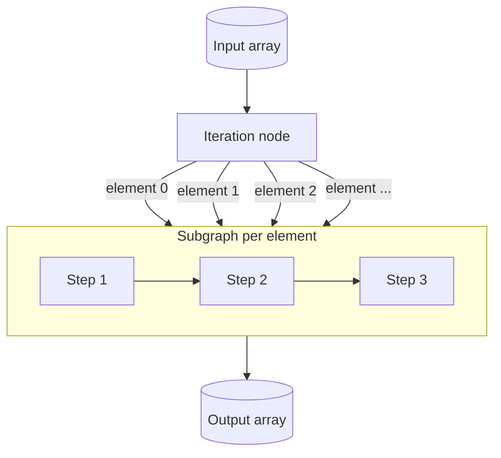

# Iteration Node

**Also known as:** Map-Over-Collection Node, For-Each Sub-Workflow, Bounded Workflow Loop

**Category:** Planning & Control Flow  
**Status in practice:** mature

## Intent

Express map-over-collection inside a visual workflow as an explicit Iteration node that runs a subgraph once per element of an input array, with bounded, deterministic, observable execution.

## Context

A team builds workflows on a visual canvas — Dify, Coze, n8n, or a similar low-code platform — where some part of the work has to be applied to every element of a list: every retrieved chunk, every search result, every uploaded file, every row in a spreadsheet. The team wants the iteration itself to be visible on the canvas alongside the rest of the flow, so failures and timings can be inspected per element rather than hidden inside a black box.

## Problem

A model-driven loop (where the language model decides when to stop iterating) is non-deterministic and hard to bound by the data length. Collapsing the whole list into one large model call hides per-element failures, so when one of fifty PDFs fails the workflow either retries the whole batch or silently drops the bad one. Pushing the loop out into a code node or an external script loses the visual debug surface that justified using the canvas in the first place. None of these options gives a structural, data-bounded, inspectable iteration.

## Forces

- Iteration must be deterministic and bounded by the array length, not by an LLM stopping condition.
- Per-element results need to be inspectable to find the one element that failed.
- Sequential vs parallel execution within the Iteration changes latency and rate-limit behaviour.
- Sub-workflow state must not leak across iterations.
- Iteration depth should be capped — nested Iteration nodes can blow up step counts.

## Therefore

Therefore: model the iteration as a structural node — array in, subgraph applied per element, array out — so that iteration is bounded by data, deterministic, and inspectable per element.

## Solution

Define an Iteration node with an input array, an inner subgraph that runs once per element with the element bound to a parameter, and an output array of per-element results. The runtime may execute elements sequentially or in parallel up to a configured concurrency. Each iteration is logged with its index; failures surface per-element rather than collapsing the whole node. Pair with map-reduce (the algorithmic shape it instantiates), visual-workflow-graph (the surrounding canvas), and parallelization (when concurrency matters).

## Structure

```
[Input array] → Iteration node { for each element: subgraph(element) → result } → [Output array].
```

## Diagram



## Example scenario

A document-processing workflow receives a list of uploaded PDFs. The team needs to extract metadata from each, run a quality check, and emit a per-document summary. They wrap the extract-check-summarise sequence in an Iteration node bound to the input list. The node runs per element with a concurrency cap of four; when one PDF errors out, the iteration logs the failed index and continues. The output array preserves order so the consumer can join back to the original list.

## Consequences

**Benefits**

- Iteration is structural and bounded — no LLM stopping condition required.
- Per-element failures and timings are visible.
- Sequential vs parallel execution is a node parameter, not a code change.
- Iteration nests cleanly inside larger visual workflows.

**Liabilities**

- Large input arrays multiply token cost linearly.
- Nested iteration without a cap can blow up step counts.
- Per-element sub-workflow state can creep into shared variables if not scoped carefully.
- Parallel execution can hit upstream rate limits.

## Failure modes

- Linear cost surprise — a large input array runs the inner subgraph once per element, and token cost rises far past the estimate.
- Nested blow-up — an Iteration node inside another runs without a cap, and step counts multiply out of control.
- Scope leak — the inner subgraph writes to a shared variable, and one element's state bleeds into the next element's result.
- Rate-limit wall — parallel elements hit an upstream API at once, and many fail together on throttling rather than on their own data.

## What this pattern constrains

The inner subgraph must operate per element with element-scoped state; it is not allowed to mutate variables outside its scope, and the number of iterations is bounded by the input array length rather than by a model decision.

## Applicability

**Use when**

- Work must be applied to every element of a list and bounded by the list length.
- Per-element failures need to be inspectable.
- The surrounding workflow is visual and the iteration should remain visual.
- Sequential or bounded-parallel execution suffices.

**Do not use when**

- The number of iterations is decided by the model rather than by data length.
- The subgraph would mutate shared variables that other branches read.
- The input array is unbounded — pair with step-budget or refuse the input.

## Components

- Input array — bounded list whose length sets the iteration count
- Iteration node — structural construct binding each element to a subgraph parameter
- Inner subgraph — workflow steps that run once per element with element-scoped state
- Output array — per-element results preserved in order
- Concurrency controller — runs the subgraph sequentially or up to a configured parallelism

## Tools

- Workflow engine — Dify, Coze, n8n, or similar canvas runtime that hosts the node
- LLM API — invoked inside the subgraph as needed per element
- Per-iteration log store — records index, timing, and failure per element

## Evaluation metrics

- Per-element success rate — fraction of array elements whose subgraph completed cleanly
- Failed-index visibility — whether errored elements surface with their index for inspection
- Wall-clock at concurrency N versus sequential — parallelism speedup
- Variable-leak incidents — subgraph state escaping its iteration scope
- Iteration-count bound respected — actual iterations equal input array length, no model decisions

## Known uses

- **[Dify (Iteration node)](https://docs.dify.ai/en/guides/workflow/node/iteration)** _available_ — Dify workflows expose an Iteration node that runs the same workflow steps on each element of an array, sequentially or in parallel.
- **[Coze (Loop / Iteration node)](https://www.coze.com/docs)** _available_ — Coze workflows ship an iteration construct for per-element subgraph execution.
- **[n8n (Split-in-Batches / Loop Over Items)](https://docs.n8n.io/)** _available_ — n8n's per-item execution model is a structural iteration over the workflow's incoming items.

## Related patterns

- _uses_ **MapReduce for Agents**
- _complements_ **Visual Workflow Graph**
- _complements_ **Parallelization**
- _complements_ **Step Budget**
- _used-by_ **Visual Workflow Graph**

## References

- [Dify — Iteration node](https://docs.dify.ai/en/guides/workflow/node/iteration) — LangGenius
