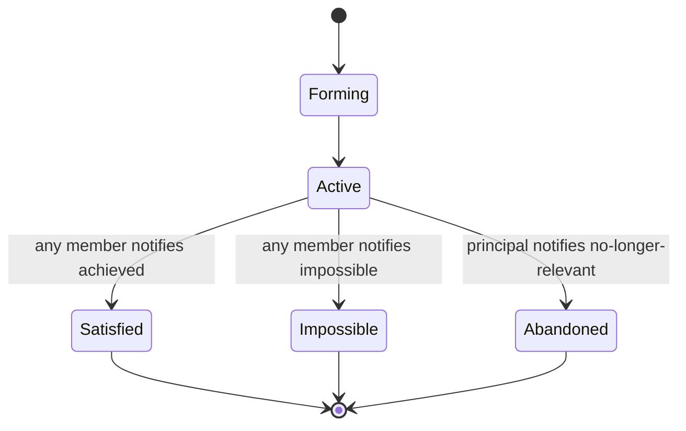

# Joint Commitment Team

**Also known as:** Joint Intentions Team, Cohen-Levesque Team, Notification-Bound Team

**Category:** Multi-Agent  
**Status in practice:** experimental

## Intent

A team of agents adopts a shared goal plus the meta-commitment that each member will notify the others as soon as it believes the goal is achieved, impossible, or no longer relevant.

## Context

Multiple agents coordinate on a shared task — a research collective, a delivery team, a multi-step pipeline crossing agents. Each agent has a partial view of progress. When one agent learns the goal is satisfied, infeasible, or no longer wanted, the others continue working unless explicitly told.

## Problem

Silent abandonment is the recurring failure. Agent A discovers the goal is impossible (the data the team was going to analyse doesn't exist) and stops, but Agent B keeps preparing analysis tooling for the missing data. Agent C learns the goal has been satisfied by an external event but doesn't tell Agent D, who keeps running expensive computations. Without an explicit meta-commitment that team members notify each other on these state changes, joint tasks waste effort and produce stale outputs.

## Forces

- Each member has a partial view; goal-state insights are not automatically shared.
- Notification has cost but small compared to wasted work.
- The meta-commitment must be enforceable, not advisory.
- Notification semantics differ for 'achieved' vs 'impossible' vs 'no longer relevant'.

## Therefore

Therefore: every agent in the team commits not only to the shared goal but to notifying the team when it believes the goal is achieved, impossible, or no longer relevant, so the team's effort tracks the goal's actual state.

## Solution

Following Cohen & Levesque's joint intentions framework: when agents form a team around a shared goal G, each agent commits to (a) pursue G as long as G is believed achievable, wanted, and unachieved, and (b) notify the rest as soon as it believes G is achieved, impossible, or no longer relevant. Notification is part of the contract, not extra-credit. The team's lifecycle has explicit transitions: forming, active, satisfied (notified by any member that G holds), impossible (notified by any member), abandoned (notified by the principal that G is no longer wanted).

## Structure

```
Forming --shared goal G--> Active (each member pursues G) --any member notifies achieved--> Satisfied | --any member notifies impossible--> Impossible | --principal notifies no longer wanted--> Abandoned
```

## Diagram



## Example scenario

A research-collective of three agents commits to 'produce a market analysis for product X by Friday'. Agent A discovers Wednesday that the underlying dataset is corrupted; it broadcasts an 'impossible' notification. Without the joint-commitment contract Agents B and C would have kept generating charts and outlines all of Thursday. With the contract, the team transitions to 'impossible' state and either replans or stands down.

## Consequences

**Benefits**

- Wasted work after goal-state change collapses.
- Team lifecycle has explicit named states.
- Notification messages produce an audit trail.

**Liabilities**

- Notification protocol adds overhead on long-running teams.
- Members can disagree about whether the goal is achieved/impossible — needs a reconciliation rule.
- False notifications (one member wrongly concludes 'impossible') can tear down the team prematurely.

## Failure modes

- False 'impossible' — one member wrongly concludes the goal cannot be met, notifies the team, and tears it down while others were close to success.
- Disagreement deadlock — members disagree on whether the goal is achieved, no reconciliation rule exists, and the team neither stops nor progresses.
- Notification noise — on a long-running team, frequent status messages cost more than the work they protect.
- Silent drop — a member stops pursuing the goal without notifying, and the rest keep spending effort on work that no longer matters.

## What this pattern constrains

A team member must not silently abandon a shared goal; notification of belief that the goal is achieved, impossible, or no longer relevant is part of the team contract.

## Applicability

**Use when**

- Multi-agent teams on shared goals with multi-step or multi-day runtime.
- Goal-state changes (satisfaction, infeasibility, abandonment) are realistic.
- Operators need an audit trail of when and why a team stopped.

**Do not use when**

- Single-agent task — no team to notify.
- Team runtime is too short for notification overhead to pay back.
- Members are unreliable observers of goal state — notifications would be noise.

## Components

- Shared goal — declared at team formation
- Joint-commitment contract — notification obligations on goal state change
- Team-state machine — forming, active, satisfied, impossible, abandoned
- Notification channel — used for goal-state messages

## Tools

- Team registry — tracks active teams and their state
- Notification bus — carries goal-state messages
- Audit log — captures every team transition

## Evaluation metrics

- Silent-abandonment incidents — teams that ended without proper notification
- Wasted-effort rate — work done after goal already achieved or impossible
- Notification latency — time from a member's belief change to broadcast

## Known uses

- **[Cohen & Levesque — Teamwork / Joint Intentions framework](https://philpapers.org/rec/COHT)** _available_
- **[Multiagent Systems (Weiss) — Joint commitment treatment](https://mitpress.mit.edu/9780262731317/multiagent-systems/)** _available_

## Related patterns

- _complements_ **Commitment Tracking**
- _composes-with_ **Coalition Formation**
- _composes-with_ **BDI Agent**
- _alternative-to_ **Supervisor**
- _complements_ **World Model as Tool**
- _alternative-to_ **Stigmergic Coordination**
- _complements_ **Partial Global Planning**
- _alternative-to_ **Deontic Token Delegation** — Delegates individual obligations down a chain with accountability rather than sharing one goal across a team.
- _alternative-to_ **Actuation-Scope-Registered Control Loops** — Those agents share one goal from the outset and the contract is about notifying each other when belief in that goal changes. These loops have permanently different objectives and are never going to agree, so the contract constrains write access to a contested resource instead of aligning intent.

## References

- [Multiagent Systems, 2nd ed.](https://mitpress.mit.edu/9780262731317/multiagent-systems/) — Gerhard Weiss (ed.), 2013
- [Teamwork](https://philpapers.org/rec/COHT) — Philip Cohen, Hector Levesque
