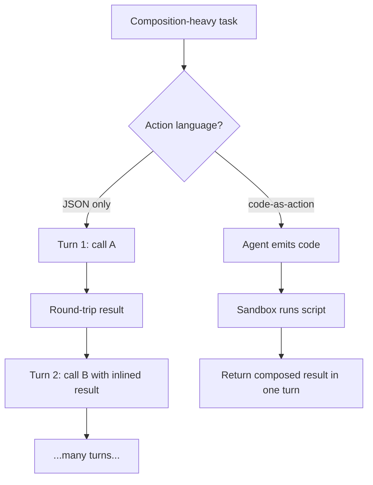

# JSON-Only Action Schema

**Also known as:** JSON-Dict Tool Calls Only, No Code-as-Action, Function-Argument JSON as Action Language

**Category:** Anti-Patterns  
**Status in practice:** deprecated

## Intent

Anti-pattern: restrict the agent's action language to JSON tool-call dictionaries even for tasks where code-as-action (functions composing, loops, conditionals over results) would be the natural shape.

## Context

A team is building an agent on a framework that standardised early on the provider's function-calling contract: the model emits one tool call per turn as a JSON dictionary with flat arguments, the host executes it, and the result comes back as another turn. As tasks grow more sophisticated — data wrangling, multi-step reductions, conditional branching on intermediate results — the team keeps the JSON-only action language and expresses composition by issuing more turns. The option of letting the agent write a short code snippet that calls tools as functions inside a sandbox is dismissed as too risky or out of scope.

## Problem

A JSON tool call cannot directly express a loop, a conditional over an intermediate value, or the reuse of one tool's output as another tool's argument. To compose three tools the agent must take three or more turns, ship each intermediate result back through the model as a string, and reconstruct any structured object on each side. Token cost is dominated by these round-tripped intermediates, latency is dominated by the turn count, and the action language drifts further from the code-shaped composition the model actually saw most of in training.

## Forces

- JSON tool calls are the dominant industry contract and the easiest to log, validate, and rate-limit.
- Code-as-action requires a sandboxed interpreter (Python, JS) with its own security envelope.
- Multiple papers (Executable Code Actions Elicit Better LLM Agents; CodeAct) report that LLMs solve composition-heavy tasks better when allowed to emit code.
- Code is over-represented in LLM training corpora compared to JSON tool-call traces.

## Therefore

Therefore: when tasks demand nesting, intermediate variables, or local reductions over tool outputs, let the agent emit code that calls tools as functions, so that composability is expressed in the action language rather than unrolled across many turns.

## Solution

Don't insist on JSON-only when the task needs composition. For composition-heavy work, swap to code-as-action: expose tools as ordinary functions in a sandboxed interpreter and let the agent write the glue. Keep JSON for simple one-tool one-arg actions where the contract genuinely fits. See code-as-action, agent-computer-interface, sandbox-isolation.

## Structure

```
Anti-pattern: composition-heavy task -> JSON tool calls only -> one call per turn, intermediates via model as strings -> many turns, high tokens. Corrected: composition-heavy task -> code-as-action in sandboxed interpreter, tools as functions -> agent writes glue code; JSON kept for simple single-tool actions.
```

## Diagram



## Example scenario

A data-investigation agent has tools for query, transform, and chart. Under JSON-only it must call query, return the rows as a JSON blob through the model, call transform with that blob inlined, return another blob, then call chart. Token cost is dominated by the round-tripped tables; latency is dominated by turn count. The team switches to code-as-action: tools are exposed as Python functions, the agent writes a five-line script that pipes query into transform into chart, the interpreter executes it, and the agent receives the chart object back. One turn replaces five.

## Consequences

**Benefits**

- Short-term: JSON tool calls are easy to validate, log, and secure, and need no code sandbox.
- Naming it lets a team pick the action language per task shape instead of by default.

**Liabilities**

- Nesting, loops, and conditionals get unrolled into many turns, multiplying tokens.
- Intermediate objects (images, data frames, structured returns) round-trip through the model as strings.
- Tasks that would be one code snippet become many turns of state passing.
- The action language is further from the LLM's training distribution than code.

## Failure modes

- Turn explosion — a task needing a loop over results takes many separate tool-call turns instead of one short snippet.
- String round-trips — intermediate data such as tables or images passes back through the model as text and gets rebuilt on each side.
- Lost composition — the agent cannot feed one tool's output into another directly, so cost and latency are dominated by state passing.

## What this pattern constrains

Avoiding it constrains the action-language choice: JSON-only dictionaries may serve narrow one-tool-per-turn flows, but composition-heavy tasks must not be forced through them when code-as-action in a sandbox is the natural shape.

## Applicability

**Use when**

- JSON-only is acceptable for narrow one-tool-per-turn flows; declare that scope explicitly.
- Cite this entry when tasks need nesting, conditionals, or reuse of intermediate results and the schema forbids expressing them.
- Switch to code-as-action behind sandbox-isolation; the sandbox becomes the security envelope.

**Do not use when**

- The task is composition-heavy (data wrangling, multi-tool reductions, conditional branching over results).
- Tools return rich objects (images, frames, structured records) that should not be serialised through the model.
- Token cost and turn count are constrained — code-as-action collapses many turns into one.

## Components

- JSON tool-call contract — one flat dictionary per turn, no nesting or composition primitives
- Per-turn dispatcher — round-trips each intermediate result through the model as a string
- Composition-heavy task — needs nesting, loops, or conditionals the action language cannot express
- Missing sandbox interpreter — would let the agent emit code that composes tools as functions

## Tools

- Provider function-calling API — sole action surface, restricts composition to multi-turn unrolling
- Sandboxed Python or JS runtime — missing alternative action surface that would collapse turns

## Evaluation metrics

- Turns-per-composition task — climbs linearly with composition depth instead of staying flat
- Round-tripped-intermediate token share — fraction of total tokens spent re-serialising prior tool results
- Composition-success rate — share of multi-tool tasks completed before a step-budget or cost cap intervenes
- Action-language entropy — how far the emitted JSON shape drifts from the model's code-trained distribution

## Known uses

- **[smolagents (named as a deliberate design rejection)](https://huggingface.co/docs/smolagents/tutorials/secure_code_execution)** _available_ — smolagents documents JSON tool-calling as the industry default it explicitly rejects in favour of code-as-action; the docs cite three research papers in support.
- **[Hugging Face Transformers Agents (ReactCodeAgent)](https://huggingface.co/docs/transformers/v4.47.1/agents_advanced)** _available_ — Same family — code-as-action is preferred over JSON-only.

## Related patterns

- _alternative-to_ **Code-as-Action Agent**
- _alternative-to_ **Tool Use**
- _complements_ **Sandbox Isolation**
- _complements_ **Agent-Computer Interface**
- _used-by_ **LLM as Periphery**
- _complements_ **Deterministic Control Flow, Not Prompt**
- _complements_ **Canonical-Entity Grounding** — Schema validates an identifier's shape; resolution validates the entity exists.

## References

- [smolagents — Secure code execution](https://huggingface.co/docs/smolagents/tutorials/secure_code_execution) — Hugging Face
- [Executable Code Actions Elicit Better LLM Agents (CodeAct)](https://arxiv.org/abs/2402.01030) — Wang et al., 2024
