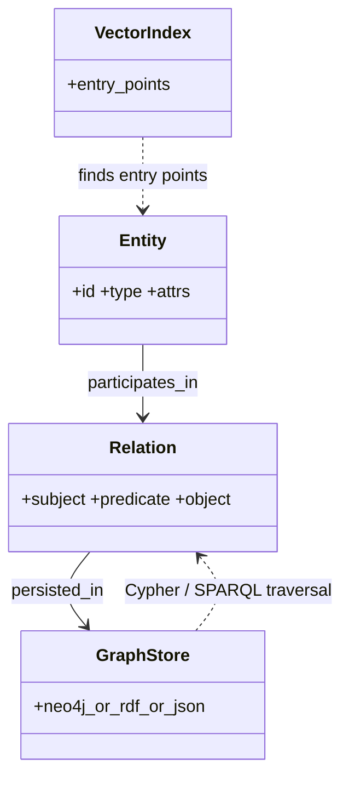

# Knowledge Graph Memory

**Also known as:** Triple Store Memory, Symbolic Memory

**Category:** Memory  
**Status in practice:** emerging

## Intent

Persist agent memory as entities and relations in a structured graph so symbolic queries (path, neighbour, type) become possible.

## Context

An agent's tasks involve questions about structured relationships rather than semantic similarity: 'who reports to whom in this organisation chart', 'what code depends on this function', 'what are the ancestors of this entity in the family tree', 'which products are compatible with this one'. The answers are not 'documents that look similar' but 'nodes connected by specific edge types in a graph'.

## Problem

Vector memory excels at semantic similarity but cannot answer relational queries: there is no embedding-space operator for 'find every node whose reports_to edge transitively reaches Alice'. When the team stores only vector representations of facts, the symbolic structure between facts — who knows whom, what depends on what — is lost. Without a graph representation, structured queries either become brittle keyword hacks or have to be answered by the model from raw text, where the relational structure has been flattened into prose and is no longer reliably queryable.

## Forces

- Entity and relation extraction is itself a model task with errors.
- Schema design for the graph is a separate engineering effort.
- Updates and deletions need referential integrity.

## Therefore

Therefore: extract entities and relations from observations into a typed graph, so that the agent can answer path, neighbour, and type questions that pure similarity search cannot.

## Solution

Extract entities and relations from observations into a graph store (Neo4j, RDF, simple JSON). Queries traverse the graph (Cypher/SPARQL or programmatic). Combine with vector memory for hybrid retrieval (vector finds entry points; graph traverses).

## Structure

```
Observations --extract entities + relations--> Graph store; Query --vector index finds entry points--> Entities --Cypher / SPARQL traversal--> Related nodes --> Answer
```

## Diagram



## Example scenario

An ops agent for a 400-person company is asked 'who would approve a $5k purchase in the design org?' Vector memory returns three semantically similar past tickets but cannot answer the structural question. The team adds knowledge-graph-memory: people, roles, reporting lines, and approval thresholds are extracted from the HRIS and intranet into a Neo4j graph. The agent now answers via a Cypher traversal — 'design-org → manager → director with approval ≥ $5k' — and combines that with vector recall of past similar approvals.

## Consequences

**Benefits**

- Structured queries over relationships.
- Inspectable, editable, debuggable knowledge.

**Liabilities**

- Extraction quality bounds graph quality.
- Schema rigidity vs flexibility tension.

## Failure modes

- Bad extraction — the extractor misreads a sentence, adds a wrong edge, and every traversal through it returns a wrong answer.
- Duplicate entities — the same person is stored under two names, so a path query stops halfway.
- Schema mismatch — a new kind of relation has no place in the fixed schema and is dropped or forced into the wrong predicate.
- Text fallback — callers run keyword search over node labels instead of traversal, and the relational structure is ignored.

## What this pattern constrains

Memory queries that require traversal must use graph operations; ad-hoc text matching over the graph is not the supported access path.

## Applicability

**Use when**

- The agent must answer relational queries (path, neighbour, type) over remembered entities.
- Observations cleanly yield entities and relations worth persisting symbolically.
- Hybrid retrieval (vector entry + graph traversal) is feasible and useful.

**Do not use when**

- Memory is unstructured text where vector search is sufficient.
- Entity and relation extraction quality is too low to populate the graph reliably.
- Operating a graph store adds complexity disproportionate to the query volume.

## Components

- Entity-and-relation extractor — LLM or NER pipeline that turns observations into typed nodes and edges
- Graph schema — typed catalogue of entity classes, edge types, and integrity rules the extractor must respect
- Graph store — persistence layer (Neo4j, RDF triple store, or JSON file) holding the typed graph
- Traversal engine — runs Cypher, SPARQL, or programmatic path/neighbour queries against the graph
- Hybrid retrieval bridge — pairs vector lookup for entry points with graph traversal for relational answers

## Tools

- Graph database — Neo4j, Memgraph, or an RDF triple store with Cypher/SPARQL
- Entity-extraction LLM — extracts subject-predicate-object triples and resolves to canonical entity IDs
- Vector index — Pinecone, Weaviate, or Chroma for the hybrid entry-point step

## Evaluation metrics

- Triple-extraction precision/recall — quality of entities and relations recovered from source observations
- Relational-query accuracy — correctness on path, neighbour, and type questions held out as an eval set
- Schema-violation rate — extracted facts that fail the graph's typed integrity rules
- Hybrid lift over pure vector — accuracy gain on relational benchmarks vs a vector-only baseline
- Stale-edge rate — sampled audit of edges that no longer reflect the source-of-truth system

## Known uses

- **Microsoft GraphRAG (graph as memory + retrieval)** _available_
- **Zep memory (hybrid)** _available_
- **[Sparrot](https://marco-nissen.com/sparrot/)** _available_ — Beliefs are stored as typed entity / relation triples in a claim graph, not only as flat embeddings, so the agent can reason over its own asserted relationships rather than only over similarity.

## Related patterns

- _alternative-to_ **Vector Memory**
- _composes-with_ **GraphRAG**
- _alternative-to_ **Synthetic Filesystem Overlay**
- _used-by_ **Semantic Memory**
- _complements_ **Procedural Memory**
- _used-by_ **Hybrid Symbolic-Neural Routing**
- _complements_ **HippoRAG**
- _generalises_ **World-Model Graph Memory**
- _complements_ **Tacit-Knowledge Elicitation Agent** — Once externalised, the extracted criteria and cases can be persisted as entities and relations so downstream agents run symbolic queries over them.
- _complements_ **Dependency-Aware Skill Retrieval** — Both make a graph the access path; knowledge-graph-memory queries remembered entities, this queries the skill-dependency graph.

## References

- [From Local to Global: A Graph RAG Approach to Query-Focused Summarization](https://arxiv.org/abs/2404.16130) — Edge et al., 2024
- [microsoft/graphrag](https://github.com/microsoft/graphrag)
