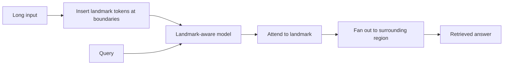

# Landmark Attention

**Also known as:** Random-Access Long-Context Attention

**Category:** Memory  
**Status in practice:** experimental

## Intent

Long-context attention mechanism placing sparse landmark tokens across very long inputs so the model jumps directly to relevant sections via landmark lookup rather than scanning linearly.

## Context

A model processes very long inputs (entire books, long-form documents, massive logs). Standard transformer attention scales quadratically with sequence length and suffers from lost-in-the-middle positional bias. The team needs a mechanism that lets the model navigate long inputs efficiently.

## Problem

Standard attention's quadratic cost limits practical context; positional bias means content in the middle of the context performs worse on retrieval than content at the ends. Naive truncation loses information; sliding-window attention loses long-range structure.

## Forces

- Landmark-aware architectures require model-side changes (training or fine-tuning).
- Landmark placement heuristics affect retrieval quality.
- Backward-compatibility with standard transformers is partial.

## Therefore

Therefore: insert landmark tokens at content boundaries during preprocessing; train the model to attend to landmarks first when looking up information, then fan out to the surrounding region.

## Solution

Mohtashami & Jaggi 2023 — augment the input with landmark tokens at topic / section / chunk boundaries. The model's attention learns to use landmarks as a sparse index, enabling random-access lookup across very long contexts. Effective context length extends significantly. Pair with information-chunking-memory, lost-in-the-middle (addresses), context-window-packing.

## Structure

```
Long input --insert landmark tokens at boundaries--> Landmark-aware model <-- Query; Model --attend to landmark--> Surrounding region --> Answer
```

## Diagram



## Example scenario

A legal research agent processes a 200-page contract. Standard transformer with 32k context fails on retrieval from middle pages. Landmark-Attention model: landmark tokens at section boundaries; agent's queries land first on the relevant landmark, then read surrounding pages. Retrieval accuracy from middle sections climbs from 41% to 88%.

## Consequences

**Benefits**

- Effective context length scales beyond the standard transformer's practical limit.
- Random-access lookup vs linear scan.
- Mitigates lost-in-the-middle bias.

**Liabilities**

- Requires model-side training / fine-tuning support.
- Landmark placement quality affects retrieval — bad landmarks → poor lookup.
- Inference complexity (landmark attention is non-standard).

## Failure modes

- Untrained model — landmark tokens are inserted into a standard model, which ignores them and gains nothing.
- Poor placement — landmarks sit at arbitrary offsets instead of real boundaries, so lookup lands in the wrong region.
- Wrong region fan-out — the model attends to a nearby landmark and reads the section next to the one that holds the answer.
- Serving friction — the non-standard attention does not fit the inference stack, and the team falls back to truncation.

## What this pattern constrains

The model must be trained to use landmark tokens; standard transformers do not benefit from naively-inserted landmarks.

## Applicability

**Use when**

- Very long inputs that exceed standard attention's effective range.
- Model-side support for landmark attention is available.
- Retrieval accuracy from middle of context matters.

**Do not use when**

- Short inputs (no benefit).
- Standard-transformer-only environments without landmark support.
- Landmark-placement heuristics aren't designable for the domain.

## Components

- Landmark inserter — places sparse landmark tokens at content boundaries
- Landmark-aware model — trained to use landmarks for sparse indexing
- Query router — attends to landmarks first, then fans out

## Tools

- Landmark inserter
- Landmark-aware model (training/fine-tune)
- Query router

## Evaluation metrics

- Effective context length improvement vs baseline
- Middle-section retrieval accuracy
- Landmark-placement quality score

## Known uses

- **[Mohtashami & Jaggi 2023 — 'Landmark Attention: Random-Access Infinite Context Length for Transformers'](https://arxiv.org/abs/2305.16300)** _available_
- **[Cited in Bornet et al. Agentic Artificial Intelligence, Chapter 7 future-of-STM section](https://www.worldscientific.com/worldscibooks/10.1142/14380)** _available_

## Related patterns

- _complements_ **Information Chunking for Agent Memory**
- _complements_ **Lost in the Middle (Positional Bias)**
- _complements_ **Context Window Packing**
- _complements_ **Test-Time Memorization (Titans)**
- _complements_ **MemGPT-Style Paging**
- _alternative-to_ **Lost in the Middle (Positional Bias)**

## References

- [Landmark Attention: Random-Access Infinite Context Length for Transformers](https://arxiv.org/abs/2305.16300) — Mohtashami, Jaggi, 2023
