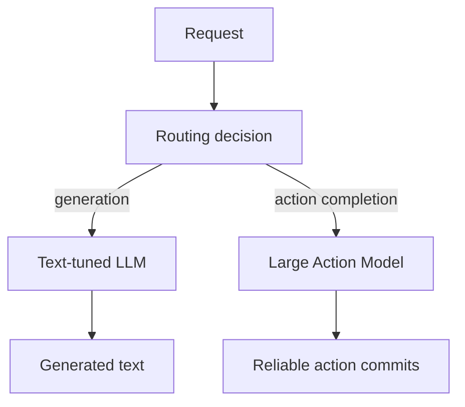

# Large Action Models (LAMs)

**Also known as:** LAM, Action-Tuned Model

**Category:** Tool Use & Environment  
**Status in practice:** experimental

## Intent

Use a model class specifically trained for action execution (tool calls, UI navigation, workflow steps) rather than text generation, when the workload is dominated by reliably completing actions in real systems.

## Context

The standard LLM is text-tuned: optimized for generating fluent prose. Wrapping it in agent scaffolding to drive tools works but is brittle — the model wasn't trained on the action-completion objective. For workloads where the value is in 'did the action commit correctly' not 'is the output well-written', LLMs leave reliability on the table.

## Problem

Text-tuned LLMs are suboptimal for action-completion workloads: they generate plausible-sounding tool calls with wrong arguments, hallucinate UI steps, fail on long action chains. The mismatch between training objective (next-token) and operational objective (action committed) shows up as unreliable execution that no amount of prompting fully fixes.

## Forces

- Training a model class for action completion requires action-completion training data, which is scarce.
- LAMs may be weaker at generation than text-tuned LLMs of similar size.
- Tooling ecosystem (Bedrock, OpenAI, Anthropic) primarily exposes text-tuned models.

## Therefore

Therefore: for workloads dominated by action completion, route to a Large Action Model trained specifically on action-execution objectives, rather than wrapping a text-tuned LLM in scaffolding.

## Solution

Identify workloads where success is measured by action completion (UI automation, multi-step API orchestration, structured workflow). Route those workloads to a LAM (Microsoft's research, Apple's UI-Tars, etc.) rather than a general LLM. Keep text-tuned LLMs for generation workloads. Pair with multi-model-routing, complexity-based-routing, computer-use, agent-computer-interface.

## Structure

```
Request --> Routing decision --(action completion)--> Large action model --> Action commits; --(generation)--> Text-tuned LLM --> Generated text
```

## Diagram



## Example scenario

A booking automation tool tries text-LLM-driven scaffolding for hotel/flight UI navigation. Success rate plateaus at 62% — model hallucinates 'click' on UI elements that don't exist, generates wrong form field names. Team switches the UI-navigation step to a LAM trained on UI-action-completion. Success rate climbs to 91%. Generation steps (summarizing the booking) stay on the text-tuned LLM.

## Consequences

**Benefits**

- Action completion reliability matches the training objective.
- Tool-call argument hallucination drops because the model was trained to commit correct arguments.
- Long action chains become tractable that text-LLM-driven agents fail on.

**Liabilities**

- LAM ecosystem is early — limited availability, limited tooling.
- Generation quality may regress vs text-tuned LLMs.
- Routing decision adds complexity (when to use LAM vs LLM).

## Failure modes

- Wrong route — a mixed request is sent to the action model, and its written reply comes out weaker than a text-tuned model would give.
- Ecosystem gap — the chosen action model lacks tooling for the target system, and integration stalls.
- Implicit per-step routing — a workflow mixing writing and acting does not decide routing per step, and one model handles both badly.
- Assumed reliability — the team trusts the action model to commit actions correctly and drops checks that the text model needed.

## What this pattern constrains

Workloads classified as action-completion route to LAM; mixed workloads must explicitly decide the routing per step.

## Applicability

**Use when**

- Workload success measured by action completion not text quality.
- Long action chains where text-LLM-driven scaffolding is unreliable.
- LAM availability for the target environment (UI, API).

**Do not use when**

- Generation-heavy workloads.
- No LAM available for the action class.
- Mixed workload where routing complexity exceeds the benefit.

## Components

- Workload classifier — generation vs action completion
- LAM access (research model or vendor)
- Router — sends workloads to the right model class
- Action-success metrics — measure LAM reliability

## Tools

- Workload classifier (generation vs action)
- LAM endpoint
- Router
- Action-success metrics

## Evaluation metrics

- Action completion rate vs LLM-driven scaffolding baseline
- LAM cost per action
- Routing accuracy

## Known uses

- **[Wang et al. 2024 — Large Action Models: From Inception to Implementation](https://arxiv.org/abs/2412.10047)** _available_
- **[Cited as the action-execution paradigm in Bornet et al. Agentic Artificial Intelligence references](https://www.worldscientific.com/worldscibooks/10.1142/14380)** _available_

## Related patterns

- _complements_ **Multi-Model Routing**
- _complements_ **Complexity-Based Routing**
- _complements_ **Computer Use**
- _complements_ **Agent-Computer Interface**
- _complements_ **Tool Use**

## References

- [Large Action Models: From Inception to Implementation](https://arxiv.org/abs/2412.10047) — Lu Wang et al., 2024
