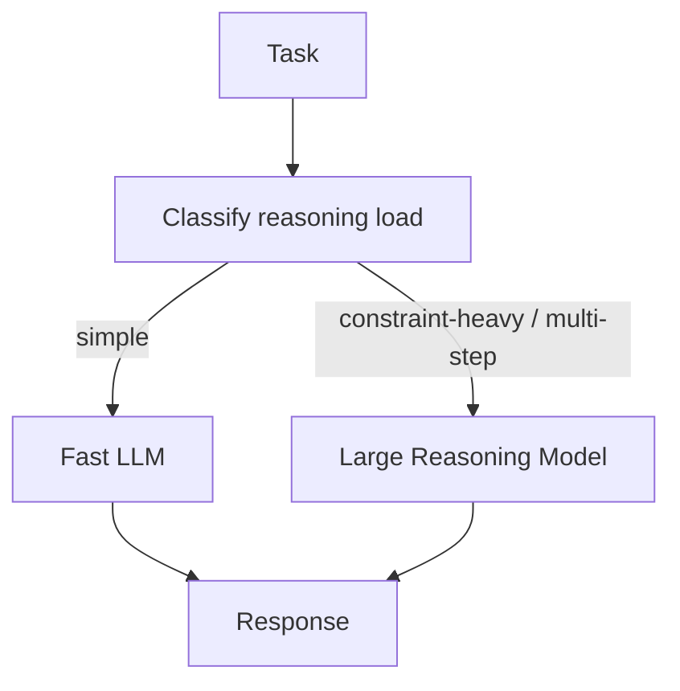

# Large Reasoning Model (LRM) Paradigm

**Also known as:** LRM, Reasoning-Tuned Model, Inference-Time Reasoning

**Category:** Reasoning  
**Status in practice:** emerging

## Intent

Route reasoning-heavy tasks to a reasoning-tuned model that trades inference time for deliberation, rather than to a fast LLM that exhibits premature-closure.

## Context

A task involves interconnected constraints, multi-step deduction, math, or formal reasoning. Standard LLMs (GPT-4o-class) respond fast but make systematic errors on constraint-heavy problems because next-token prediction biases toward fluency over correctness. Reasoning-tuned models exist (o1 family, DeepSeek R1, Gemini Thinking) — slow but methodical.

## Problem

Routing every task to a fast LLM means constraint-heavy tasks fail in characteristic ways (premature-closure, false-confidence-syndrome). Routing everything to an LRM is slow and expensive for easy tasks. The team needs a routing decision.

## Forces

- LRM latency is 10–100× LLM (often minutes).
- LRM cost is higher per token.
- Some tasks genuinely need fast response; LRM is unacceptable there.

## Therefore

Therefore: classify each task by reasoning load and route to LRM when the task is constraint-heavy / multi-step / math; otherwise route to LLM.

## Solution

Build a router that classifies tasks: simple lookups / generation → LLM; multi-step math, formal reasoning, interconnected-constraint problems → LRM. Track per-class success rate to refine routing. Pair with complexity-based-routing, multi-model-routing, test-time-compute-scaling, generate-and-test-strategy, golden-rule-simpler-is-better (don't overuse LRM).

## Structure

```
Task --> classify reasoning load --> {simple lookup or generation -> fast LLM | multi-step or constraint-heavy -> large reasoning model} --> response; routing decision + per-class success --> log --> router refinement
```

## Diagram



## Example scenario

A financial-analysis agent handles two query types: 'what was Apple's Q3 revenue' (simple lookup) and 'given these 12 covenants, can this acquisition close?' (multi-constraint reasoning). Router sends the first to GPT-4o-mini (200ms, $0.0001). Second goes to o1 (90s, $0.40, methodically tests each covenant against the term sheet). Both succeed at their task class; routing keeps cost bounded.

## Consequences

**Benefits**

- Constraint-heavy tasks succeed where LLM-only would fail.
- Cost concentrated on tasks that benefit; easy tasks stay cheap.
- Quality lift on hard problems matches the reasoning-tuned model's design objective.

**Liabilities**

- LRM latency unacceptable for some user-facing flows.
- LRM cost higher per call.
- Router classification quality dominates: bad routing wastes the LRM on easy tasks or starves hard tasks.

## Failure modes

- Wasted reasoning model — the router sends simple lookups to the reasoning model, and latency and cost rise with no quality gain.
- Starved hard task — a constraint-heavy problem is classified as simple, goes to the fast LLM, and fails with premature closure.
- Latency surprise — a user-facing flow is routed to the reasoning model and the response is too slow for the interaction.
- Unreviewed routing — routing decisions are not logged or checked against per-class success, so misclassification persists.

## What this pattern constrains

LRM is used only for tasks classified as constraint-heavy / multi-step-reasoning; routing decisions are logged and reviewed.

## Applicability

**Use when**

- Mixed task workload with both simple and constraint-heavy queries.
- Latency budgets allow LRM on some queries.
- Cost difference is bearable for the hard-task minority.

**Do not use when**

- All-fast user-facing flows.
- No multi-step / constraint-heavy queries in the workload.
- Router quality cannot be maintained.

## Components

- Task classifier — reasoning-load estimator
- Fast LLM endpoint
- LRM endpoint (o1, DeepSeek R1, Gemini Thinking)
- Routing log — per-task class and outcome
- Per-class success-rate tracker

## Tools

- Task classifier (reasoning-load estimator)
- Fast LLM endpoint
- LRM endpoint (o1, DeepSeek R1, Gemini Thinking)
- Per-class success-rate tracker

## Evaluation metrics

- Routing accuracy (right model per task)
- Per-class success rate
- LRM cost per query vs LLM-only baseline

## Known uses

- **[OpenAI o1 family (o1, o1-Preview, o3) — Sep 2024 onward](https://openai.com/index/learning-to-reason-with-llms/)** _available_
- **[DeepSeek R1, Gemini Thinking — 2024/2025](https://api-docs.deepseek.com/news/news250120)** _available_
- **[Bornet et al. — Agentic Artificial Intelligence, Chapter 6 (crossword puzzle LLM-vs-LRM experiment)](https://www.worldscientific.com/worldscibooks/10.1142/14380)** _available_

## Related patterns

- _complements_ **Complexity-Based Routing**
- _complements_ **Multi-Model Routing**
- _complements_ **Test-Time Compute Scaling**
- _complements_ **Extended Thinking**
- _complements_ **Generate-and-Test Strategy**
- _alternative-to_ **Context Fragmentation**
- _alternative-to_ **Premature Closure**
- _complements_ **Test-Time Memorization (Titans)**
- _complements_ **Deliberation Over Observation** — Routing a task to a reasoning-tuned model buys deliberation on constraint-heavy problems and buys this failure on interactive ones, where such models score higher on the overthinking measure.

## References

- [Agentic Artificial Intelligence — Chapter 6: Reasoning](https://www.worldscientific.com/worldscibooks/10.1142/14380) — 2025
- [OpenAI — Learning to Reason with LLMs](https://openai.com/index/learning-to-reason-with-llms/) — 2024
