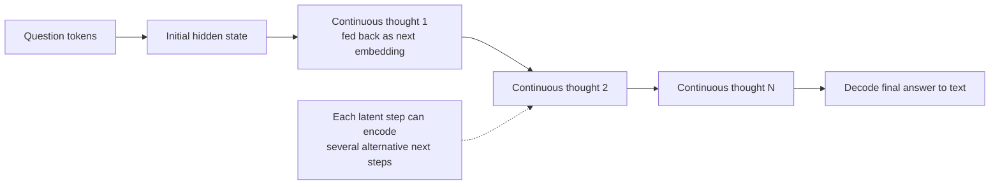

# Latent-Space Reasoning

**Also known as:** Continuous-Thought Reasoning, Coconut, Latent Chain-of-Thought

**Category:** Reasoning  
**Status in practice:** experimental

## Intent

Let the model reason in continuous hidden-state space instead of decoding each step to text, feeding the last hidden state back as the next input embedding, so one latent step can hold several continuations.

## Context

A team is building an agent that must do hard multi-step reasoning — planning that needs backtracking, logical deduction with dead ends. The standard approach is chain-of-thought: the model writes its reasoning out as text tokens, step by step. The team has to decide whether reasoning must happen in natural language at all, given that most of those tokens exist for fluent text rather than for the computation itself.

## Problem

Forcing every reasoning step through natural-language tokens spends most of the compute on producing coherent words rather than on the few decisions that matter, and it makes the model commit to one continuation at each step — once a token is emitted, the path is chosen. Tasks that need to keep several options open and backtrack are penalised, because token-by-token decoding cannot represent 'either of these next steps' in a single state. The language channel becomes a bottleneck on reasoning that is shaped for human readers, not for search.

## Forces

- Most reasoning tokens ensure fluent text, not the computation the task needs.
- Decoding to a token forces the model to commit to one continuation per step.
- Tasks needing backtracking benefit from keeping several next steps open.
- A hidden state can encode a distribution over continuations a single token cannot.
- Reasoning that never becomes text is far harder to inspect and supervise.

## Therefore

Therefore: keep the reasoning state in the model's continuous latent space — feed the last hidden state back as the next input embedding instead of decoding it to a word — so a step can carry several alternative continuations and the model searches rather than commits.

## Solution

Instead of decoding each reasoning step into a word token and re-encoding it, take the model's last hidden state as the reasoning state — a 'continuous thought' — and feed it directly back as the next input embedding. The model reasons through a sequence of these latent states and only decodes to text when it produces the final answer. Because a continuous state is not collapsed onto one token, it can encode several alternative next steps at once, letting the model explore breadth-first and defer commitment, which helps on tasks that require backtracking. Training mixes latent steps into the reasoning trace so the model learns to use them.

## Structure

```
Question tokens -> a sequence of continuous thoughts (each the last hidden state fed back as the next input embedding) -> decode only the final answer to text. No intermediate text decoding; a latent step can encode several next steps.
```

## Diagram



*Reasoning runs as a chain of continuous hidden states fed back as input embeddings; only the final answer is decoded to text.*

## Example scenario

An agent solves a logic puzzle that requires trying a branch, hitting a contradiction, and backing up. With text chain-of-thought it commits to one branch per emitted token and struggles to backtrack. With latent-space reasoning it carries its reasoning as continuous hidden states, each of which can hold several candidate next moves at once, exploring breadth-first before decoding only the final solution to text — reaching the answer with fewer thinking tokens.

## Consequences

**Benefits**

- Spends compute on the reasoning state rather than on producing fluent words.
- A latent step can encode several next steps, enabling breadth-first exploration.
- Helps on planning and logic tasks that need backtracking.
- Often reaches the answer with fewer thinking tokens than text chain-of-thought.

**Liabilities**

- Latent reasoning is not human-readable, so it is hard to inspect, supervise, or audit.
- It needs training support; a model cannot be prompted into it at inference alone.
- Losing an explicit trace removes a safety and debugging surface.
- Gains are task-dependent and do not always beat strong text chain-of-thought.

## Failure modes

- Unauditable decision — a wrong answer comes out of latent steps that cannot be read, and there is no trace to find where it went wrong.
- Prompting expectation — a team tries to get latent reasoning from an untrained model by prompting alone, and nothing changes.
- Lost oversight — moving reasoning into hidden states removes the text trace that safety review relied on.
- Task mismatch — latent reasoning is applied to a task where strong text chain-of-thought does better, and accuracy drops.

## What this pattern constrains

Intermediate reasoning is not decoded to text; the model may emit tokens only for the final answer, and the continuous reasoning state cannot be read back as a natural-language trace.

## Applicability

**Use when**

- The task needs multi-step reasoning with backtracking or search.
- Token-by-token commitment is hurting reasoning quality.
- Training or fine-tuning the model to use latent steps is feasible.
- A human-readable reasoning trace is not a hard requirement.

**Do not use when**

- An auditable, human-readable reasoning trace is required (safety, compliance).
- Only inference-time prompting is available and the model cannot be trained.
- Text chain-of-thought already solves the task well.
- The task is simple enough that latent search adds no value.

## Components

- Continuous thought — the last hidden state used as the reasoning state and fed back as input
- Latent reasoning loop — the sequence of hidden-state steps taken before any decoding
- Decoder gate — switches from latent steps to emitting the final answer in text
- Training curriculum — mixes latent steps into reasoning traces so the model learns to use them

## Tools

- Model with hidden-state feedback — inference path that feeds the last hidden state back as the next embedding
- Fine-tuning pipeline — trains the model to reason over latent steps

## Evaluation metrics

- Accuracy on backtracking-heavy tasks versus text chain-of-thought
- Thinking tokens per solved problem — efficiency relative to text reasoning
- Latent-step count — how many continuous thoughts are used before decoding
- Answer accuracy versus trace inspectability — the supervision trade-off
- Generalisation across reasoning task types — where latent reasoning helps or hurts

## Known uses

- **[Coconut (Meta)](https://github.com/facebookresearch/coconut)** _available_ — Chain of Continuous Thought: the last hidden state is fed back as the next input embedding rather than decoded to a word token; presented at ICLR 2025.
- **[Soft Thinking / soft-token reasoning](https://arxiv.org/abs/2505.15778)** _available_ — Concurrent research line reasoning over a soft mixture of token embeddings rather than one discrete token.

## Related patterns

- _alternative-to_ **Chain of Thought** — Latent-space reasoning keeps the chain in continuous hidden states instead of decoding each step to text tokens.
- _complements_ **Tree of Thoughts** — A continuous thought can encode several next steps at once, giving a latent analogue of tree-of-thoughts breadth-first exploration.

## References

- [Training Large Language Models to Reason in a Continuous Latent Space](https://arxiv.org/abs/2412.06769) — Shibo Hao et al. (Meta), 2024
- [Coconut: A Framework for Latent Reasoning in LLMs](https://towardsdatascience.com/coconut-a-framework-for-latent-reasoning-in-llms/) — 2025
- [facebookresearch/coconut](https://github.com/facebookresearch/coconut) — 2025
