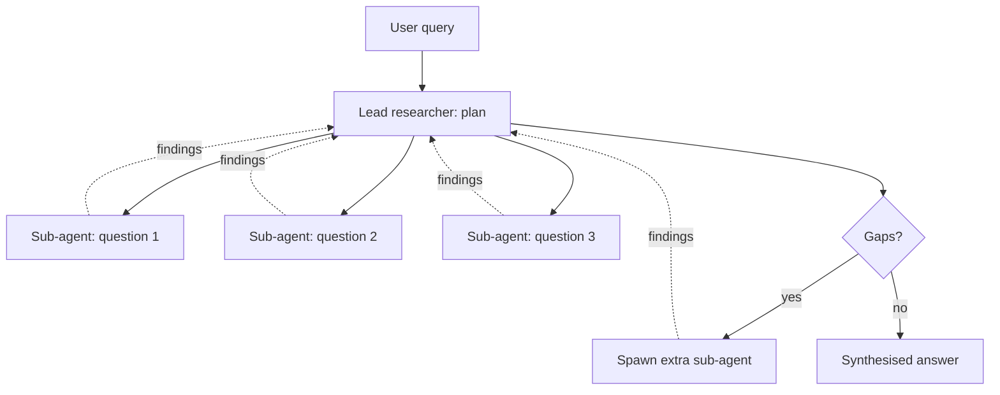

# Lead Researcher

**Also known as:** Research Orchestrator, Lead-and-Subagents

**Category:** Multi-Agent  
**Status in practice:** mature

## Intent

A lead agent writes a research plan and dispatches parallel sub-agents that fan out for breadth-first information gathering, then merges results.

## Context

A team is using an agent to handle open-ended research tasks — write a market brief on a niche industry, gather competitive intelligence, prepare a literature review. The work benefits from breadth-first exploration across many sources rather than depth-first reasoning along one thread, and there is a deadline measured in hours, not days.

## Problem

A single agent doing the research serially is bottlenecked on its own token generation: it can only search and read one source at a time, and by the time it has visited ten sources the deadline has passed or its context window is exhausted. A generic orchestrator-workers pattern handles parallel sub-tasks but does not say anything about how to plan research questions, how to keep sub-agents from overlapping, or how to synthesise findings into a coherent answer. The team needs a structure shaped specifically for research, not a generic dispatcher.

## Forces

- Sub-agent count vs cost.
- Synthesis quality bounded by lead agent's reasoning over fragmented results.
- Information overlap across sub-agents is wasted compute.

## Therefore

Therefore: have a lead plan parallel research questions, fan out to independent sub-agents that return structured findings, and synthesise with optional follow-up spawns, so that breadth-first exploration replaces serial single-thread reasoning.

## Solution

Lead agent receives the user query, plans a set of parallel research questions, and dispatches each to a sub-agent. Each sub-agent searches independently and returns structured findings to the lead. The lead reads the returned findings and synthesises the answer; if synthesis reveals gaps, the lead spawns additional sub-agents.

## Structure

```
User query --> Lead (plan research questions) --dispatch in parallel--> Sub-agents (search independently) --structured findings--> Lead (synthesise) --gaps?--> [yes: spawn extra sub-agents | no: answer]
```

## Diagram



## Example scenario

An investment research firm asks an agent to write a brief on a niche industrial-equipment market by Friday. A single agent takes hours and misses half the relevant sources. They restructure as lead-researcher: the lead reads the brief, plans five parallel research questions (market size, top vendors, regulatory landscape, recent M&A, customer reviews), and dispatches each to a sub-agent that searches independently. Findings come back as structured records; the lead synthesises them and dispatches a follow-up sub-agent for one gap it spots. Wall-clock time drops from hours to twenty minutes.

## Consequences

**Benefits**

- Breadth-first parallelism cuts wall-clock time.
- Inspectable scratchpad makes the research auditable.

**Liabilities**

- Sub-agent overlap and redundancy.
- Synthesis is the new bottleneck.

## Failure modes

- Overlapping sub-agents — the plan splits the query into questions that overlap, and several sub-agents read the same sources.
- Synthesis bottleneck — the lead receives more findings than it can read well and writes a shallow answer.
- Gap loop — the lead keeps spawning extra sub-agents for every small gap and never settles on an answer.
- Narrow plan — the lead's first plan misses a whole angle of the question, and no sub-agent ever looks there.

## What this pattern constrains

Sub-agents return findings only to the lead; peer-to-peer communication is forbidden.

## Applicability

**Use when**

- Research-shaped tasks benefit from breadth-first parallel sub-agents.
- A lead can plan, dispatch, and synthesise findings rather than execute serially.
- Source diversity matters and a single agent's serial search would be a bottleneck.

**Do not use when**

- The query is narrow enough that a single agent answers it cheaply.
- Generic orchestrator-workers fits the task without the research-specific structure.
- Synthesis effort would dominate and erase the parallelism gains.

## Components

- Lead researcher — plans parallel sub-questions, dispatches sub-agents, and synthesises findings
- Research sub-agent — independent worker that searches for one sub-question and returns structured findings
- Structured-findings schema — typed return shape sub-agents must conform to
- Gap-detection step — synthesis check that decides whether to spawn follow-up sub-agents
- Inspectable scratchpad — auditable record of plan, dispatches, and merged findings

## Tools

- Web-search and retrieval APIs — primary information-gathering tools inside each sub-agent
- LLM API — one call for the lead's plan plus one per sub-agent per search turn
- Parallel-dispatch runtime — concurrency primitives that fan out sub-agents simultaneously

## Evaluation metrics

- Wall-clock-time reduction — speedup versus a serial single-agent baseline
- Source-coverage breadth — distinct sources cited across sub-agent findings
- Sub-agent overlap rate — redundant work where two sub-agents fetched the same source
- Synthesis-quality lift — human-rated answer quality versus a single-agent serial run
- Cost per research task — total spend across lead and all sub-agents

## Known uses

- **[Anthropic Multi-Agent Research](https://www.anthropic.com/engineering/multi-agent-research-system)** _available_
- **OpenAI Deep Research** _available_

## Related patterns

- _specialises_ **Orchestrator-Workers**
- _uses_ **Parallelization**
- _specialises_ **Supervisor**
- _alternative-to_ **Clone Fan-Out Research**
- _alternative-to_ **Rumination Agent**

## References

- [How we built our multi-agent research system](https://www.anthropic.com/engineering/multi-agent-research-system) — Anthropic, 2025
