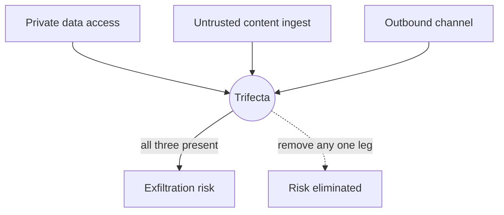

# Lethal Trifecta Threat Model

**Also known as:** Willison Trifecta, Three-Capabilities Exfiltration Risk

**Category:** Safety & Control  
**Status in practice:** emerging

## Intent

Block prompt-injection-driven exfiltration by ensuring no single agent execution path holds all three of: access to private data, exposure to untrusted content, and an outbound communication channel.

## Context

A team builds a tool-using agent that combines three capabilities in the same execution: it reads data the operator wants to keep private (tokens, customer records, internal files), it ingests content from sources the operator does not control (emails, fetched web pages, third-party API responses, MCP servers from unknown providers), and it can call tools that transmit information outside the trust boundary (public HTTP requests, image-URL renders, link previews, chat webhooks, even error reports). This combination is extremely common — email assistants, browsing agents, coding agents with model-context-protocol servers, and any large language model that can both query internal systems and reach the public internet.

## Problem

An attacker only has to plant one well-crafted prompt-injection payload in any piece of untrusted content the agent will read. Once that payload reaches a model that also has access to private data and an outbound channel, the injection can instruct the model to fetch the private data and ship it out, and the model has no reliable way to refuse, because instructions inside data look indistinguishable from instructions in the system prompt. Filtering the untrusted content is unreliable, prompting the model to ignore embedded instructions is unreliable, and the outbound channels are easy to overlook — image URLs, link previews, error reports, and ordinary tool calls all serve as exfiltration paths.

## Forces

- Each of the three capabilities is individually useful, and many real agents need all three.
- Prompt-injection content is indistinguishable from legitimate content to the model.
- Outbound channels are easy to overlook — image URLs, link previews, error reports, and tool calls can all serve as exfiltration paths.
- Removing capabilities reduces agent utility; the operator must consciously trade utility for safety.

## Therefore

Therefore: tag every tool and data source by which of the three capabilities it provides and let the host refuse any execution path that holds all three at once, so that exfiltration is eliminated by construction rather than by classifier accuracy.

## Solution

Treat the three capabilities — **private-data read**, **untrusted-content ingest**, and **outbound communication** — as a tagged capability set on every tool and data source. For each agent execution path, enforce at orchestration time that at least one of the three is missing. Concrete moves: split the agent into two runs (one that reads private data, one that reads untrusted content), strip outbound network for the run that touches both, or sanitise untrusted content into typed fields before it reaches private-data context. The check is performed by the host, not by guardrail prompts.

## Structure

```
Tools and sources tagged {private-data read, untrusted ingest, outbound channel} --> Host checks each execution path --all three present--> Refuse or split (separate runs / strip outbound / sanitise to typed fields) | --at least one missing--> Run
```

## Diagram



## Example scenario

A coding agent runs with the user's private GitHub token (private data), browses a third-party documentation site for setup instructions (untrusted content), and can post to a chat webhook for status updates (outbound channel). A prompt-injection payload hidden in a third-party docs page tells the model to fetch the GitHub token and POST it to attacker.example via the chat webhook. The trifecta is complete; the attack succeeds. Removing any one leg — running browsing in a tokenless subagent, disabling the chat webhook for the browsing leg, or stripping outbound DNS — would have blocked it.

## Consequences

**Benefits**

- Eliminates an entire class of exfiltration attacks by construction, not by classifier accuracy.
- Forces explicit capability tagging — surfaces tools that combine too much authority.
- Composable with other safety patterns (dual-LLM, egress lockdown, sandbox isolation).

**Liabilities**

- Restricts powerful single-agent designs that read everything and act anywhere.
- Requires disciplined capability tagging across the tool catalogue; missing tags create silent gaps.
- Does not address injection by other paths (poisoned tool output, supply-chain prompts, model weights).

## Failure modes

- Missing tag — a new tool reads private data but is not tagged as such, so the host check passes a path that holds all three legs.
- Recombined legs — two split runs are later joined by a step that passes untrusted text into the run that also has the outbound channel.
- Out-of-scope injection — the attack comes through a poisoned tool output rather than ingested content, and the trifecta check never sees it.

## What this pattern constrains

An execution path may not simultaneously read private data, ingest untrusted content, and reach an outbound channel; tools missing capability tags must be treated as carrying all three.

## Applicability

**Use when**

- The agent processes content the operator does not control.
- The same agent has access to data or credentials the operator wants to keep private.
- The tool catalogue includes any tool that can reach a destination the operator does not control.

**Do not use when**

- All three capabilities are needed in the same execution and the operator accepts the residual risk after applying narrower controls.
- There is no private data in scope and the agent is purely public-input-to-public-output.

## Components

- Capability tag — label on every tool and data source for private-read, untrusted-ingest, or outbound-comm
- Trifecta checker — orchestration-time enforcement that no execution path holds all three legs
- Tool catalogue — registry where capability tags are authored and reviewed
- Path splitter — mechanism that runs untrusted and private legs in separate sessions when needed

## Tools

- Static capability analyser — compile-time scan that flags untagged tools as carrying all three legs
- Egress firewall — network-level enforcement of outbound-channel restrictions
- Session isolator — host primitive that strips capabilities for the untrusted leg

## Evaluation metrics

- Untagged-tool count — tools missing capability labels and therefore treated as all-three
- Trifecta-violation incidents — execution paths that combined all three legs at runtime
- Path-split coverage — share of untrusted-content reads done in a tokenless subagent
- Exfiltration-test pass rate — red-team payloads the model neither obeyed nor leaked from

## Known uses

- **[Simon Willison, original framing](https://simonwillison.net/2025/Jun/16/the-lethal-trifecta/)** _available_ — Coined June 2025 after a string of vendor incidents fit the same shape.
- **[Microsoft 365 Copilot CVE-2024-38206 fix](https://msrc.microsoft.com/update-guide/vulnerability/CVE-2024-38206)** _available_ — Removed outbound channel for sessions that read both untrusted email and private SharePoint content.
- **[GitHub MCP, GitLab Duo postmortem mitigations](https://simonwillison.net/2025/Jun/16/the-lethal-trifecta/)** _available_ — First patches in both products removed an outbound path rather than trying to filter the untrusted leg.

## Related patterns

- _complements_ **Dual LLM Pattern** — Dual-LLM removes private-data access from the model that reads untrusted content — one concrete way to break the trifecta.
- _complements_ **Prompt Injection Defense**
- _complements_ **Input/Output Guardrails**
- _complements_ **Sandbox Isolation**
- _complements_ **Tool Output Poisoning Defense** — Tool output poisoning is one of the untrusted-content sources the trifecta calls out.
- _complements_ **Control-Flow Integrity**
- _complements_ **Action Selector Pattern**
- _complements_ **Adversary-Indistinguishability Blind Spot** — The trifecta blocks injection-driven exfiltration by separating capabilities; this names a detection blind spot that persists even when the attacker is an autonomous agent acting legitimately.
- _complements_ **Agent Tool-Invocation Data Black-Box** — The trifecta blocks injection-driven exfiltration by separating capabilities; the data black box is non-adversarial undisclosed routing of user data through the agent's own tool calls.
- _complements_ **Cumulative Disclosure Accounting** — That model blocks an exfiltration path assembled from three capabilities in one run; this one meters authorised reads that accumulate into an unauthorised inference.
- _complements_ **Monotonic Privilege Confinement** — Names the capability combination that makes an escalation dangerous; narrowing the action space on contamination is one way to break that combination part-way through a run.

## References

- [The lethal trifecta for AI agents: private data, untrusted content, and external communication](https://simonwillison.net/2025/Jun/16/the-lethal-trifecta/) — Simon Willison, 2025
- [Design Patterns for Securing LLM Agents against Prompt Injections](https://arxiv.org/abs/2506.08837) — Beurer-Kellner et al., 2025
