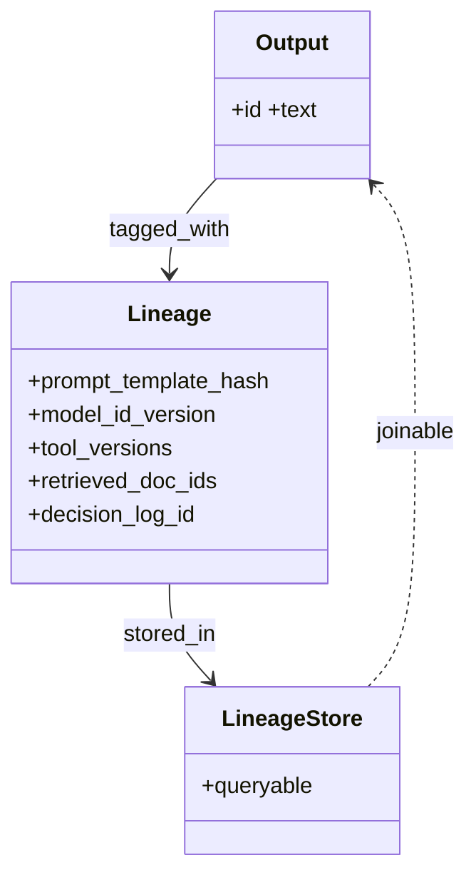

# Lineage Tracking

**Also known as:** Data Lineage, Artefact Provenance

**Category:** Governance & Observability  
**Status in practice:** mature

## Intent

Track which prompt version, model version, and data sources produced each agent output.

## Context

A team runs an agent whose outputs may be referenced weeks or months after they were produced — an underwriting decision, a generated contract clause, a research summary cited in another document. Over that time the prompts evolve, the model is upgraded, the tool set changes, and the retrieval index is rebuilt. When a customer or auditor surfaces a specific past output and asks how it was produced, the team needs to be able to answer precisely.

## Problem

Without recording which prompt template, which model version, which tool versions, and which retrieved documents produced each output, the team cannot reconstruct what happened six weeks ago. Disputes become unanswerable and rollbacks become guesswork, because there is no record of which combination of ingredients was even live at that time. The team is forced to choose between manual reconstruction from incomplete clues or accepting that the system effectively forgets why it said what it said.

## Forces

- Lineage metadata adds storage.
- Schema evolution of lineage is itself a problem.
- PII in lineage records (prompts contain user data).

## Therefore

Therefore: stamp every agent output with prompt-template hash, model id and version, tool versions, retrieved-document ids, and decision-log id in a queryable store, so that any output can be traced back to the exact ingredients that produced it.

## Solution

Tag every agent output with: prompt template hash, model id and version, tool versions, retrieved-document ids, decision-log id. Store in a queryable lineage store. Make lineage joinable to the output store.

## Structure

```
Agent output --> Lineage stamper (prompt template hash, model id + version, tool versions, retrieved-doc ids, decision-log id) --> Lineage store <--join on output id--> Output store (accepts tagged outputs only); Lookup interface --> resolve past output to its ingredients
```

## Diagram



## Example scenario

A customer files a complaint about an agent answer they got six weeks ago. The team has no record of which prompt template was live then, which model version answered, or which retrieved documents were used; reproducing the answer is impossible. They add lineage-tracking: every output is tagged with prompt-template hash, model id and version, tool versions, retrieved-document ids, and the decision-log id, all stored in a queryable lineage table. The next disputed answer is fully reconstructed in minutes and traced to a since-rolled-back prompt change.

## Consequences

**Benefits**

- Output disputes are answerable.
- Targeted rollback becomes possible.

**Liabilities**

- Storage growth.
- Lineage schema must evolve carefully.

## Failure modes

- Missing retrieval ids — the stamper records prompt and model versions but drops the retrieved-document ids, so a disputed answer cannot be traced to its source text.
- Broken join — the lineage store and output store use different output ids after a migration, and old outputs no longer resolve to their ingredients.
- Schema change breaks history — a new lineage field is added without versioning, and queries against older records fail or return partial rows.
- Unbounded growth — every output carries a full lineage row forever, and storage cost forces a cleanup that deletes records still needed for disputes.

## What this pattern constrains

Outputs without lineage tags are not promoted to production storage.

## Applicability

**Use when**

- Output disputes, audits, or rollbacks require knowing exactly what produced an output.
- Prompts, models, tools, and retrieved documents change often enough that ad-hoc tracking fails.
- A queryable lineage store can be joined to the output store.

**Do not use when**

- The agent is a one-shot experiment with no audit need.
- No store exists to capture and join lineage records.
- Output volume is small enough that manual reconstruction is acceptable.

## Components

- Lineage Stamper — attaches prompt-template hash, model id and version, tool versions, retrieved-doc ids, and decision-log id to each output
- Queryable Lineage Store — indexed table joinable to the output store on output id
- Output Store — production-side store that only accepts tagged outputs
- Schema Evolver — versions the lineage schema across the agent's lifetime without breaking old records
- Lookup Interface — resolves any past output back to the exact ingredients that produced it

## Tools

- Langfuse — captures prompt, model, and retrieval metadata per trace
- LangSmith — joins per-run lineage with eval and trace data
- Weights & Biases Prompts — versioned prompt and model lineage store

## Evaluation metrics

- Lineage coverage — share of production outputs that carry the required tags
- Reconstruction success rate — fraction of disputed outputs fully resolved from the lineage store
- Mean time to reconstruct a past output — query latency for a six-week-old answer
- Targeted-rollback hit rate — share of rolled-back ingredients identified precisely instead of blanket reverts
- Lineage-schema migration count — schema changes accommodated without breaking historical queries

## Known uses

- **Langfuse, LangSmith, Weights & Biases Prompts** _available_

## Related patterns

- _complements_ **Provenance Ledger**
- _complements_ **Cost Observability**
- _complements_ **Replay / Time-Travel**
- _alternative-to_ **Black-Box Opaqueness**
- _alternative-to_ **Hidden Mode Switching**
- _composes-with_ **Prompt Versioning**
- _used-by_ **Sovereign Inference Stack**
- _complements_ **Attention-Manipulation Explainability**
- _complements_ **Postmortem Pattern Mining** — Lineage records which prompt/model/data produced one output; the citations from records to source postmortems give the aggregate report the same traceability over the mined corpus.
- _complements_ **Serving-Stack Attestation** — Lineage records the model version the caller claimed; this pattern supplies the measured backend, precision and generation configuration that make the recorded identity a fact rather than a copy of configuration.
- _complements_ **As-Of Information-Set Pinning** — Lineage records which sources produced an output after the fact; this pattern constrains which versions may be read in the first place and keeps them servable for the dispute window.

## References

- [NIST AI Risk Management Framework](https://www.nist.gov/itl/ai-risk-management-framework) — 2023
