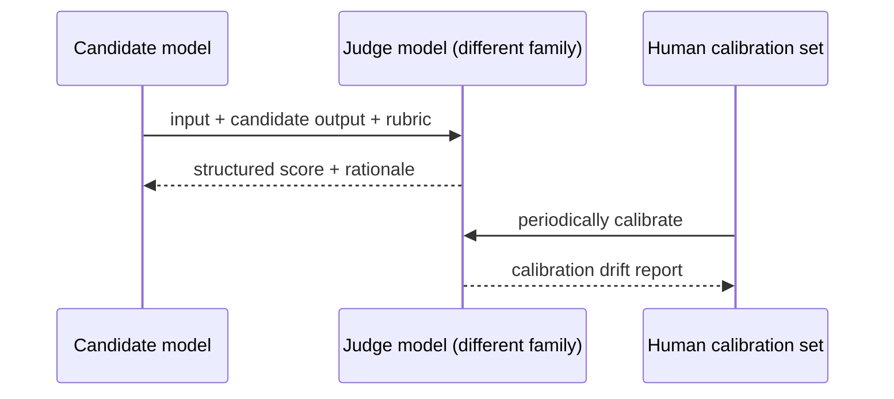

# LLM-as-Judge

**Also known as:** Model Grading, Auto-Evaluator

**Category:** Governance & Observability  
**Status in practice:** mature

## Intent

Use an LLM to score open-ended outputs against rubric criteria when no exact-match metric applies.

## Context

A team is evaluating an agent whose outputs are free-form text — summaries, generated code, long-form prose, support replies — where no single reference answer is uniquely correct. They want regression detection automated enough to run on every release or pull request, not paced by how many summaries a human can grade in a week. They are willing to write down what good looks like in the form of a rubric.

## Problem

Exact-match scoring fails on free-form outputs because there are many acceptable answers, and similarity metrics on raw text miss the qualities the team actually cares about such as faithfulness, completeness, or tone. Pure human grading is too slow to gate a CI pipeline that runs many times per day. The team is forced to choose between cheap-but-blind metrics that miss real regressions and expensive human review that does not scale.

## Forces

- Judges have biases (length, position, model-family preference).
- Calibration against human judgement is its own dataset.
- Same-model judging is suspect when the candidate is from the same family.

## Therefore

Therefore: prompt a judge model from a different family with the input, the candidate output, and an explicit rubric, and calibrate it periodically against human-graded samples, so that open-ended outputs get a structured score with rationale instead of an unscored verdict.

## Solution

Define a rubric. Prompt a judge model with the input, candidate output, and rubric. Receive a structured score plus rationale. Calibrate periodically against human-graded samples. Use a different model family for judge vs candidate where possible.

## Structure

```
Input + candidate output + rubric --> Judge model (different family) --> Structured score + rationale; Human calibration set --periodic comparison--> Judge --> Drift report
```

## Diagram



## Example scenario

A team running a summarisation eval relies on humans to grade 200 summaries per release, which takes a week and gates every deploy. They add llm-as-judge: a different model family scores each summary against a rubric (faithfulness, completeness, clarity) and emits a structured score plus rationale. They calibrate weekly against a 30-sample human-graded slice and flag drift. Releases now ship daily with an automated quality gate, and humans only spot-check.

## Consequences

**Benefits**

- Scales free-form evaluation.
- Rationales are debugging breadcrumbs.

**Liabilities**

- Judge biases skew scores in subtle ways.
- Cost: every eval is now N x judge calls.

## Failure modes

- Same-family favouritism — the judge comes from the same model family as the candidate and rates its familiar style higher than an equally good answer.
- Uncalibrated gate — judge scores block or pass releases without any recent comparison to human grades, and drift goes unseen.
- Vague rubric — criteria such as tone are loosely worded, and the judge's scores swing on surface features such as length.
- Cost multiplication — every eval item now needs one or more judge calls, and the team trims the eval set to stay in budget.

## What this pattern constrains

Scores are advisory unless calibrated against human judgement at known intervals.

## Applicability

**Use when**

- Open-ended outputs need automated regression detection without a reference answer.
- A rubric can be written that covers the qualities you actually care about.
- Calibration against human-graded samples is feasible periodically.

**Do not use when**

- An exact-match or reference metric already grades the task.
- No rubric can be agreed and the judge would just rehearse model bias.
- Calibration data and review cycles cannot be sustained.

## Components

- Rubric — written criteria covering the qualities that matter (faithfulness, completeness, tone)
- Judge Model — different model family from the candidate, prompted with input and output
- Structured Score Schema — numeric or categorical verdict plus free-text rationale
- Human Calibration Set — periodically graded samples used to detect judge drift
- Drift Report — divergence between judge scores and human scores over time

## Tools

- Judge LLM API from a different family than the candidate — primary scoring engine
- MT-Bench / AlpacaEval — published rubrics and judge protocols
- Ragas / DeepEval / Langfuse — eval frameworks with built-in LLM-as-judge scorers

## Evaluation metrics

- Judge-vs-human agreement — Pearson or Cohen's kappa between automated and human scores on the calibration set
- Calibration drift over time — change in agreement since the last calibration pass
- Position-bias delta — score change when candidate-A and candidate-B order is swapped
- Length-bias delta — score change as output length varies with content held roughly constant
- Per-eval judge cost — added spend per evaluated item from the judge calls

## Known uses

- **MT-Bench / AlpacaEval** _available_
- **Ragas / DeepEval / Langfuse** _available_

## Related patterns

- _used-by_ **Eval Harness**
- _used-by_ **Evaluator-Optimizer**
- _generalises_ **Agent-as-a-Judge**
- _used-by_ **Shadow Canary**
- _generalises_ **Blind Grader with Isolated Context**
- _used-by_ **Scorer Live Monitoring**
- _alternative-to_ **Reward Hacking**
- _alternative-to_ **Sycophancy**
- _complements_ **Cross-Reflection**
- _complements_ **Generator-Critic Separation**
- _complements_ **Heterogeneous-Model Council with Synthesis Judge**
- _complements_ **Intermediate Artifact Evaluation**
- _complements_ **Agent Evaluator**
- _used-by_ **evaluation-driven-development**
- _used-by_ **Sampled Prompt Trace Eval**
- _complements_ **Dimensional Synthetic Eval Set**
- _used-by_ **Prompt Variant Evaluation**
- _alternative-to_ **Trajectory Anomaly Monitor** — An LLM judge is flexible but far slower; the trajectory monitor is a trained lightweight hot-path verifier.
- _complements_ **Prior-Estimate Anchoring** — The judging stage is where the anchor lands; a scoring call that receives the previous score is not the independent judgement the pattern assumes.
- _complements_ **Judge-Channel Injection** — This is the failure surface of model grading: the judge pattern assumes the candidate output is data, and the injection turns it into instructions the judge obeys.
- _used-by_ **Checklist Partial-Credit Scoring** — Checkpoints that cannot be settled by a scripted assertion are graded by a judge model against a short rubric, which is where judge calibration drift enters this pattern.
- _complements_ **Chance-Corrected Judge Validation** — That pattern introduces the judge and asks for periodic calibration against human grading; this one names the artifact, the statistic and the threshold that turn calibration into a licence the judge has to hold.
- _complements_ **Simulated-User Rollout Evaluation** — The judge scores a finished artefact against a rubric; the simulated user participates in and steers the episode, and the primary score comes from environment state rather than model opinion. A judge is still needed for the tone and policy checks state grading misses.

## References

- [Judging LLM-as-a-Judge with MT-Bench and Chatbot Arena](https://arxiv.org/abs/2306.05685) — Zheng et al., 2023
