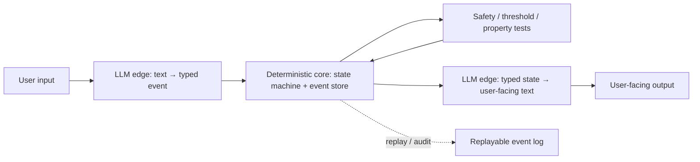

# LLM as Periphery

**Also known as:** Deterministic-Core LLM-Edge, LLM — это периферия, а не ядро

**Category:** Structure & Data  
**Status in practice:** experimental

## Intent

Invert the typical LLM-in-the-middle architecture: a deterministic state machine and event store form the core; the LLM is restricted to edge tasks — input interpretation and output synthesis only.

## Context

An agent system is being designed where some decisions are safety-critical or property-testable (state transitions, threshold enforcement, eligibility, persisted facts) and others are inherently interpretive (free-text classification, summary generation, ambiguous intent parsing). The default architectural reflex is to place the LLM at the centre of the loop and call code from it. The author of the Habr write-up that surfaced this shape argues the default is inverted: the LLM should be the periphery, not the core.

## Problem

When the LLM holds state and orchestrates transitions, every state mutation is non-deterministic, every safety-critical decision is unverifiable, and every regression in the LLM ripples through the whole system. The decision the Habr author reached after building a self-knowledge bot: keep all state transitions, thresholds, and safety-critical decisions in explicit, property-tested code; use the LLM only at the edges where its strengths (interpretation, synthesis) match the task. Distinct from the existing deterministic-llm-sandwich pattern (which wraps a centrally-placed LLM in deterministic gates): here the deterministic component is canonical and the LLM is auxiliary.

## Forces

- LLM strengths (interpretation, synthesis) and weaknesses (state, exact rules, repeatability) point at different parts of the system; one architecture cannot serve both.
- State held inside an LLM context cannot be property-tested; state held in code can.
- Centring the LLM gives developer velocity early; the cost shows up later as untestability and ripple-regressions.
- Inverting the default requires more upfront design — most frameworks assume LLM-at-the-centre.

## Therefore

Therefore: design the deterministic state machine and event store first; identify the points where interpretation or synthesis is genuinely needed; insert the LLM only at those edge points, with explicit input/output schemas and no persistent state.

## Solution

Place a deterministic state machine and an event store at the core. Decisions about state transitions, threshold checks, and persistence happen in explicit code with property-based tests. The LLM is invoked at well-defined edges: interpreting free-text input into a typed event, synthesizing user-facing text from a typed state, classifying ambiguous inputs into a known taxonomy. The LLM is stateless across edges; the event store is the only state. New LLM calls re-read from the event store and produce edge outputs that get written back as typed events.

## Structure

```
User input -> LLM edge (free text -> typed event) -> Deterministic core (state machine + event store, property-tested thresholds and safety checks) -> LLM edge (typed state -> user-facing text) -> output; event store is the only state and supports replay and audit
```

## Diagram



## Example scenario

A self-knowledge assistant could be built LLM-first: the LLM holds conversation state, decides when to advance the user's reflection week, and writes summaries. Instead the author built it inverted: a deterministic Stability Engine holds session state, an Event Core stores every user answer as an immutable typed event, and the LLM is called only at two edges — to turn the user's free-text answer into a typed event, and to synthesize the next probing question from the current event-store state. Crisis detection, threshold enforcement, and session advancement live in code with property-based tests. An LLM regression changes only the phrasing of questions or the parsing of answers; it cannot move the user backwards in the protocol or skip a safety check.

## Consequences

**Benefits**

- Safety-critical and state-transition logic becomes property-testable in explicit code.
- LLM regressions are bounded to the edge they live on; the core does not move.
- Event store gives full replayability and audit; debugging is conventional rather than LLM-prompt archaeology.
- Cost is bounded: LLM calls are per-edge, not per-state-transition.

**Liabilities**

- Higher upfront design cost; most frameworks make LLM-at-the-centre easier to bootstrap.
- Genuinely interpretive workflows where the dialog drives state may not fit the inversion cleanly.
- Boundary between 'edge' and 'core' is a design judgement that has to be maintained as the product evolves.
- Single source citing this pattern explicitly to date; risk that the shape is better expressed as a refinement of deterministic-llm-sandwich rather than a distinct pattern.

## Failure modes

- Edge creep — a convenient LLM call starts deciding a state transition or threshold, and the core is no longer deterministic or testable.
- Hidden state in the edge — an LLM call carries memory across turns through its prompt history, so outputs no longer follow from the event store alone.
- Bad typed event — the input edge misreads free text and writes a wrong but valid event, and the core acts on it with full confidence.
- Forced inversion — a workflow where the dialog itself drives state is squeezed into the pattern, and the state machine grows awkward cases to mimic what the model was doing.

## What this pattern constrains

Forbids the LLM from holding state, performing state transitions, or making safety-critical decisions. The LLM is restricted to typed-input, typed-output edge transformations.

## Applicability

**Use when**

- Systems where some decisions are safety-critical or property-testable and others are interpretive.
- Agents that need full replayability and audit of state transitions.
- Teams comfortable with event-sourced / state-machine design and willing to pay the upfront design cost.
- Products where LLM-cost or LLM-regression risk is high and bounding it to edges is worth the design effort.

**Do not use when**

- Pure dialog or summarization workloads where the LLM is the work, not the edge.
- Greenfield prototypes where bootstrapping speed matters more than testability.
- Workloads where the boundary between edge and core cannot be drawn stably.
- Teams that lack the engineering bandwidth to maintain the deterministic core's tests and event-store discipline.

## Components

- Deterministic state machine — owns all state transitions; explicit, property-tested code
- Event store — append-only typed events; the only persistent state
- LLM input edge — converts free-text input into a typed event
- LLM output edge — synthesizes user-facing text from typed state
- Property tests — exhaustive checks on the deterministic core
- Boundary monitor — tracks what crosses the edge; flags when LLM is being asked to make state decisions

## Tools

- Event-store implementation — append-only log with replay (DynamoDB streams, Kafka, Postgres event table)
- Property-based testing library — Hypothesis, fast-check, QuickCheck-family
- Typed event schema — Pydantic, Zod, protobuf — defining the LLM-edge contracts
- LLM with strict structured output — the edge transformers

## Evaluation metrics

- Edge purity — share of LLM calls whose output is a typed event or typed text (vs free-form state mutation)
- Core test coverage — share of state-transition code reachable by property-based tests
- Replay determinism — share of historical sessions that replay to identical core state from the event log
- LLM-regression blast radius — share of edges affected when the LLM model or prompt changes (low = inversion is working)
- Boundary-violation count — flagged attempts to push state decisions into the LLM

## Known uses

- **[Habr self-knowledge bot (MAX webhook → adapter → Stability Engine → Dialog Engine → Event Core architecture) — the article naming the inversion explicitly](https://habr.com/ru/articles/1027210/)** _available_

## Related patterns

- _complements_ **Deterministic-LLM Sandwich** — the sandwich wraps a central LLM in deterministic gates; this pattern inverts which side is canonical. Authoring pass may decide to merge if forces fully overlap.
- _complements_ **World-Model Separation**
- _uses_ **Event-Driven Agent**
- _uses_ **Append-Only Thought Stream**
- _uses_ **JSON-Only Action Schema** — typed edge outputs from the LLM
- _complements_ **Policy-as-Code Gate**
- _generalises_ **Subject-First Agent Architecture (ENA Stateful Core)**
- _complements_ **Semantic Decision Node** — Periphery keeps state and transitions in deterministic code and uses the model at the edges; a semantic decision node is the typed, probabilistic form of the classification edge that architecture calls for.

## References

- [Я строю AI-бот для самопознания. Вот спек, архитектура и почему LLM — это периферия, а не ядро](https://habr.com/ru/articles/1027210/) — 2026
