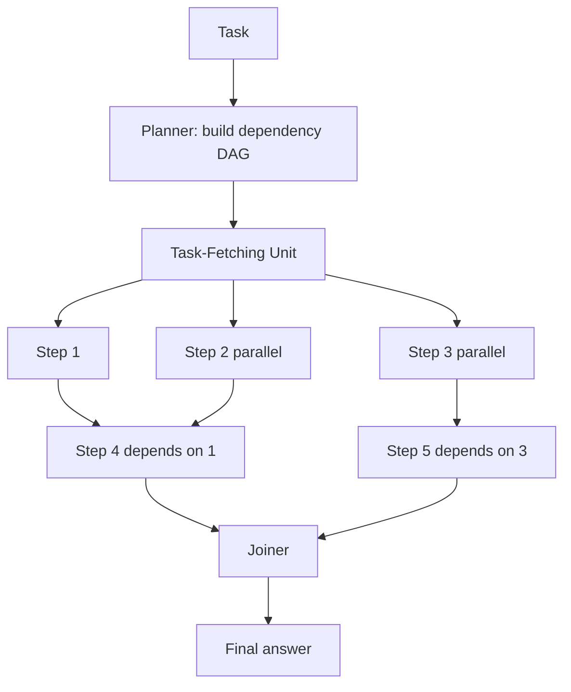

# LLMCompiler

**Also known as:** LLM Compiler, Parallel ReWOO

**Category:** Planning & Control Flow  
**Status in practice:** experimental

## Intent

Take ReWOO's plan-as-DAG and run independent steps in parallel through a task-fetching dispatcher.

## Context

A team runs an agent whose work consists of many tool calls — fetching prices for nine tickers, summarising five documents, querying three APIs — and most of those calls are independent of each other. The deployment is latency-sensitive: a user is waiting for an answer or a downstream system has a deadline. The team is already using a plan-then-execute style architecture such as ReWOO (Reasoning Without Observation), where the planner emits a directed acyclic graph of tool calls before any tool runs.

## Problem

A sequential executor walks the plan one tool call at a time, so end-to-end latency is the sum of every call even when the calls have no mutual dependency. Naive parallel-tool-calling (firing them all at once from a single chat turn) ignores the dependency graph and breaks when later calls reference earlier results. A bespoke parallel runner without bounded concurrency and a join step blows past provider rate limits, leaks errors across branches, and assembles results out of order. The team needs a runner that respects the dependency graph while overlapping independent work.

## Forces

- Concurrency control: limits per provider, rate limits, fan-out costs.
- Failure isolation: one branch failing should not kill others.
- Joiner correctness: combining out-of-order results.

## Therefore

Therefore: have the planner emit a dependency DAG and a task-fetching unit dispatch independent steps concurrently before a joiner assembles them, so that end-to-end latency collapses to the longest dependency chain instead of the sum of all calls.

## Solution

Three roles. Planner builds the dependency DAG. Task-Fetching Unit dispatches steps as their inputs become available, with bounded concurrency. Joiner assembles the final answer from the resolved DAG.

## Structure

```
Task --> Planner (dependency DAG of tool calls) --> Task-Fetching Unit --dispatch when inputs resolve, bounded concurrency--> parallel steps --> Variable resolver feeds dependent steps --> Joiner --> Final answer
```

## Diagram



## Example scenario

An agent that builds a daily portfolio brief makes nine independent tool calls — fetch prices for nine tickers — strictly in sequence, taking 18 seconds where it could take two. The team rebuilds the loop as llm-compiler: the planner emits the call DAG up front, the task-fetching unit dispatches each fetch as soon as its dependencies (none, in this case) resolve, with concurrency capped at five, and the joiner assembles the brief. The brief returns in just over two seconds and the planner can express genuine cross-step dependencies when they exist.

## Consequences

**Benefits**

- End-to-end latency drops to the longest dependency chain.
- Cost remains roughly the same as ReWOO.

**Liabilities**

- Concurrency adds operational complexity.
- Planner mistakes are amplified by parallel execution.

## Failure modes

- Missed dependency — the planner leaves out an edge in the DAG, and a step fires in parallel before the input it needs exists.
- Amplified plan error — a wrong planner step is dispatched alongside many others, and several branches run on the same bad premise before anyone sees it.
- Rate-limit burst — the concurrency bound is set too high, and the parallel steps hit provider limits and fail together.
- Joiner gap — one branch errors, and the joiner assembles an answer from the rest without flagging the missing piece.

## What this pattern constrains

Steps run only when all referenced upstream variables are resolved.

## Applicability

**Use when**

- Latency-sensitive agents waste time waiting on independent tool calls in series.
- A planner can build a dependency DAG up front for the workload.
- Bounded concurrency and a join step are acceptable engineering investments.

**Do not use when**

- Tool calls are mostly sequential with strong dependencies.
- Parallel-tool-calls already gives most of the latency win at lower complexity.
- DAG planning cost dominates the savings on the actual workload.

## Components

- Planner — emits a dependency DAG of tool calls before any tool fires
- Task-fetching unit — dispatches steps as soon as their inputs resolve
- Concurrency-bounded executor — runs independent steps in parallel within rate limits
- Joiner — assembles the final answer from the resolved DAG
- Variable resolver — substitutes upstream outputs into downstream step inputs

## Tools

- LLM API — strong model for the planner; cheaper one acceptable for individual steps
- Tool catalogue — registered functions the planner can reference in the DAG
- Concurrency primitive — async runtime or worker pool bounded by provider rate limits

## Evaluation metrics

- End-to-end latency vs sequential executor — speedup from parallel dispatch
- Critical-path length versus call count — how many calls actually had to be serial
- Rate-limit-induced retries — concurrency hitting provider caps
- Planner DAG correctness — fraction of plans whose dependencies execute without rework
- Failure isolation rate — branch failures that did not cascade to siblings

## Known uses

- **[LLMCompiler (reference implementation)](https://github.com/SqueezeAILab/LLMCompiler)** _available_ — Berkeley SqueezeAILab release of the LLMCompiler paper code.
- **[LangGraph LLMCompiler example](https://github.com/langchain-ai/langgraph)** _available_ — LangGraph ships an LLMCompiler example.

## Related patterns

- _specialises_ **ReWOO**
- _uses_ **Parallelization**
- _alternative-to_ **Parallel Tool Calls**
- _composes-with_ **Subagent Isolation**
- _complements_ **Graph of Thoughts**
- _used-by_ **Control-Flow Integrity**
- _complements_ **Speculative Agentic Actions** — The compiler overlaps independent steps of a KNOWN plan DAG; speculation overlaps the next step of an UNKNOWN plan by guessing it, so a speculated hit can feed the compiler's next dispatch.

## References

- [An LLM Compiler for Parallel Function Calling](https://arxiv.org/abs/2312.04511) — Kim, Moon, Tabrizi, Lee, Mahoney, Keutzer, Gholami, 2023
