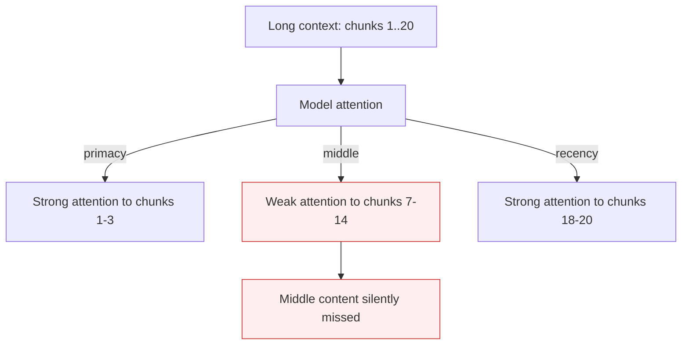

# Lost in the Middle (Positional Bias)

**Also known as:** Long-Context Positional Bias, U-Curve Attention

**Category:** Anti-Patterns  
**Status in practice:** deprecated

## Intent

LLM accuracy on retrieving information from long contexts drops sharply when relevant content sits in the middle of the prompt rather than at the start or end.

## Context

A team puts a long context in front of the model (RAG with many chunks, long documents, multi-turn conversation history). Quality on retrieval-style queries depends on where the relevant content sits in the prompt. The team doesn't know about the positional bias and is surprised when middle-of-prompt content gets ignored.

## Problem

The model exhibits a U-shaped attention curve: content at the start (primacy) and end (recency) of the prompt is retrieved well; content in the middle is poorly retrieved. The team feeds RAG chunks ordered by relevance — relevant chunks end up in the middle of the prompt — and the model misses them. Distinct from context-fragmentation (which is about simultaneous holding of constraints) by being positional, not relational.

## Forces

- Positional bias is an attention-architecture property; not fixable in prompt.
- Reordering content to put relevance at the ends costs preprocessing.
- Some content (instructions) must stay in a known position; can't be reordered freely.

## Therefore

Therefore: design prompts to place critical content at start or end (or duplicate it in both); use landmark-attention or chunking + selective-retrieval to mitigate; track per-position retrieval quality in eval.

## Solution

Acknowledge the bias as architectural. Pair with: landmark-attention (architectural mitigation, requires model support), information-chunking-memory (preprocessing mitigation), context-window-packing (positional design), context-window-dumb-zone (related utilization limit).

## Structure

```
Anti-pattern: Long context (chunks 1..N) -> Model attention (strong at start and end, weak in middle) -> middle content silently missed. Corrected: Retrieve -> chunk and trim -> pack key content at start or end -> Model -> eval with middle-placed evidence.
```

## Diagram



## Example scenario

A RAG-based research agent retrieves 20 chunks for each query, packs them into the prompt in order of relevance score. Queries that should be answered from chunk 7-12 (middle) fail; queries answered from chunk 1-3 or 17-20 succeed. Team initially thinks 'the retrieval is wrong' — wrong diagnosis; the retrieval was right, but the model didn't attend to the middle chunks. Fix: reorder so highest-relevance chunks land at start and end, drop the rest.

## Consequences

**Benefits**

- Short-term: dumping more retrieved chunks into a large window is the simplest way to add context and looks like it should only help.
- Naming it lets a team design prompt layout around position and add evals that check middle-placed content, instead of trusting window size.

**Liabilities**

- Middle-of-prompt content silently ignored.
- RAG quality drops with chunk count even though more chunks 'should help'.
- Eval metrics may pass on start/end-content but fail on middle-content.

## Failure modes

- Relevance-ordered burial — RAG chunks sorted by relevance put the key passage in the middle of a long prompt, and the model answers as if it were absent.
- More chunks, worse answers — the team raises the chunk count to help recall, and answer quality drops because more content lands in the weak middle zone.
- Position-blind evals — test cases place the answer near the start or end, so the eval passes while real queries with middle-placed evidence fail.

## What this pattern constrains

No useful constraint; the missing constraint is positional-quality awareness in prompt design.

## Applicability

**Use when**

- Never as an unaddressed state. Cite when reviewing long-context RAG or document-QA agents.
- Surface in eval design to test middle-of-prompt retrieval explicitly.
- Use as the rationale for prompt-ordering or landmark-attention adoption.

**Do not use when**

- Any RAG / long-context deployment without positional-quality testing.
- Long-context prompts where critical content is placed without regard to position.
- Production agents whose RAG quality is below expectation and the team is iterating on retrieval without considering positional bias.

## Components

- Long context — input
- Model attention — U-shaped curve
- Middle-of-prompt content — silently missed
- Missing positional-quality eval

## Tools

- Positional-quality eval
- Mitigation pattern infrastructure (landmark-attention, chunking, packing)
- Chunk-ordering tool

## Evaluation metrics

- Per-position retrieval accuracy
- Middle-content retrieval lift after mitigation
- RAG-quality correlation with chunk position

## Known uses

- **[Liu et al. 2023 — 'Lost in the Middle: How Language Models Use Long Contexts'](https://cs.stanford.edu/~nfliu/papers/lost-in-the-middle.arxiv2023.pdf)** _available_
- **[Cited in Bornet et al. Agentic Artificial Intelligence, Chapter 7](https://www.amazon.com/Agentic-Artificial-Intelligence-Harnessing-Reinvent-ebook/dp/B0F1DS36YC)** _available_

## Related patterns

- _alternative-to_ **Landmark Attention**
- _alternative-to_ **Information Chunking for Agent Memory**
- _alternative-to_ **Context Window Packing**
- _complements_ **Context Window Dumb-Zone Cap**
- _complements_ **Context Fragmentation**
- _complements_ **Landmark Attention**
- _complements_ **Information Chunking for Agent Memory**
- _complements_ **Context Anxiety** — Lost-in-the-middle is positional recall in a full context; context anxiety is budget misperception regardless of position.
- _complements_ **Set-and-Forget System Prompt** — The same positional weakness measured for retrieval targets; here it applies to the standing instruction block itself, which sits at the position that ages fastest.
- _complements_ **Prior-Estimate Anchoring** — Positional bias concerns where evidence sits in the prompt; this is a pull toward a particular value wherever it sits.

## References

- [Lost in the Middle: How Language Models Use Long Contexts](https://cs.stanford.edu/~nfliu/papers/lost-in-the-middle.arxiv2023.pdf) — Nelson F. Liu et al., 2023
- [Agentic Artificial Intelligence — Chapter 7](https://www.worldscientific.com/worldscibooks/10.1142/14380) — 2025
