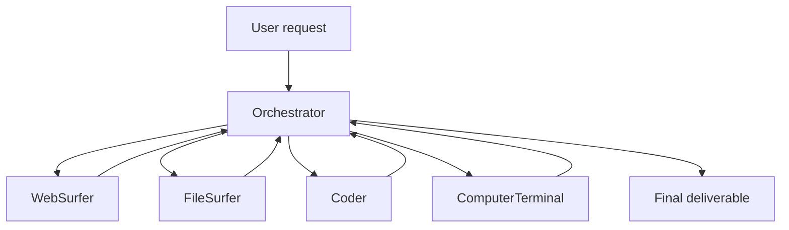

# Magentic-One Generalist Multi-Agent

**Also known as:** Magentic-One, Orchestrator + Specialist Agents (Microsoft)

**Category:** Multi-Agent  
**Status in practice:** emerging

## Intent

Use Microsoft's generalist multi-agent architecture: a single Orchestrator agent dispatches to four specialist sub-agents (WebSurfer, FileSurfer, Coder, ComputerTerminal) for solving open-ended complex tasks that span web browsing, file manipulation, code execution and shell operations.

## Context

The team has an open-ended automation task: 'research X, write a report, run analysis, send it'. The task spans modalities — web, files, code, shell — none of which a single agent handles equally well. Building bespoke specialists per task is expensive.

## Problem

Single-modality agents fail on cross-modality tasks. Bespoke multi-agent systems take significant engineering per task class. The team needs a generalist architecture that already covers the common modalities and orchestrates them sensibly.

## Forces

- Generalist architectures sacrifice depth in any one modality.
- Orchestrator coordination is non-trivial.
- Microsoft's specific specialist set may not match every team's needs.

## Therefore

Therefore: adopt the Magentic-One architecture as a generalist multi-agent baseline — Orchestrator + WebSurfer + FileSurfer + Coder + ComputerTerminal — and customize specialists only where the baseline falls short.

## Solution

Deploy Magentic-One's five-component architecture. The Orchestrator decomposes user requests, plans, dispatches to specialists, integrates results. WebSurfer handles browser automation. FileSurfer navigates filesystems. Coder writes and runs code in isolated environments. ComputerTerminal executes shell commands. The Orchestrator maintains a task ledger and replan log. Pair with orchestrator-workers, supervisor, browser-agent, computer-use, one-tool-one-agent.

## Structure

```
User request --> Orchestrator (decompose, plan, task ledger, replan log) --dispatch--> WebSurfer | FileSurfer | Coder | ComputerTerminal --results--> Orchestrator (integrate, replan if needed) --> Final deliverable
```

## Diagram



## Example scenario

A team needs an automation agent for: 'pull the 2024 EU AI Act revisions from the web, extract the diff against the 2023 version, run a frequency analysis on the changed terms, send the report'. Magentic-One: Orchestrator decomposes into 4 sub-tasks. WebSurfer pulls the EU site. FileSurfer manages the cached docs. Coder writes and runs the diff + frequency analysis. ComputerTerminal triggers the email send. Orchestrator integrates and reports. Task completes in one run.

## Consequences

**Benefits**

- Generalist baseline reduces engineering time per new task class.
- Cross-modality tasks become tractable with one architecture.
- Open-source reference implementation accelerates adoption.

**Liabilities**

- Generalist depth is lower than bespoke specialists in any one modality.
- Orchestrator complexity and replan logic require maintenance.
- Microsoft's specialist choices may not match every team's modality mix.

## Failure modes

- Shallow specialist — a task needs deep skill in one modality, and the generalist specialist handles it worse than a bespoke agent would.
- Replan loop — the orchestrator keeps revising its task ledger after each failed step and never converges.
- Missing modality — the team's work needs a capability outside the four specialists, and the orchestrator forces it through the closest one.
- Specialist-to-specialist shortcut — a specialist dispatches to another directly, and the orchestrator's ledger no longer reflects what happened.

## What this pattern constrains

The Orchestrator is the single coordination point; specialists do not directly dispatch to each other.

## Applicability

**Use when**

- Open-ended automation tasks spanning web/files/code/shell.
- Team wants a generalist baseline rather than bespoke specialists.
- Microsoft / Autogen ecosystem already in use.

**Do not use when**

- Single-modality tasks (specialist would do better).
- Modality mix doesn't match the four built-in specialists.
- Team can't operate the Orchestrator complexity.

## Components

- Orchestrator — task decomposition, planning, replan
- WebSurfer — browser automation
- FileSurfer — filesystem navigation
- Coder — code authoring and execution
- ComputerTerminal — shell command execution
- Task ledger — Orchestrator state

## Tools

- Orchestrator
- WebSurfer
- FileSurfer
- Coder
- ComputerTerminal
- Task ledger

## Evaluation metrics

- End-to-end task success rate
- Per-specialist invocation frequency
- Replan rate per task

## Known uses

- **[Microsoft Research — Magentic-One reference implementation (Fourney et al. 2024)](https://arxiv.org/abs/2411.04468)** _available_
- **[Cited in Bornet et al. Agentic Artificial Intelligence references](https://www.worldscientific.com/worldscibooks/10.1142/14380)** _available_

## Related patterns

- _specialises_ **Orchestrator-Workers**
- _complements_ **Supervisor**
- _complements_ **Browser Agent**
- _complements_ **Computer Use**
- _complements_ **One Tool, One Agent**

## References

- [Magentic-One: A Generalist Multi-Agent System for Solving Complex Tasks](https://arxiv.org/abs/2411.04468) — Adam Fourney et al., 2024
