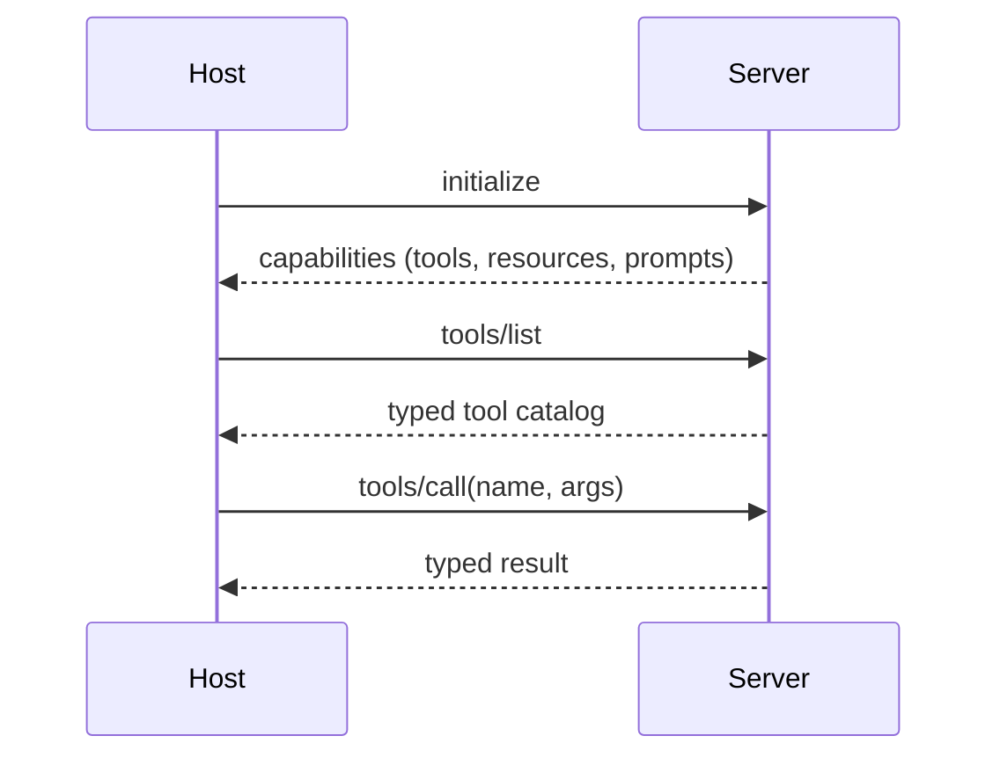

# Model Context Protocol

**Also known as:** MCP, Open Tool Protocol

**Category:** Tool Use & Environment  
**Status in practice:** mature

## Intent

Standardise how agents discover and call tools so that a tool written once is usable by any conformant agent.

## Context

An organisation operates several agent hosts at once: an IDE plugin, a desktop assistant, a custom CLI, a teammate's editor agent. Each of them wants access to the same underlying tools (a GitHub integration, a Postgres query tool, a documentation search) and ideally the team should be able to write each tool once.

## Problem

Without a shared protocol, every tool has to be re-implemented as a vendor-specific function-calling adapter for each host. The same GitHub integration ends up rewritten three times with subtly different argument names and error shapes, and the implementations drift as each host evolves. Authentication is rewired per host, and there is no clean way for a new agent host to discover what tools already exist in the organisation.

## Forces

- Agents need a stable contract; tool authors need freedom to evolve the implementation.
- Local (stdio) and hosted (HTTP) deployments have different operational shapes but should expose the same surface.
- Auth must travel without leaking host credentials to every tool.

## Therefore

Therefore: put every tool behind a server speaking a shared discovery/invocation protocol, so that tool authors and agent hosts evolve independently against a stable typed contract.

## Solution

Tools live behind a server speaking a common protocol. Hosts list available tools, call them with typed arguments, and receive typed results. The protocol covers discovery, invocation, errors, and (in some implementations) prompts and resources alongside tools.

## Structure

```
Host --initialize--> MCP server --capabilities (tools, resources, prompts)--> Host --tools/list--> typed tool catalog --tools/call(name, args)--> MCP server --typed result--> Host
```

## Diagram



*MCP is the interface between an agent host and a tool server: typed catalog up front, typed calls and results during.*

## Example scenario

A developer writes a 'GitHub PR review' tool once and exposes it via Model Context Protocol. Now it works in Claude Desktop, in Cursor, in their custom CLI agent, and in their teammate's VS Code agent — without rewriting the integration four times. The host and the tool only need to agree on MCP, not on each other's internal details.

## Consequences

**Benefits**

- Write a tool once, expose it to Claude Desktop, Claude Code, Cursor, custom hosts.
- Protocol-level auth (bearer-wrapped per-user tokens) keeps multi-tenancy out of each tool.

**Liabilities**

- Adds a process boundary; latency and operational surface increase.
- Schema versioning across servers and clients is a real concern as the protocol evolves.
- Long-lived SSE connections need server-side keep-alives and per-tool timeouts; connection drops mid-tool-call leave orphaned operations whose results are never reconciled.
- Streaming-tool backpressure: slow consumers can fill server buffers when the model lags behind the tool's stream output.

## Failure modes

- Schema mismatch — a server updates a tool's argument shape, an older host still sends the old one, and calls fail or misbehave.
- Orphaned call — the connection drops mid-call, the server finishes the operation, and the host never learns the result.
- Buffer pile-up — the model reads a streaming tool more slowly than it produces output, and server buffers fill until the call stalls.
- Invisible tool — a capability exists in the organisation but no server advertises it, so the agent cannot see or use it.

## What this pattern constrains

Agents can only see tools advertised by an MCP server; servers can only advertise tools matching the protocol's typed shape.

## Applicability

**Use when**

- Tool palettes need to be portable across multiple host applications.
- Multiple clients (IDEs, agents, CLIs) consume the same tool set.
- Tools are written in different languages and a transport-level protocol is needed.

**Do not use when**

- Single host, single language, no portability requirement; native function calls are simpler.
- Tool latency is dominated by transport overhead and the extra hop hurts.
- Audit boundaries demand the tool live in the same process as the agent.

## Components

- MCP Host — application embedding the agent that opens connections to MCP servers
- MCP Client — per-connection module inside the host that speaks the protocol
- MCP Server — process exposing tools, resources, and prompts behind the protocol
- Tool Catalogue — typed list returned by tools/list with JSON-Schema arguments
- Transport Layer — stdio, HTTP, or SSE channel carrying the JSON-RPC messages

## Tools

- MCP SDKs (Python, TypeScript, others) — implement client and server roles to spec
- JSON-Schema validators — check tool arguments and results at the protocol boundary

## Evaluation metrics

- Tool-call success rate per server — fraction of calls returning a typed non-error result
- Schema-validation failure rate — signal for drift between server and client expectations
- Initialization latency — time to complete capability negotiation per connection
- Tool catalogue churn — how often advertised tools change between sessions
- Auth-failure rate — share of calls rejected for credential or permission reasons

## Known uses

- **[Weft](https://github.com/luxxyarns/weft)** _available_ — Node.js MCP server exposing Ravelry through the WEFT JSON format; stdio + HTTP entry points.
- **[Anthropic Claude Desktop / Claude Code](https://docs.claude.com/en/docs/claude-code/overview)** _available_
- **Cursor MCP integration** _available_
- **[OpenAI Agents SDK](https://openai.github.io/openai-agents-python/)** _available_
- **[Windsurf Cascade (now Devin Desktop)](https://docs.devin.ai/desktop/cascade/mcp)** _available_
- **Zed** _available_
- **[GitHub Copilot](https://github.com/features/copilot)** _available_

## Related patterns

- _used-by_ **Cross-Domain Enterprise Agent Network**
- _complements_ **Inter-Agent Communication**
- _complements_ **Secrets Handling**
- _used-by_ **Tool Discovery**
- _complements_ **Tool Output Poisoning Defense**
- _used-by_ **Tool Search Lazy Loading**
- _generalises_ **Tool Use**
- _composes-with_ **Translation Layer**
- _used-by_ **Tool/Agent Registry**
- _generalises_ **MCP-as-Code-API**
- _alternative-to_ **Synthetic Filesystem Overlay**
- _generalises_ **MCP Bidirectional Bridge**
- _complements_ **Decentralized Agent Network**
- _alternative-to_ **Agent Adapter**
- _complements_ **Hierarchical Tool Selection**
- _generalises_ **Direct API Wrapper**
- _generalises_ **Composite Service**
- _generalises_ **MCP Server-Side Sampling** — MCP standardises client-to-server tool calling; this pattern uses the reverse direction, where the server calls back to the host's model via the sampling primitive.

## References

- [Model Context Protocol](https://modelcontextprotocol.io)
- [Anthropic: Introducing the Model Context Protocol](https://www.anthropic.com/news/model-context-protocol) — 2024
