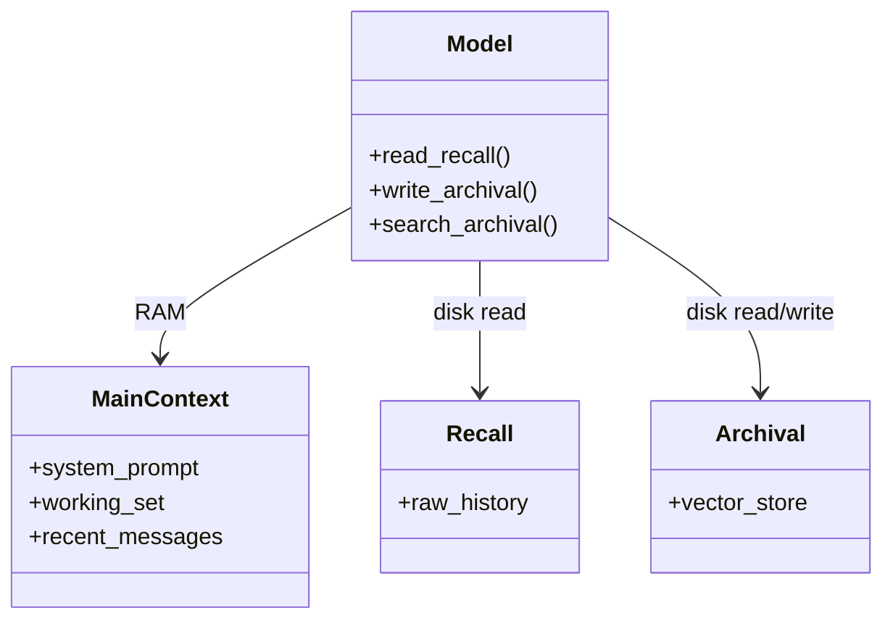

# MemGPT-Style Paging

**Also known as:** Virtual Context, Memory Paging, OS-Style Memory, Indexed Experience Memory, Memex(RL), Indexed Experience Store

**Category:** Memory  
**Status in practice:** emerging

## Intent

Treat the LLM context window as RAM and external storage as disk, with the model issuing tool calls to page memory in and out.

## Context

A long-running agent's conversation or document state grows past the model's context window. The team needs to keep the agent useful over interactions that may span thousands of turns, or over documents that are larger than any window the provider offers.

## Problem

A fixed context window forces a hard choice between losing state and stuffing irrelevant content. Naive truncation drops whatever happens to be at the boundary, which may be exactly the information the next turn needs. Stuffing the window with potentially-relevant content from the past inflates cost and dilutes the model's attention on the actually-relevant pieces. Neither option scales; both degrade quality. The team needs a paging discipline — the way an operating system pages between main memory and disk — where the model itself can decide what to load in and what to swap out as the task evolves.

## Forces

- Paging tools compete for context space themselves.
- Eviction policy (LRU? LFU? salience?) affects quality.
- Tool latency on page faults adds to user-visible time.

## Therefore

Therefore: let the model treat its context window as RAM and an external store as disk, with explicit tool calls to page memory in and out, so that the agent decides what to remember without retraining its context size.

## Solution

Two memory tiers. Main context: system prompt, working set, recent messages. External context: recall (raw history) and archival (vector store). The model has tool calls for read_recall, write_archival, search_archival. Paging happens at the agent's discretion; the model treats main context as RAM and external as disk.

## Structure

```
Model --works in--> Main context (system prompt, working set, recent messages); Model --read_recall--> Recall (raw history); Model --write_archival / search_archival--> Archival (vector store) --page in--> Main context
```

## Diagram



## Example scenario

A long-running personal assistant that tracks a user's projects across six months hits the context window every conversation and starts dropping older but still relevant context. The team adopts memgpt-paging: a small main context holds the system prompt and the active turn; recall and archival tiers live in external storage; the model uses search_archival and read_recall tool calls to page in what it needs. The agent now treats the window as RAM it explicitly manages instead of as a hard ceiling.

## Consequences

**Benefits**

- Conversation continuity beyond the context window.
- Inspectable memory tiers; archival is queryable independently.

**Liabilities**

- Tool definitions consume context budget.
- Page-fault tool calls add latency.

## Failure modes

- Missed page-in — the model does not call search_archival when it should, and answers without facts it had stored.
- Page thrashing — the model keeps loading and evicting the same items, adding latency on every turn.
- Lost write — the model forgets to call write_archival before evicting, and the item is gone from both tiers.
- Tool overhead — paging tool definitions take enough of the window that the working set shrinks.

## What this pattern constrains

Memory beyond the working set is accessible only via paging tool calls; the agent cannot directly read external state.

## Applicability

**Use when**

- Long-running agents need state that exceeds the model's context window.
- The model can be trusted to manage memory via tool calls (read, write, search).
- External recall and archival storage tiers are available and queryable.

**Do not use when**

- Context easily fits the working set and external paging is overkill.
- Tool-call latency for paging is unacceptable for the use case.
- Simpler retrieval-on-demand patterns already serve the workload.

## Components

- Main context — the in-window working set: system prompt, recent messages, and pinned state
- Recall tier — out-of-window raw conversation history paged in via read_recall
- Archival tier — vector store of distilled memories paged in via search_archival and written via write_archival
- Paging tool surface — read_recall / write_archival / search_archival function definitions exposed to the model
- Eviction policy — LRU, LFU, or salience-based rule that decides what leaves main context on each page-in

## Tools

- Vector store — Chroma, Pinecone, or Letta's archival store for similarity search over distilled memory
- Document store — Postgres or SQLite for raw recall (full chronological history)
- Embedding model — produces vectors for both archival writes and search queries

## Evaluation metrics

- Page-fault rate — paging tool calls per user turn; signals whether main context is sized well
- Page-fault latency added per turn — wall-clock penalty when the model has to swap memory in
- Eviction-error rate — turns where the evicted slot turned out to be needed within the next few turns
- Cross-window continuity — task completion on dialogues whose total tokens exceed the window many times over
- Archival recall@k — how often the right historical item appears in the top-k of search_archival

## Known uses

- **[Letta (formerly MemGPT)](https://github.com/letta-ai/letta)** _available_

## Related patterns

- _uses_ **Vector Memory**
- _alternative-to_ **Five-Tier Memory Cascade**
- _uses_ **Tool Use** — Paging operations are tool calls.
- _alternative-to_ **Cross-Session Memory**
- _alternative-to_ **Context Window Packing**
- _alternative-to_ **Agentic Memory**
- _complements_ **Context Window Dumb-Zone Cap**
- _complements_ **Landmark Attention**
- _complements_ **Filesystem as Context**
- _alternative-to_ **Context Folding** — Paging moves spans in and out of an external store; folding discards the span and keeps only a summary.

## References

- [MemGPT: Towards LLMs as Operating Systems](https://arxiv.org/abs/2310.08560) — Packer, Wooders, Lin, Fang, Patil, Stoica, Gonzalez, 2023
