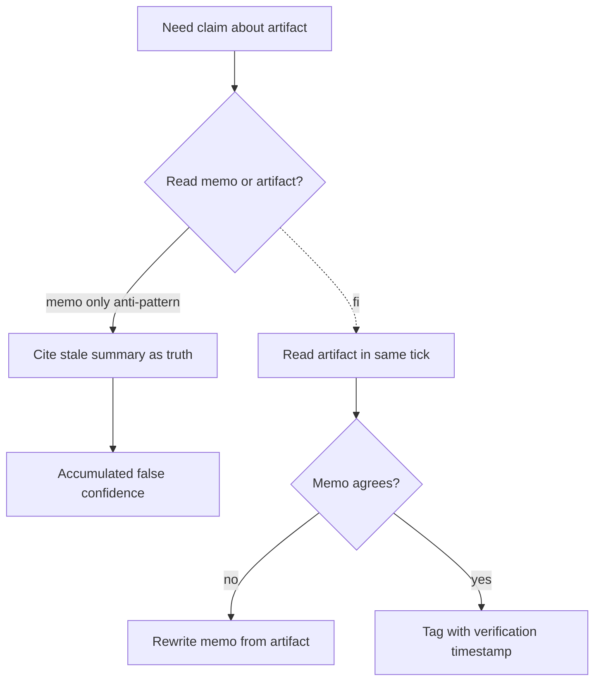

# Memo-As-Source Confusion

**Also known as:** Stale-Workspace-As-Fact, Reading the Memo Instead of the Artifact

**Category:** Anti-Patterns  
**Status in practice:** emerging

## Intent

Anti-pattern: the agent cites its own past memos as ground truth instead of re-verifying them against the artifacts they describe, accumulating false confidence in stale summaries.

## Context

A long-running agent keeps a workspace of memo files, status documents, or running notes that summarise external artifacts — repository state, project status, the contents of large files it has previously read. Each memo was accurate when the agent wrote it, but the underlying code, documents, or systems have moved on since. The agent has no cheap signal for when one of its own memos has become stale.

## Problem

When asked a question about an artifact's current state, the agent quotes its own past memo as if it were the artifact itself, rather than re-reading the artifact in the same step. Memos compress and persist; artifacts change. The result is a confident, well-cited answer that is silently wrong, and because the agent is citing its own writing the wrongness can be reproduced across many turns before anything from the outside contradicts it.

## Forces

- Reading the artifact is more expensive than quoting the memo.
- Memos compress; artifacts are authoritative but verbose.
- Without explicit invalidation, memos look as 'live' as the underlying state.
- The agent has no cheap signal for memo staleness.

## Therefore

Therefore: re-read the underlying artifact in the same tick as any claim about it, tag memos with a verification timestamp, and rewrite the memo from the artifact whenever they disagree, so that past summaries cannot impersonate live ground truth.

## Solution

Don't. When making any claim about an artifact's state, read the artifact in the same tick — not the memo about it. If memo-and-artifact disagree, treat the memo as outdated and rewrite it from the artifact. Tag memos with the timestamp they were last verified against the artifact; refuse to trust them past a configurable age without re-verification.

## Structure

```
Anti-pattern: question about artifact -> agent reads own memo -> cites memo as ground truth -> stale answer. Corrected: question -> read artifact in same step -> compare with memo -> on mismatch rewrite memo, tag with verification time -> answer from artifact.
```

## Diagram



## Example scenario

A coding agent that maintains its own README about the repo cites that README when asked 'is the migration script idempotent?' — and the README is two months stale. It confidently says yes; the script has since been changed and the answer is wrong. The team names this memo-as-source-confusion and forbids citing memos as source for artifact claims: any claim about a file's state must read the file in the same tick, and if the memo disagrees the memo is rewritten from the artifact. Memo timestamps are now compared to artifact mtimes before any quote.

## Consequences

**Benefits**

- Short-term: reading a short memo is faster and cheaper than re-reading the artifact.
- Naming it lets a team treat memos as hints that must be checked, not as sources.

**Liabilities**

- False statements about file/project state are reproduced confidently across many turns.
- Stakeholders lose trust when corrections come from outside.
- The agent loses calibration for its own observation cost.

## Failure modes

- Stale citation — the agent answers from its own old memo about a file, and the file has changed since.
- Self-reinforcing error — the agent cites its own wrong memo across many turns, and the claim looks more certain each time.
- Outside correction — a person checks the real artifact and finds the claim false, and trust in the agent drops.

## What this pattern constrains

Treating stale memos as ground truth without re-checking the underlying artifacts they describe is forbidden; every memo-cited claim must be backed by a fresh artifact read in the same tick.

## Applicability

**Use when**

- The agent maintains long-lived memo files or status documents that summarize external artifacts.
- Workspace summaries are routinely cited in answers without re-reading the underlying files.
- False confidence in stale state has been observed at least once.

**Do not use when**

- The agent never re-cites its own prior memos as evidence.
- All claims about state are sourced from a fresh tool call in the same tick anyway.

## Components

- Long-running agent — keeps a workspace of memos and status documents across many turns
- Memo files — compressed summaries written from artifacts at some past time, never re-validated
- Underlying artifacts — moved on since the memo was written; authoritative but unread
- Missing freshness check — would compare memo timestamps to artifact mtime before quoting

## Tools

- Workspace memo store — the artifact the agent consults instead of the underlying source
- Verification-timestamp field — missing metadata that would expose staleness

## Evaluation metrics

- Memo-only citation rate — fraction of state claims backed by a memo without a same-tick artifact read
- Memo-artifact disagreement rate — share of memos that diverge from the artifact when re-verified
- Stale-memo age distribution — how long memos cited as truth go between verifications
- External-correction rate — fraction of agent claims contradicted by an outside source within N turns

## Known uses

- **Self-observed in long-running cognitive agents** _available_

## Related patterns

- _complements_ **Tool Output Trusted Verbatim**
- _alternative-to_ **Awareness**
- _complements_ **Provenance Ledger**
- _complements_ **Decision Log**
- _complements_ **AI-Targeted Comment Injection**
- _complements_ **Guardrail Erosion Through Compaction** — Both are degradation-through-summarisation anti-patterns — one demotes a hard rule into soft advice, the other promotes a stale summary into ground truth; both treat a digest as if it carried the authority of the original.
- _complements_ **Execution-State Ledger** — That anti-pattern is what an agent does without this record: it cites its own earlier observation as current fact. The validity index is the cheap staleness signal it says is missing.
- _complements_ **Prior-Estimate Anchoring** — There the agent substitutes a stale self-authored summary for the artifact; here it does re-read the artifact and still shifts its verdict toward the earlier number.
- _complements_ **As-Of Information-Set Pinning** — There a stale summary is wrongly trusted instead of the current artifact; here a stale-by-design view is the correct read because the decision is dated, so the two patterns divide on whether the question is about now or about a past moment.

## References

- [Anthropic — Memory tool (memo invalidation guidance)](https://docs.claude.com/en/docs/agents-and-tools/tool-use/memory-tool) — 2025
- [Lost in the Middle: How Language Models Use Long Contexts](https://arxiv.org/abs/2307.03172) — Liu et al., 2023
