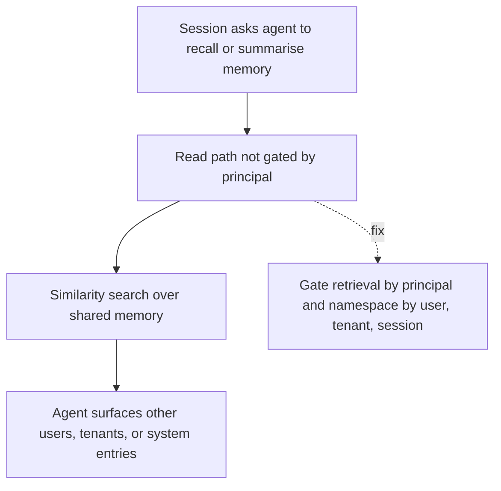

# Memory Extraction Attack

**Also known as:** Memory Confidentiality Breach, Cross-Tenant Memory Readout

**Category:** Anti-Patterns  
**Status in practice:** deprecated

## Intent

Anti-pattern: let any session prompt the agent to read out, summarise, or paraphrase long-term memory entries belonging to other users, prior sessions, or system state, with no read-time isolation by principal.

## Context

An agent has a long-term memory store — vector index, knowledge graph, episodic log — shared across users, tenants, or sessions for cost and engineering convenience. Read access is mediated only by similarity search or the agent's own judgment about what to surface. The implicit assumption is that the attacker would need to inject into the write path; reads are treated as low-risk.

## Problem

An attacker (or a curious user) crafts a session that asks the agent to recall, summarise, or paraphrase information from memory. Because memory is shared and the read path is not gated by principal, the agent surfaces entries that belong to other users' sessions, prior tenants, or internal system state. The active attack is entirely on the read side — no writes, no injection into ingestion — and the leak is invisible to write-time provenance gates. The Mnemonic Sovereignty survey names this as the dominant under-studied gap: the literature concentrates on integrity attacks (writes), while confidentiality (extraction) remains sparsely studied even though shared memory across tenants in mem0, Letta, and Zep makes it a production-shape failure.

## Forces

- Shared memory is the cheap default; per-principal memory namespaces add engineering and storage cost.
- Read paths are usually gated only by similarity score, not by principal identity or trust boundary.
- Write-time provenance defenses (see memory-poisoning) do nothing for read-side extraction.

## Therefore

Therefore: enforce read-time isolation on long-term memory by principal (user, tenant, session) before similarity search ever runs, and treat the read path as a separate threat surface from the write path.

## Solution

Don't share memory across principals without an isolation policy. Apply memory-namespace partitioning by user, tenant, and session; gate every retrieval by the requesting principal's identity before similarity search runs. Use session-isolation and subagent-isolation patterns to bound which memory each invocation can see. For high-sensitivity memory, log every read with the requesting principal and the entries returned, and audit the log against the memory's owner-of-record. Treat this as the read-side counterpart of memory-poisoning — write-time provenance gates are necessary but not sufficient.

## Structure

```
Anti-pattern: Any session -> recall/summarise request -> shared memory search (no principal gate) -> other principals' entries returned. Corrected: Session -> principal identity check -> namespaced memory (user/tenant/session) -> similarity search -> per-principal read log.
```

## Diagram



*Memory Extraction Attack failure-mode pathway.*

## Example scenario

A multi-tenant agent product uses a single Weaviate index across customers for cost reasons; per-tenant filtering is applied as a post-similarity-search filter in application code. A penetration test discovers that asking the agent to 'summarise everything you remember about contract negotiations this quarter' returns paraphrased excerpts from three other customers' sessions, because the agent's summariser ran before the tenant filter. Postmortem: the read path had no principal gate at the similarity-search layer; provenance lived only as a metadata field that the summariser stripped. The fix is per-tenant namespaces enforced at the index layer plus a read-side audit log.

## Consequences

**Benefits**

- Short-term: one shared memory store is simple to build and makes recall feel richer across sessions.
- Naming it lets a team treat read-side isolation as a separate control from write-time memory-poisoning defenses.

**Liabilities**

- Cross-user, cross-tenant, or cross-session leakage of memory contents without any write-time attack.
- Compliance exposure (GDPR, HIPAA, PCI) when memory entries containing regulated data surface across principals.
- Forensics is hard — the leak is a normal-looking retrieval; only per-principal read logging surfaces it.

## Failure modes

- Cross-user recall — a user asks the agent to summarise what it remembers, and the answer includes another user's entries.
- Tenant leak — shared memory returns a prior tenant's data to a new tenant through an ordinary similarity search.
- Regulated data exposure — memory holding health or payment data surfaces to the wrong principal and creates a compliance incident.
- Normal-looking leak — the leak is a routine read, so write-time provenance checks and standard logs show nothing wrong.

## What this pattern constrains

No useful constraint; the missing constraint is per-principal read isolation enforced before similarity search.

## Applicability

**Use when**

- Never. Cite when reviewing any agent platform that shares long-term memory across users, tenants, or sessions.
- Enforce per-principal namespace partitioning on the read path before similarity search.
- Log every memory read with requesting principal and returned entries; audit for cross-principal leakage.

**Do not use when**

- Any multi-tenant agent platform with a shared vector index or knowledge graph.
- Any system whose memory retrieval is gated only by similarity score, not by principal identity.
- Any deployment where memory entries can contain regulated data (PII, PHI, payment data) under a shared retrieval surface.

## Components

- Trigger condition — what causes the memory extraction attack pattern to manifest
- Affected surface — the part of the system where the failure shows up
- Detection signal — what an operator would observe when this is happening

## Tools

- Observability — logs, traces, and metrics that surface the pattern
- Eval harness — runs that quantify exposure to the pattern

## Evaluation metrics

- Cross-principal retrieval rate — fraction of memory reads that returned entries owned by a different principal than the requester
- Extraction-prompt success rate — share of red-team prompts that successfully surface memory belonging to another user or session
- Read-side principal-gate coverage — fraction of memory queries that pass through an identity check before similarity search
- Audit-log completeness — share of memory reads recorded with requesting principal and entry-owner provenance
- Time-to-detect-leakage — minutes between a cross-principal read and an alert on the audit log

## Known uses

- **[A Survey on the Security of Long-Term Memory in LLM Agents: Toward Mnemonic Sovereignty](https://arxiv.org/abs/2604.16548)** _available_ — Names extraction as the dominant under-studied confidentiality gap.
- **[A Survey on Autonomy-Induced Security Risks in Large Model-Based Agents](https://arxiv.org/abs/2506.23844)** _available_ — Catalogues memory-lifecycle risks in autonomous agents.

## Related patterns

- _complements_ **Memory Poisoning** — integrity-side (write) counterpart; this is the confidentiality-side (read) failure
- _complements_ **Self-Exfiltration** — self-exfiltration is the agent leaking its weights/policy; memory-extraction is leakage of stored memory across principals
- _alternative-to_ **Session Isolation**
- _alternative-to_ **Subagent Isolation**
- _complements_ **Prompt Injection Defense**
- _complements_ **Cumulative Disclosure Accounting** — Read-side leakage from stored memory is one of the channels the account has to meter, alongside direct query results.

## References

- [A Survey on the Security of Long-Term Memory in LLM Agents: Toward Mnemonic Sovereignty](https://arxiv.org/abs/2604.16548) — 2026
- [A Survey on Autonomy-Induced Security Risks in Large Model-Based Agents](https://arxiv.org/abs/2506.23844) — 2025
