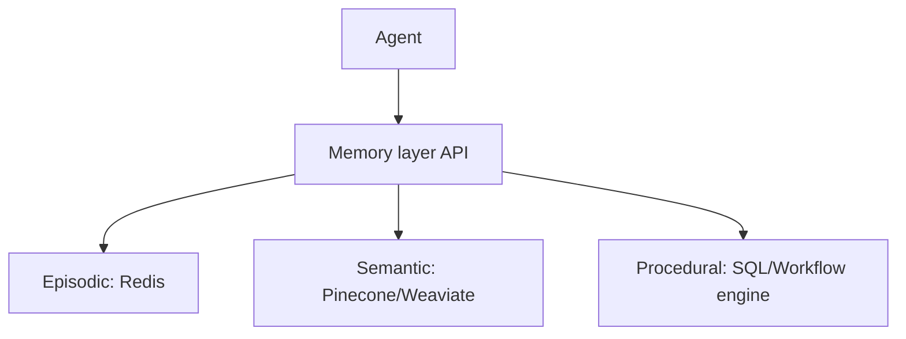

# Memory-Type Storage Specialization

**Also known as:** Per-Memory-Type Storage, Polyglot Memory Persistence

**Category:** Memory  
**Status in practice:** mature

## Intent

Use different storage technologies optimized per memory type — fast in-memory stores (Redis-class) for episodic, vector databases (Pinecone/Weaviate) for semantic, relational or workflow engines for procedural — instead of one general store for everything.

## Context

A team building an agent with episodic + semantic + procedural memory. The convenient shortcut is to put it all in one store (a vector DB, or a relational DB, or a key-value store). Each memory type has different access patterns; one store optimizes for one access pattern and serves the others poorly.

## Problem

Single-store memory architectures sacrifice latency, cost, or correctness for at least two of the three memory types. Episodic needs sub-millisecond reads on recent items; semantic needs similarity search; procedural needs ACID workflow integrity. No single store is optimal for all three.

## Forces

- Multiple stores means multiple operational dependencies.
- Cross-store consistency requires coordination logic.
- Engineering complexity scales with storage variety.

## Therefore

Therefore: pick storage per memory type — fast in-memory cache (Redis-class) for episodic, vector DB (Pinecone, Weaviate, Qdrant) for semantic, relational DB or workflow engine for procedural — and define the coordination logic explicitly.

## Solution

Episodic Memory → Redis or similar in-memory store with timestamps, user IDs, interaction summaries, identified intents. Semantic Memory → vector DB storing embeddings with metadata for similarity retrieval. Procedural Memory → relational DB or workflow engine storing workflow definitions, decision trees, process maps with versioning. Agent's memory layer routes reads / writes per type. Pair with three-layers-agent-memory, episodic-memory, semantic-memory, procedural-memory.

## Structure

```
Agent --> Memory layer API --route by type--> {Episodic: in-memory store, Semantic: vector DB, Procedural: relational DB / workflow engine}
```

## Diagram



## Example scenario

A legal-tech agent stores: case-history conversations (episodic), legal principles and precedents (semantic), legal-analysis workflows (procedural). Episodic in Redis with TTL; semantic in Pinecone with embedding model; procedural in PostgreSQL with versioned workflow rows. Memory layer API routes per memory type. Each store scales independently as case volume grows.

## Consequences

**Benefits**

- Each memory type gets the storage it needs — latency, cost, correctness optimized per type.
- Bornet's retail case: 40% latency reduction vs single-store baseline.
- Independent scaling — episodic load doesn't affect semantic capacity.

**Liabilities**

- Operational footprint of multiple stores.
- Cross-store consistency requires deliberate design.
- Backups, monitoring, security across multiple stores.

## Failure modes

- Cross-store drift — an episode is deleted in one store, but facts and procedures derived from it remain in the others.
- Direct joins — a caller queries two stores directly and skips the memory-layer API, so routing rules break.
- Uneven protection — backups or access controls are set up for one store and missed on another.
- Wrong-store write — a type is written to the store meant for another, and it is missing where reads look for it.

## What this pattern constrains

Each memory type uses its designated storage class; cross-type queries route through a memory-layer API, not direct cross-store joins.

## Applicability

**Use when**

- All three memory types are needed.
- Operational capacity for multiple stores.
- Per-type performance characteristics matter.

**Do not use when**

- Only one memory type in use.
- Team can operate exactly one store.
- Cross-type queries dominate (might favor one polyvalent store).

## Components

- Memory layer API — single entry point per agent
- Episodic store (in-memory cache)
- Semantic store (vector DB)
- Procedural store (relational / workflow)
- Cross-store coordination logic

## Tools

- Episodic in-memory store (Redis-class)
- Semantic vector DB (Pinecone/Weaviate)
- Procedural relational/workflow store
- Memory-layer API

## Evaluation metrics

- Per-type latency
- Per-type capacity utilization
- Cross-store consistency violation rate

## Known uses

- **[Bornet et al. — Agentic Artificial Intelligence, Chapter 7 'Architectural Foundations for Long-Term Memory'](https://www.worldscientific.com/worldscibooks/10.1142/14380)** _available_

## Related patterns

- _complements_ **Three Layers of Agentic AI Memory**
- _complements_ **Episodic Memory**
- _complements_ **Semantic Memory**
- _complements_ **Procedural Memory**
- _complements_ **Vector Memory**

## References

- [Agentic Artificial Intelligence — Chapter 7](https://www.worldscientific.com/worldscibooks/10.1142/14380) — 2025
